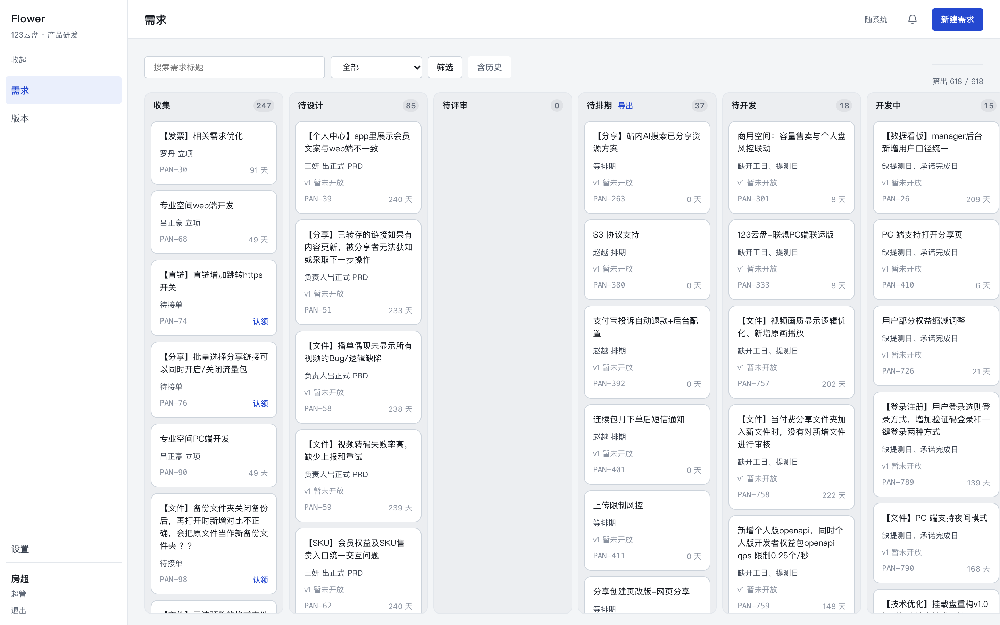
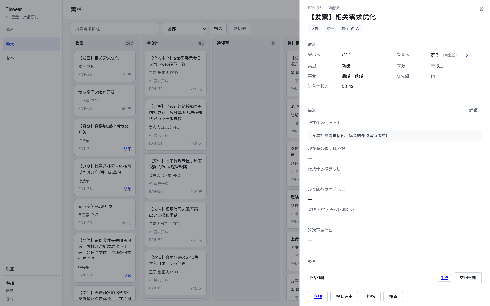
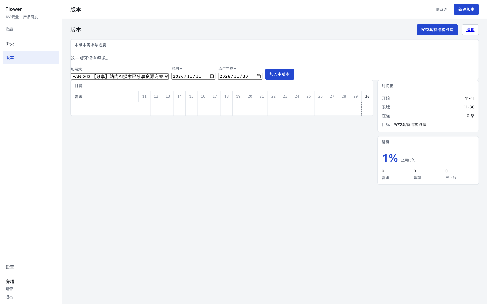
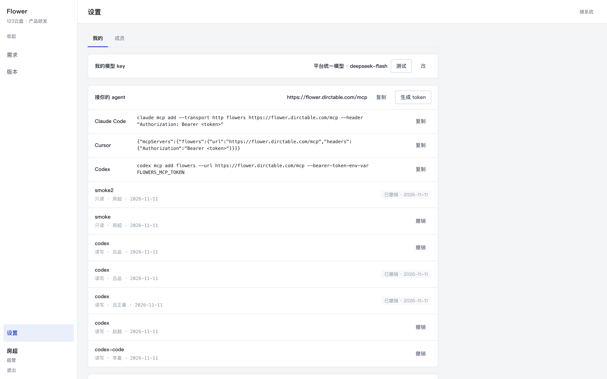
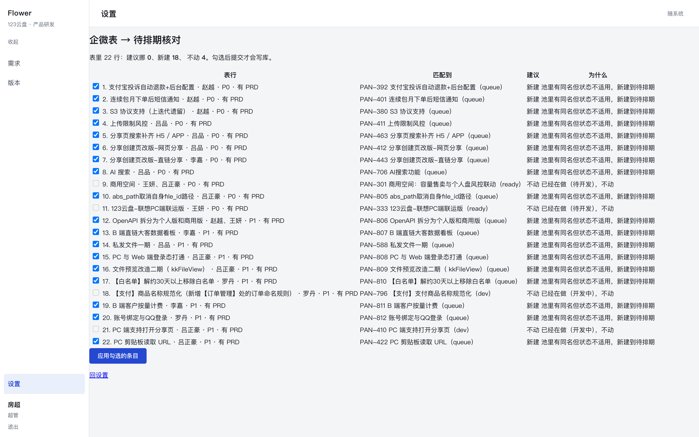

# flowers · 需求门禁

> 123 云盘产品线的需求流程系统：**状态机是产品，界面只是它的窗口**。
> 一条需求从「收集」走到「已上线」，谁能做哪一步、什么时候能做，全由领域层判定；
> 页面只负责把读模型给的东西画出来。



## 它解决什么

| 以前 | 现在 |
|---|---|
| 需求散在群聊、表格、口头约定里，「现在到哪一步了」靠问 | 一条需求一个状态，十列看板一眼看完 |
| 谁都能改、谁都能推，出问题查不到人 | 每次推进都写事件：**谁、什么时候、从哪到哪、为什么** |
| 排期靠一张手工表，延期没人知道 | 版本页有甘特与承诺日，延期自动进告警 |
| 描述只有一段话，评审靠猜 | **六问必填**：缺一条不能立项、不能生成评估材料 |
| 通知靠人转述 | 群里播报状态变动，需要谁动手的私聊推给他 |

## 60 秒跑起来

```bash
git clone <repo> flowers && cd flowers
npm install
npm run db:up && npm run db:migrate && npm run seed
npm run dev            # http://localhost:3000
```

生产构建必须走 webpack（`npm run build`，`extensionAlias` 只在它下面生效）。

自检三件套：

```bash
npx vitest run     # 114 个文件 / 2016 条用例，跑独立测试库
npx tsc --noEmit   # 类型
npm run demo       # 领域冒烟：一条需求走完 8 步；跑完要 npm run seed -- --reset
```

---

## 状态机：10 个状态 · 15 条迁移

```
inbox 收集 → design 待设计 → review 待评审 → queue 待排期 → ready 待开发 → dev 开发中 → test 测试中 → live 已上线
                                    ↘ rejected 已拒绝        ↗ 任意非终态 → shelved 已搁置 → inbox
```

| 迁移 | 触发 | 关键约束 |
|---|---|---|
| inbox → design | 立项 | **六问必填**（`context/problem/outcome/surfaces/edgeCases/outOfScope`） |
| inbox/design → review | 提交评审 | 必须有正式 PRD |
| review → queue / design | 评审通过 / 打回 | 只有派单评审人与超管能签；打回要写原因 |
| queue → ready | 排期 | 版本 + 提测日 + 承诺完成日，且要有 PRD |
| ready → dev → test → live | 时钟 | cron 每 5 分钟推进一轮 |
| dev → ready | **退回待开发** | 接错了/方案变了，必须写原因 |
| test → dev | 打回 | 重填承诺完成日 |
| live → queue | 回滚 | 清空版本与两个日期，旧值写进事件 |
| 任意 → shelved → inbox | 搁置 / 恢复 | 原因必填；恢复回收集（不记原阶段） |

另有一条**状态校准**（超管）：把存量卡片直接摆到它真实所在的阶段，必须写原因，
只改状态、不动版本与产物。它是纠错，不是捷径。

## 权限：按「负责人所在条线」锚定

| 能力 | 谁 |
|---|---|
| `edit` | 负责人本人 / 负责人所在条线的负责人 / 超管 |
| `review` | 该条线负责人 / 超管（且状态=评审、派单是自己） |
| `reassignOwner` | 条线负责人（只能转本线）/ 超管 |
| `claim` | 任何 PM / 条线负责人 / 超管（只能认领无主需求） |
| `admin`、`manageMembers` | 超管 |

七人在册：房超（超管）、赵越（商业线）、吕正豪（功能线）、吕品 / 李嘉 / 王妍 / 罗丹（PM）。

---

## 界面导览

| 页面 | 截图 |
|---|---|
| **需求看板**：十列 = 十状态；卡片三行（标题 / 等待谁 / 编号 + 停留天数）；默认隐藏「已上线超 90 天」 |  |
| **抽屉**：信息 / 六问 / 参考材料 / 评审 / 事件 / 动作条。缺六问时「立项」「生成」直接把点的人送去编辑 |  |
| **版本页**：甘特 + 时间进度 + 本版本需求与进度（加需求、改提测日 / 承诺日 / 版本） |  |
| **设置**：模型、企微绑定、自己的机器人、MCP token |  |
| **企微表核对**（超管）：表行 → 池里匹配到谁 → 建议挪/新建/不动 → 逐条勾选后落库 |  |

操作步骤见 **[使用手册](docs/使用手册.md)**。

打印版（按用户故事地图组织，A4 横版一页）：

- [普通 PM：从登录到接上自己的 agent](docs/pdf/flowers-从登录到接上agent-PM.pdf)
- [条线负责人：从登录到接上自己的 agent](docs/pdf/flowers-从登录到接上agent-条线负责人.pdf)

---

## 对外接口：MCP 讲规则，REST 干活

### MCP（27 个工具）

`/mcp`（Streamable HTTP，`Authorization: Bearer flw_…`）。工具描述写清「能不能做、合法状态、
要填什么、六问不齐会怎样」，执行建议走 REST——每条描述末尾都带技能包地址。

### REST（`/api/v1/*`）

```bash
GET  /api/v1/meta                 # 公开：版本、技能包地址
GET  /api/v1/skills[/flowers-ops] # 公开：技能包（版本=内容哈希）
GET  /api/v1/board
GET  /api/v1/requirements?state=&owner=&q=&number=&offset=&limit=
POST /api/v1/requirements
GET|PATCH /api/v1/requirements/:id
POST /api/v1/requirements/:id/{claim|assign|plan|artifacts}
POST /api/v1/requirements/:id/actions/:action   # start-design … calibrate 共 13 个
POST /api/v1/requirements/batch                 # 批量改，默认 dryRun
GET  /api/v1/members | /releases
```

错误按 `AppError.code` 映射到 403 / 404 / 409，正文是那句中文；写操作不要自动重试。

### 技能包 `flowers-ops`

`skills/flowers-ops/`：SKILL.md + 零依赖 CLI，脚本直接打 REST。

```bash
FLOWERS_API=https://flower.dirctable.com FLOWERS_TOKEN=flw_… \
  node flowers.mjs list --state=queue --limit=10
```

---

## 通知与告警

| 通道 | 内容 | 台账 |
|---|---|---|
| 群播报 | 八种动静：认领 / 立项 / 提交评审 / 评审通过 / 拒绝 / 搁置 / 已上线（催验收）/ 回滚；每天 10:00 版本日报 | `group_posts` |
| 私聊 | 与你有关的事件；共用的机器人是**个人机器人**（只服务本人），其他人要用自己的群机器人 webhook | `notify_deliveries` |
| 汇总表 | 进待排期时追加一行到企微表（两层幂等） | `sheet_sync` |
| 告警 | P0 系统故障 / P1 流程卡点 / P2 版本风险 / P3 数据质量 | `app_settings` 冷却 |

告警消息四段：**级别 → 现在多少 → 具体哪 3 条（PAN + 负责人 + 多久）→ 下一步 + 链接**，
并 @ 相关人；@ 到条线负责人时写明「请安排人处理」。P0 冷却 6 小时，P1–P3 为 3 天。

> 批量事件（导入、批量改）带 `payload.batch`，**只写账、不播报**。

---

## 架构

```
app/                 Next App Router：页面 + 少量薄路由（/mcp、/api/v1/*、/uemaster/*）
src/core/            领域层（状态机、服务、读模型、通知、告警）——规则只在这里
  requirements/      每个动作一个服务：evaluate / review / schedule / reschedule / reopen …
  read/              读模型：看板、详情、版本、通知候选
  notify/            群播报、私聊、企微 CLI 封装
  alerts/            告警规则（纯函数）+ 跑批
  sheet/             汇总表同步与核对
  uemaster/          生成器任务包、产物落库、阶段门
mcp/                 27 个工具：schemas、描述、执行入口
skills/flowers-ops/  技能包（文档 + CLI）
scripts/             cron 用的批处理（播报、同步、告警、迁移、自检）
docs/                使用手册与图片
```

约定三条：**服务层只收 `(db, actor, input)`**；同一事务里写事件；外部失败一律「数据化」
（不抛给界面，记台账下一轮重试）。

## 部署（当前生产）

- 主机 `dogyun`，systemd `flowers.service`（端口 3010），数据库容器 `flowers-postgres`
- 入口 `edge-nginx` → `172.19.0.1:3010`；`flower.dirctable.com` 与 `b123` 的门都走它
- cron：推送/播报 5 分钟、汇总表 10 分钟、日报 10:00、自检 30 分钟、告警 15 分钟
- 关键环境变量：`DATABASE_URL`、`FLOWERS_SESSION_SECRET`、`FLOWERS_COOKIE_DOMAIN`、
  `FLOWERS_PUBLIC_URL`、`FLOWERS_QUEUE_SHEET_DOC/_TAB`、`FLOWERS_GEN_CMD`、`FLOWERS_GATE_URL`

## 怎么改这个项目

1. **加一个状态动作**：`state-machine.ts` 加边 → 写服务 → `read/detail.ts` 的 `actionsFor`
   与 `ACTION_ABILITY` → `app/actions.ts` → MCP 工具与 `LEGAL_FROM` → 用例。
   少一处，`tests/mcp-legal-from.test.ts` 的漂移探测器就会红。
2. **改通知文案**：先改 `read/notify.ts` 的 `sentenceOf`（站内/私聊/群三处共用），再补用例。
3. **加告警规则**：`alerts/rules.ts` 写纯函数 → `alerts/run.ts` 补快照查询 → 用例里喂快照。

## 已知限制

1. 搁置恢复回「收集」，不回原阶段（没存「搁置前状态」）。
2. 批量操作只覆盖描述类字段；负责人与排期各自有更严的规则。
3. 迁移数据的「停留天数」只能显示「自迁移起 N 天」——没有历史事件可回溯。
4. 个人机器人只服务主人；其他成员要私聊必须配自己的群机器人 webhook。
5. 「编号」在迁移后重排，老编号不可反查（只保留 `legacy_ref`）。
