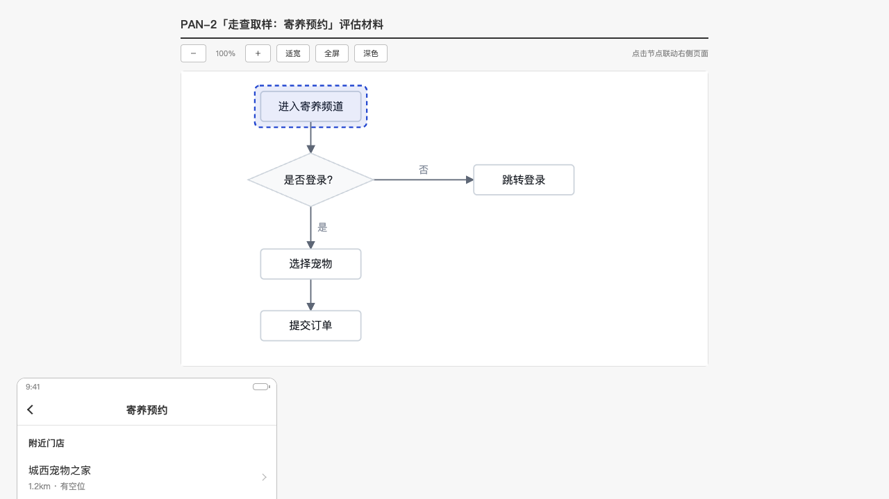
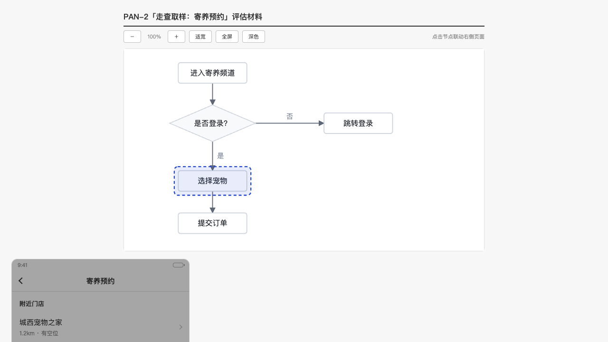

# P2.11 · 走查页交给 UEmaster 自己构建

owner 的原话：**「我需要展示出来的东西和 uemaster 效果一致，不要改」**。

P2.10 那条 B 路线里，模型画图、引擎验收都做到了，但**成品 HTML 是我们自己拼的**
（`compose.ts` 里那套三栏 CSS/JS）。「看起来像 UEmaster」和「是 UEmaster 的产物」是
两件事——前者每次改样式都会漂，后者只需要一次 byte 比对就能证明。UEmaster 早就写好
了这个构建器，我们只 vendor 了它的一半（`flow-canvas`），另一半（`flow-walkthrough`）
一直空着。

这一版补齐那一半，并把「组装」这件事**挪到模型和构建器之间**：模型交页面片段，我们把
片段拼成 walkmap/1，构建器出 HTML。我们这一侧不再有一行自己的三栏标记。

| 文件 | 性质 |
| --- | --- |
| `vendor/uemaster/flow-walkthrough/**` | 新增。build.py / selftest.py / walkmap-v1.md / page-guide.md / templates / LICENSE |
| `vendor/uemaster/README.md` | 增量。记第二来源、commit、以及「模板与主题靠相对路径」这个坑 |
| `src/core/uemaster/walkmap.ts` | 新增。契约类型、拼装、校验（build.py 规则镜像）、跑构建器 |
| `src/core/uemaster/compose.ts` | 重写第二段：交片段 → 拼 walkmap → 校验 → build.py 出产物 |
| `tests/walkmap.test.ts` | 新增。12 条用例（真 Python、真库、真文件系统，无网络） |
| `tests/compose.test.ts` | 增量。页面说明的夹具换成页面片段；断言改成构建器的结构标记 |
| `docs/superpowers/plans/p2-11-*.md/png` | 本文与两张产物截图 |

`src/core` 其余服务、`app/`、`mcp/` 一行没动；`generator.ts`（另一个 worker 的）也没动。
没有新依赖。

---

## 1. 搬了什么

```
vendor/uemaster/flow-walkthrough/
  LICENSE                     MIT（Copyright (c) 2026 roxor）
  contract/walkmap-v1.md      walkmap/1 契约：spec/svg/pages/state_groups/nodes/css_vars
  references/page-guide.md    页面画法：wt-* 词表、375/690、状态与弹窗、标注编号
  scripts/build.py            入口：walkmap.json + 片段 → 单文件三栏 HTML（226 行，stdlib）
  scripts/selftest.py         上游自测脚本，不参与运行时（"整个 scripts/ 一起搬"）
  templates/walkthrough.html  构建器骨架模板
```

上游 commit：`f080b15cdbcfcaa0b64af841df41dba330110b3c`（2026-11-04 13:33:36 +0800，
与 `flow-canvas` 同一次同步）。`vendor/uemaster/_theme/default.walkmap.json` 已经在
P2 那次带进来了，两个技能共用这一个 `_theme/`。

### 两个「不看代码就会漏」的依赖

`build.py` 里有两处**靠 `__file__` 往上推**的路径，两处的失败方式不一样：

| 依赖 | 代码 | 缺了会怎样 |
| --- | --- | --- |
| `templates/walkthrough.html` | `TEMPLATE = dirname(HERE)/templates/…` | `FileNotFoundError`，硬错 |
| `_theme/default.walkmap.json` | `THEME_DIR = dirname^3(__file__)/_theme` | **静默**退回脚本内置默认色（`os.path.exists` 为假 → `base = {}`），与 flow-canvas 那次漏 `_theme` 一模一样 |

所以目录关系不能动：`vendor/uemaster/flow-walkthrough/scripts/build.py` 往上三级是
`vendor/uemaster/`，主题在那里；上一级是 `vendor/uemaster/flow-walkthrough/`，模板在
那里。把技能目录挪到 `vendor/flow-walkthrough/` 会**同时**丢掉模板（崩）和主题（静默
掉色）。这条写进了 `vendor/uemaster/README.md`。

`examples/` 没有搬（它不是运行时资产），但测试会从 `/tmp/uem` 读它——见第 5 节。

---

## 2. `walkmap.ts`：我们这一侧的契约

三层，各管一件事：

| 函数 | 性质 | 干什么 |
| --- | --- | --- |
| `buildWalkmap({title, svg, nodes, pages})` | 纯函数 | 拼成 walkmap/1 的 JSON（`svg` 与 `pages[].file` 写相对文件名） |
| `validateWalkmap(walkmap, {svg, fragments})` | 纯函数 | 复述 build.py 的 error 规则，输出**中文句子** |
| `renderWalkthrough(walkmap, assets)` | 子进程 | 落临时目录 → `python3 build.py walkmap.json -o out.html` → 读回产物 |

外加 `materializeWalkmap(dir, walkmap, assets)`：单独抽出来，是为了让「同一份输入」
能被两个不同的 build.py（vendored / 上游）读，字节比对才有意义。

### 为什么 `svg` / `pages[].file` 是文件名，而正文要单独传

契约里 `svg` 是**相对路径**（`build.py` 用 `os.path.join(base, wm["svg"])` 解析）。
第一版把正文塞进 `walkmap.svg`，于是「校验看的是路径、落盘写的是正文」——`--check`
和字节比对同时炸。现在正文走 `WalkmapAssets`（`{svg, fragments}`）：
**同一个形状给落盘、给校验、给比对**，三处不可能只对一处。

### 状态组怎么推

规则只有一条，纯函数 `deriveStateGroups`：

- 页面片段按**内容**去重（`html.replace(/\r\n/g,'\n').trim()` 相同 = 同一页），
  `pages[].id` 取第一次出现的节点 id，前缀 `p-`；
- 同一个页面被 **≥2 个 `kind=page` 的节点**引用 → 建一个状态组：`id` = 页面 id、
  `title` = 这些标题的**公共前缀**（`寄养首页 · 未预约` / `寄养首页 · 待确认` → `寄养首页`，
  前缀不足 2 字就退回第一个标题）、每个状态的 `label` = 节点标题、`node` = 节点 id；
- 代表节点自动写上 `state: "<组id>/<状态id>"`（契约口径）；
- 只有一个节点指向的页面**不建组**（上游硬规则：单状态页面不建组、右侧不放按钮）。

代价写在「还粗糙的地方」第 1 条：真正的多状态页（弹窗 vs 原页面）片段**不一样**，
所以它们不会自动成组——上游是靠人给每个页面起 slug，而提示词 2 的产物里没有这一列。

### 判断 / 系统环节：没有页面，挂到最近的那个页面

`SKILL.md` 的对应原则是「无页面的步骤不建节点，动作说明写进前一节点的标注」。我们的
提示词 1 仍会画出判断（`{}`）与后台（`[[]]`）节点，所以只能选一个诚实的处理：它们
不建 `pages` 条目，`nodes[id].page` 指向**前一个**页面节点（没有前一个就指向后一个），
自己的 `anno` 留在自己身上。点它不会变成死点，右栏写的正是「这一步为什么在这里」，
设备框里也不会凭空多出一个编造出来的页面。

### 校验规则（build.py 的镜像）

编号与 `build.py` 的报错顺序一致，所以「先报哪一条」在两边不会漂：

1. `spec` 必须是 `walkmap/1`（主版本）；
2. 标题非空、`svg` 路径非空、SVG 正文含 `data-flowspec="1"`；
3. `pages[].id` 唯一、`frame ∈ {phone, wide}`、至少一份页面；
4. 每个节点都有已定义的页面 → **「节点 X 没有对应的页面」**；
5. 状态组 ≥2 状态 → **「状态组 Y 少于两个状态」**；`id/label` 齐全、引用节点存在、
   代表节点不许再声明别的 `state`、`state` 必须属于某组；
6. `default_node` 在映射里；
7. 读内容的三条（给了 `fragments` 才查）：页面含 emoji、片段没有 `wt-` 组件类、
   片段是整份文档（`<html>/<head>/<body>`）；
8. SVG 与映射的差集只给 **warning**（与 build.py 同口径：点了没反应 / 幽灵映射）。

emoji 判据照抄 build.py 的 `EMOJI_RANGES`（不是 `\p{Extended_Pictographic}`）：`→`
不算、`✅` 算。这条差异有用例钉着，否则我们会拒掉构建器收的东西。

---

## 3. `compose.ts` 第二段：模型交「页面片段」

### 提示词 2 的形状

每个节点要么

```json
{"id":"A","kind":"page","frame":"phone","title":"进入寄养频道",
 "html":"<div class=\"wt-screen\">…</div>",
 "anno":[["内容","按距离列出可寄养门店"],["操作","点「立即预约」后判断是否首次预约"]]}
```

要么（判断 / 系统环节，**不给 html**）

```json
{"id":"B","kind":"decision","title":"是否登录？","anno":[["判定依据","会话里有没有用户"]]}
```

比 owner 给的最小形状多了 `id` 与 `title`：`id` 是映射的唯一键（清单里就有），`title`
是右栏「当前节点」那一行。少了这两个，`nodes` 就拼不出来。

提示词里**逐条抄**了 `page-guide.md` 的关键规则（模型读不到仓库里的文件）：

- 设备框里只放上线后用户会看到的内容；设计理由、边界条件、「待确认」、演示说明一律不写；
  元素下方不加解释性小字；
- 手机 375px（`frame=phone`）/ 后台 690px（`frame=wide`）；
- `wt-*` 组件词表整列贴出（`wt-screen`、`wt-statusbar`、`wt-nav`、`wt-body`、`wt-card`、
  `wt-list*`、`wt-input`、`wt-btn*`、`wt-badge`、`wt-empty`、`wt-bottombar`、
  `wt-modal/wt-dialog*`、`wt-toast`、`wt-browserbar`、`wt-table`）；
- 只写 body 内片段（不要 `<html>/<head>/<body>/<script>/<style>`）；
- **一个状态一份片段**；弹窗态 = 原页面 + `wt-modal`（放在 `wt-screen` 里），
  toast 态 = 原页面 + `wt-toast`；状态之间共用的结构必须一模一样；
- 能推进流程的按钮写 `onclick="goNode('节点id')"`；
- 不用 emoji（构建器硬校验）；只画需求里有的内容。

### 重试

两条关，共用 2 次预算（首版 + 一次修）：

1. `readFragments`：`extractJson` → zod → **节点全覆盖**（少一个就重来，空壳页面在评审里
   比「没有这一步」更误导）+ kind 的义务（`page` 必须有 html，`system/decision` 不许有）；
2. `validateWalkmap`：契约层（第 2 节的 8 条）。

两次共用一个 `why`：对模型来说都是「这份哪里不合规」，修法都是整份重发。两次都不行就抛
`AppError('pages_rejected', '页面片段 2 次都没通过校验：<校验器的原话>')`——那句原话就是
「节点 X 没有对应的页面」/「页面 X 的片段没有使用 wt- 组件类」。

**先校验再 spawn**：把一份已知是错的 walkmap 交给 Python，只会在错误前面多一层
`Traceback`。校验过了再跑 `build.py`，它的报错就只剩「我们自己的 bug」这一类。

### 落盘与 attach 不变

- 产物路径仍是 `data/uemaster/<PAN-n>/<stage>.html`，内容换成 build.py 的整份 HTML；
- `attachArtifact` 仍然只调一次：**一份材料一行**，页面片段（状态切换）是这份 HTML 内部
  的事——切状态是浏览器里 `goNode` 干的，不重渲染、不重上传。所以「每个节点一次快照、
  上传一次、重渲染复用」在产物里就是一件事：片段被内联进那一份文件，永远不再变。

---

## 4. 逐字节证明

同一份 walkmap（上游 `examples/pet-boarding` 原样拷出来，相对路径不动）：

```
$ cp -r /tmp/uem/skills/flow-walkthrough/examples /tmp/wm-proof/ex && cd /tmp/wm-proof
$ python3 <repo>/vendor/uemaster/flow-walkthrough/scripts/build.py ex/walkmap.json -o vendored.html
{"pages": 13, "nodes": 15, "svg_nodes": 15, "state_groups": 2, "errors": [], "warnings": []}
已生成 vendored.html
$ python3 /tmp/uem/skills/flow-walkthrough/scripts/build.py ex/walkmap.json -o upstream.html
{"pages": 13, "nodes": 15, "svg_nodes": 15, "state_groups": 2, "errors": [], "warnings": []}
已生成 upstream.html
$ shasum -a 256 vendored.html upstream.html
9b583ce7265dcf5b199d4e54614a7ac657ca01d11d269b5a3c80c42011b380ff  vendored.html
9b583ce7265dcf5b199d4e54614a7ac657ca01d11d269b5a3c80c42011b380ff  upstream.html
$ cmp vendored.html upstream.html && echo BYTE-IDENTICAL
BYTE-IDENTICAL
```

47,104 字节，两份 sha256 相同。这条也做成了用例
（`tests/walkmap.test.ts > 与上游 build.py 逐字节一致`），比对的是**同一个目录里同一份
`walkmap.json`**，所以「模板/主题是靠相对路径找到的」这件事一起被证明了：主题没找到就
会掉色，字节就对不上。

产物看一眼（build.py 出来的三栏，点节点联动右栏）：





上面这两张是**真产物**：本地起 `composeEvaluation`（假 provider、真 flowlayout、
真 build.py）生成 `data/uemaster/PAN-2/evaluate.html`，再用静态服务打开截图。
「点左侧节点 → 中间换页 / 右侧换标注」是模板自己的 JS，不是我们的。

---

## 5. 测试

`tests/walkmap.test.ts`（12 条，真 Python、真库、真文件系统，零网络）：

```
$ npx vitest run tests/walkmap.test.ts
 ✓ buildWalkmap > 同一份片段只落一个页面文件；共用它的两个节点成一组状态
 ✓ buildWalkmap > 组名取标题的公共前缀；猜不出来就退回第一个标题
 ✓ buildWalkmap > 上游 pet-boarding 样本过我们的拼装后，build.py --check 通过
 ✓ validateWalkmap > 节点引用了不存在的页面 → 中文 rejects：节点 X 没有对应的页面
 ✓ validateWalkmap > 状态组只有一个状态 → 中文 rejects：状态组 Y 少于两个状态
 ✓ validateWalkmap > 片段没用 wt- 类、含 emoji、是整份文档 → 三条都点名
 ✓ validateWalkmap > emoji 判据与 build.py 的区间一致：`→` 不算 emoji，`✅` 算
 ✓ 与上游 build.py 逐字节一致 > 同一份 walkmap：vendored 与上游原件的产物 byte-identical
 ✓ composeEvaluation → build.py 的产物 > 两段页面片段 → 落盘的 HTML 是 build.py 的三栏骨架，不是我们的模板
 ✓ composeEvaluation → build.py 的产物 > 校验不通过（节点没有页面）→ 重问一次，仍不通过才失败；构建器一次都没跑
 ✓ composeEvaluation → build.py 的产物 > 片段里没有 wt- 类 → 带这句中文重问一次，第二次合规就过
 ✓ composeEvaluation → build.py 的产物 > 落库与推进照旧：evaluate 材料 → 需求进待设计，且只 attach 一次
 Test Files  1 passed (1)
      Tests  12 passed (12)
```

几个「断言什么」是有讲究的：

- **节点没有页面**：`validateWalkmap` 直接给中文；端到端那条把 `build` 依赖换成计数桩，
  断言 `built === 0`——**构建器一次都没跑**，不是「跑了但失败了」。
- **状态组只有一个状态**：手拼一份 `state_groups` 只有 1 个状态的 walkmap，断言
  「状态组 home 少于两个状态」。
- **字节一致**：比对产物 bytes 与**报告 JSON**（`已生成 X` 那一行带输出文件名，两个命令
  的 `-o` 不同，所以只比报告）。
- **端到端三栏骨架**：断言的是 build.py 的结构标记——`class="layout"`、`class="flow-panel"`、
  `id="flow-svg-light"`、`id="frame-phone"`、`class="anno-panel"`、`id="state-card"`、
  `class="page" id="p-A"`、`data-flowspec="1"`，以及片段里的 `wt-statusbar` / `wt-modal` /
  `wt-bottombar`。**没有一条断言我们自己的标记**——旧的 `node-btn` / `data-pane` /
  `data-states` 已经从断言里删干净，它们本来也不再存在。

`tests/compose.test.ts` 同步改了夹具（`PAGES_JSON` → 页面片段）与提示词断言
（`A  [页面]  进入寄养频道`、`wt-screen`、`375px`），10 条全绿。

全量（与另一个 worker 的 22 条新用例一起）：

```
$ npx vitest run
 Test Files  19 passed (19)
      Tests  458 passed (458)
$ npx tsc --noEmit
（无输出）
```

> 并行跑测试时见过一次大面积失败（117 条，跨 12 个文件）：库里 `requirements` 被另一个
> worker 同时跑的 `resetDb` truncate 掉了。单独跑我这组、以及等它跑完再跑全量，都是绿的。
> 这是**共用一张测试库**的既有问题，不是这次改动引入的（第 7 节）。

---

## 6. 收尾：seed 与 provider 设置

按要求最后跑 `npm run seed -- --reset`。关于「把 `app_settings` 里那三行 `provider.*`
写回去」：**读的时候库里就是空的**。

```
$ npx tsx ./tmp-dump.mts          # select * from app_settings order by key
keys:
（0 行）
```

原因是既有的：`src/db/reset.ts` 的 `resetDb()` 会
`truncate …, app_settings restart identity cascade`，而每个测试文件都在 `beforeEach` 里调它
——**任何一次 `npx vitest run` 都会清掉这三行**。我在 16:09 跑基线（422 条）之前没能先读，
所以无法判断清理前是否有行；能确认的是：读取时 0 行、没有可恢复的内容、整个过程没有
打印任何密钥（只打印了 key 名与值的长度）。

---

## 7. 还粗糙的地方

1. **状态组只能从「同一片段」推**。真正的多状态页（原页面 vs 弹窗态）片段不一样，
   所以它们**不会**自动成组——上游是靠人给每个页面起 slug 再手写 `state_groups`。
   我们的提示词 2 没有 `page` 这一列（owner 给的形状里没有），所以只能拿「同一份字节」
   当页面身份。要变好，最小改动是让模型多交一个 `page: "表单页"` 字段；
   再往上是把页面的结构差（去掉 `wt-modal` 后是否同构）算成身份。
2. **同一片段被两个节点复用时，构建器会给一条 warning**（「状态 A 与 B 使用同一页面：
   页面无差异就不是真正的状态，建议合并」）。我们保留了这个组：流程里确实是两个节点
   （例如「进入频道」与「跳转登录」用了同一屏占位），右栏的切换按钮就是节点之间的跳转。
   这条 warning 在报告里被断言过（`buildWalkmap` 那条用例），并且不阻断产物。
3. **判断 / 系统节点被挂到最近的页面节点**。点它看到的是「它发生的那一屏」，不是它自己
   的页面（它本来就没有）。上游的做法是根本不建这种节点；要彻底对齐，得改提示词 1 的
   节点形态——那是另一件事，会动到 P2.10 的图判据。
4. **片段预算 6000 tokens**。长页面可能被截断，截断的 HTML 会被 `wt-` 校验拒掉，表现为
   一次重试。真遇到长页面，该做的是按节点分批请求，而不是继续调大预算。
5. **`wt-modal` / `wt-toast` 只是提示词约定**，没有结构级校验。校验器只查 emoji、`wt-`
   词表是否出现过、是否误交整份文档——「弹窗态有没有真的包住原页面」这件事，现在靠
   模型照 guide 写。
6. **共用一张测试库**：另一个 worker 同时跑 `vitest` 会 truncate，我这组用例会偶发
   「需求不存在」。要根治得给每组用例独立的 schema/库，那是测试基础设施的活。
