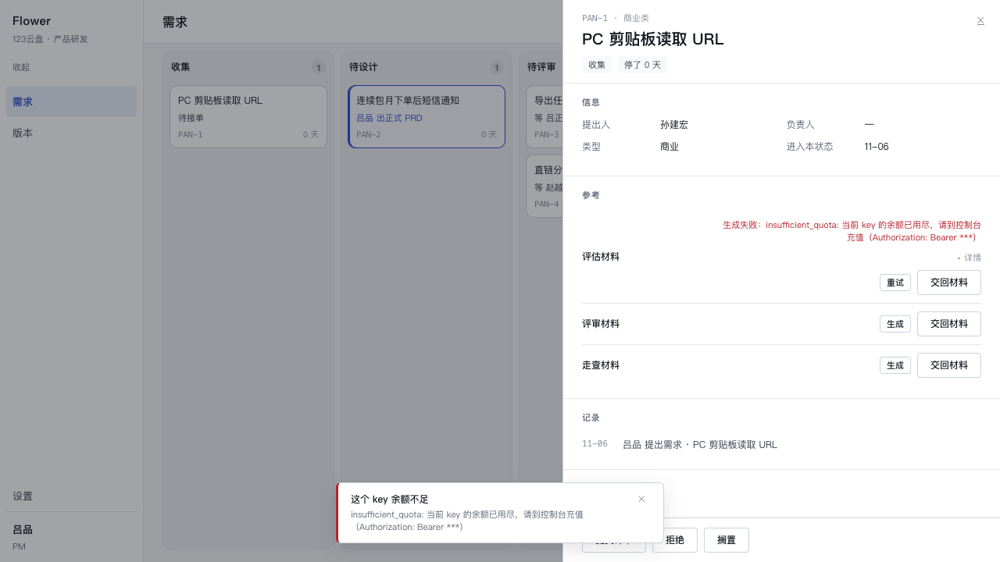
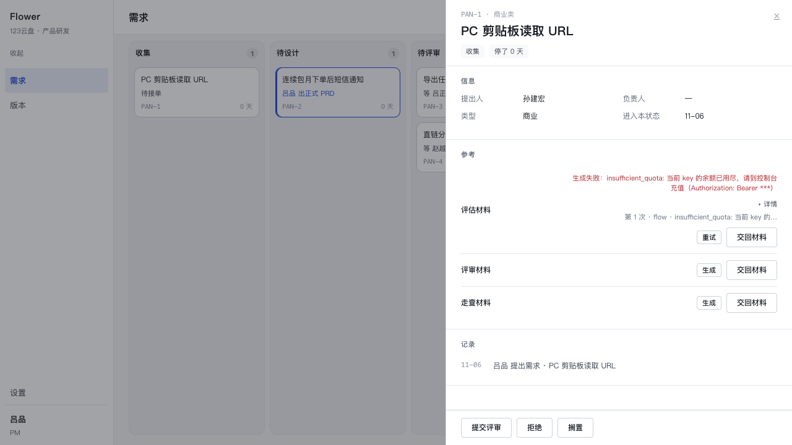
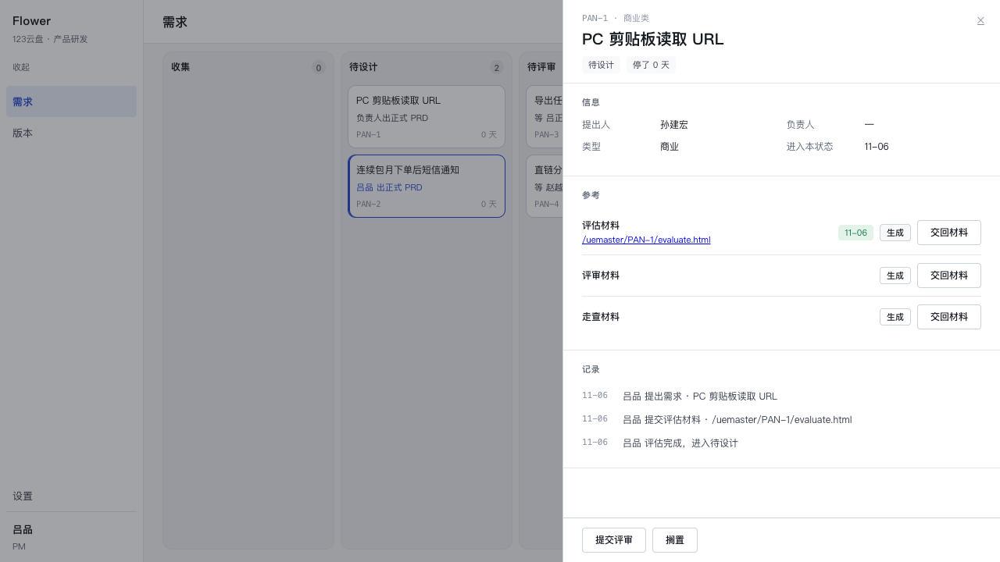

# P2.13 · 留痕 + 边界 toast

owner 的两句话：「留痕」「考虑边界情况给 toast，例如他的 key 没余额了」。

这一版只回答两件事：**失败的那一次的每一次尝试去哪了**（原来只有最后一句话活着），
以及**点完按钮去看别处的人，回来时怎么知道它失败了**（原来只有行里那句话）。

设计上没有新概念：留痕是 `uemaster_jobs` 旁边的一张只增不改的表，toast 是那条失败原因的
一个瞬时副本。`uemaster_jobs.error` 的语义一个字都没改（仍是最后那句话）。

---

## 1. 表：`uemaster_job_attempts`

迁移 `src/db/migrations/0005_uemaster_job_attempts.sql`（`drizzle-kit generate` 产出，
`npm run db:migrate` 已应用）。schema 定义在 `src/db/schema.ts`。

| 列 | 类型 | 说明 |
| --- | --- | --- |
| `id` | uuid PK | 默认 `gen_random_uuid()` |
| `job_id` | uuid NOT NULL | FK → `uemaster_jobs.id`，`on delete cascade` |
| `attempt` | integer NOT NULL | **阶段内**的第几次（1 基） |
| `phase` | text NOT NULL | `flow` \| `pages` \| `build`（表上 CHECK + 服务层同口径） |
| `model` | text NOT NULL | 这一次用的模型名 |
| `prompt_chars` | integer NOT NULL | 送出去的字数 |
| `output_chars` | integer NOT NULL | 回来的字数（失败时通常 0） |
| `error` | text NULL | 这一次被拒/失败的那句话；**null = 这一次通过了** |
| `ms` | integer NOT NULL | 这一次花了多久（模型调用或构建） |
| `created_at` | timestamptz NOT NULL | 默认 `now()` |

索引：`(job_id, id)`（读一条作业的全部尝试）。

### 一行是什么、为什么这么小

**一行 = 一次对外动作**：一次模型调用，或一次 `build.py` 构建。没有别的行。

- **不存提示词、不存回话**。提示词里是整份 PRD + 节点清单（几万字符），回话是 HTML；
  存下来这张表就变成一个语料库，而排查要看的是三个数字：问了多少、答了多少、卡在哪。
  `prompt_chars=805 / output_chars=0` 与 `prompt_chars=805 / output_chars=102` 一比，
  「模型什么都没回」与「模型回了但形状不对」立刻分得开，而不用把正文翻出来。
- **`attempt` 是阶段内的序号**，不是全局序号：`第 1 次 · flow`、`第 1 次 · pages`
  各自从 1 开始，因为它们是两条独立的预算（图 3 次、页面 2 次）。
- **`error` 只记这一次的**。作业最终那句话仍写在 `uemaster_jobs.error` 里，两处不重复：
  表是过程，作业行是结论。
- **构建那行的 `prompt_chars` 是 0**：这一段没有提示词，输入是 walkmap 不是文字；
  `output_chars` 是它吐出来的 HTML 长度。

### 接线：在哪几处写

`compose.ts` 里的三个地方（全部**追加**，判据、重试预算、最终那句话都没动）：

| 位置 | phase | attempt | error |
| --- | --- | --- | --- |
| `buildFlow` 循环（最多 3 次） | `flow` | 1..3 | 通过 = null；被拒 = 引擎/形状那句 |
| `buildPages` 循环（最多 2 次） | `pages` | 1..2 | 通过 = null；被拒 = 校验器那句 |
| `composeEvaluation` 的 `full.build(...)` | `build` | 1 | 通过 = null；失败 = `build.py` 那句 |

`provider_error`（网络/4xx/超时）也落一行：`output_chars=0` + 服务端原文，然后才抛。
这一行是「这次什么都没回来」的唯一证据。

写入口在 `attempts.ts`（`makeTrace(db, jobId, model)`），两个刻意的选择：

- **`jobId === null` 时整体跳过**。`composeEvaluation` 在用例与脚本里会被直接调用
  （不经过 `uemaster_jobs`），那时没有作业可挂——不为了记录去编一条作业。
- **写入失败吞掉**。留痕是加分项：那段代码正在把「模型一直画不对」翻译成一句中文，
  把它换成一句 `insert ... 违反外键` 是纯粹的降级。文件头写了这条。

「与周围步骤同一个事务」：每个步骤里唯一的写库动作就是这一行 insert，包一层事务只是
给一条语句加壳，所以按「practical」的说法直接写入（`db.execute`，自动提交）。

---

## 2. 分类器：`classifyFailure(raw)`

`src/core/uemaster/trace.ts`。纯函数，不 import 库、不看时钟，服务端与浏览器共用同一份。

```ts
export function classifyFailure(raw: string): { kind: FailureKind; title: string; detail?: string }
```

规则是**子串匹配的一张有序表**，顺序即优先级：

| kind | 标题（`title`） | 针（needles） |
| --- | --- | --- |
| `quota` | 这个 key 余额不足 | `insufficient_quota` `余额` `quota` `402` `billing` |
| `invalid_key` | 这个 key 无效 | `401` `incorrect api key` `invalid_api_key` `unauthorized` |
| `no_access` | 没有权限，或这个模型不可用 | `403` `可用渠道不存在` `无可用渠道` `model not found` `does not exist` |
| `rate_limit` | 被限流了，过一会儿再试 | `429` `rate limit` |
| `timeout` | 请求超时 | `请求超时` |
| `network` | 连不上模型接口 | `fetch failed` `econnrefused` `enotfound` |
| `unknown` | **原文本身**（不发明标题） | — |

三个决定：

1. **顺序是有理由的**。`402` 先于 `401`（同一句里既有状态码又有「余额」时，余额是那个
   actionable 的原因）；`请求超时` 先于 `fetch failed`（超时是**我们**砍的，说成「连不上」
   会让人去查网络）。
2. **`detail` 只在原文比标题多带信息时给**。实现是把命中的针与 `http/status/code`
   这类格式词从原文里剔掉，看还剩不剩下字母或中文：`insufficient_quota` 剩 0 → 只有
   一行；`Incorrect API key provided: sk-***` 剩一截 → 两行。不靠白名单猜，靠残留判。
3. **未知 = 原文当标题**。编一个「模型出错了」比什么都不说更坏：它会让人去查一个
   没坏的东西。

### 不吐 key

`classifyFailure` 进门先 `scrubSecret`，三条形状：`sk-xxx`、`Bearer xxx`、
40→32 个字符以上的连续 token（无前缀的 key）。这不是重复劳动：`provider.ts` 已经在它那条
路上洗过（`redactSecret`），但这一层的输入是「任何一段可能带 key 的文本」，
而它的输出会上界面、会被截图发出去。`Toast` 组件再洗一遍（props 是公开的）。

用例断言的是**结果**：`${title}\0${detail}` 不含 key，也不含 key 去掉 `sk-` 之后的部分。

---

## 3. 抽屉里的「详情」

- 位置：参考段那一行（`RefRow` → `GenerateButton`）。失败时在红色那句 **下面**多一个
  `<details>`，标题只有两个字「详情」。
- 展开后每条尝试一行，纯文本、没有散文：
  `第 1 次 · flow · 2 个节点 1 条连线被拒` / `第 2 次 · flow · 102 字` /
  `第 1 次 · pages · 回话里没有 JSON 对象（第一个字符就该是 {）`.
- **成功的作业什么都不显示**。行还是「链接 + 日期 + 生成」，一个新元素都没有。
  行是有的（库里），只是不上界面。

那一行字怎么来的（`attemptLine`，纯函数）：

| 情况 | 输出 |
| --- | --- |
| 形状判据被拒 | 把 `只有 2 个节点、1 条连线…` 压成 `2 个节点 1 条连线被拒` |
| 别的理由 | 压平成一行、超过 28 字截断加 `…`，**不改写** |
| 通过的那一次 | `… · 1203 字` |

通过的尝试也照列：一次失败里最有用的对照常常是「第一次被拒、第二次过了、第三次卡在别处」；
只列失败的那些，读者会以为这一关从来没通过。

数据从哪来：`JobView.attempts`（`jobStatus`）。失败与详情**同一次往返**，
中间不会出现「有一句原因、点开详情是空的」那一帧。还在跑的作业给空数组（每次轮询
1.5 秒一次，不为了一个不存在的答案多查一次）。

---

## 4. Toast

`app/components/Toast.tsx`，`createPortal` 到 `document.body`。

- **位置**：底部居中（`left:50% / translateX(-50%) / bottom: var(--s-5)`）。底部右侧会被
  560px 的抽屉盖住，居中之后它落在抽屉左边，读得到又不压住整条动作条。
- **寿命**：6000ms 自动消失（`TOAST_MS`），右上角 ✕ 随时可关。`key={seq}` 让「又失败
  一次」重新计时，而不是沿用上一次那 6 秒。
- **内容**：一行标题（分类结果），第二行只在 `detail` 存在时出现（服务端原文）。
- **只用于终端失败**：轮询到 `failed`、`start` 直接失败（没生成器 / 正在生成中）、
  客户端放弃等待，三种都出。成功一次都不出。
- **行里那句还在**，一个字不改（`生成失败：<原文>`）：浮层是瞬时的那一声，行里是留档的那一句。
- 样式只用 token（`--c-surface` `--c-line-strong` `--c-negative` `--sh-overlay` `--r-sm`
  `--t-caption`…），没有一处字面色值。左边 3px 的负向色条是「这是坏消息」的唯一装饰。

参考段那一行的宽度也顺手修了一处：失败时那一格里有「一句原文 + 详情清单」，按内容撑开会
把 `1fr` 那一列（阶段名）压成一列竖排的单字（1280px 下实测只剩 20px）。现在
`.row3 .acts` 有 `max-width:340px`，`评估材料` 读得成一行，其余两行的
「生成 / 交回材料」也不会竖着排。

---

## 5. 用例与真实输出

### 5.1 单元：`tests/trace.test.ts`（26 个）

覆盖上表每一类 + 未知 + 空串 + 不吐 key + `attemptLine` 三种形状。

```
 ✓ tests/trace.test.ts (26 tests) 6ms
   ✓ classifyFailure > 配额 · 官方码（只有七个字母，不带第二行）
   ✓ classifyFailure > 配额 · 网关的中文说法
   ✓ classifyFailure > 配额 · 裸状态行
   ✓ classifyFailure > 配额 · billing 措辞
   ✓ classifyFailure > key 无效 · 一串 401
   ✓ classifyFailure > key 无效 · 官方原文（key 已脱敏）
   ✓ classifyFailure > key 无效 · 下划线码
   ✓ classifyFailure > key 无效 · unauthorized
   ✓ classifyFailure > 无权限 · 网关中文（分组/渠道）
   ✓ classifyFailure > 无权限 · 裸 403
   ✓ classifyFailure > 无权限 · model not found
   ✓ classifyFailure > 限流 · 裸 429
   ✓ classifyFailure > 限流 · 官方措辞
   ✓ classifyFailure > 超时 · provider.ts 自己的句子
   ✓ classifyFailure > 网络 · undici 的 fetch failed + cause
   ✓ classifyFailure > 网络 · 只有 DNS 错误码
   ✓ classifyFailure > 未知 · 不发明诊断，原文就是标题
   ✓ classifyFailure > 未知形状：kind=unknown，且**没有**编出来的标题（标题就是原文）
   ✓ classifyFailure > 空原文也能读：不返回空白标题
   ✓ classifyFailure > 分类结果里**绝不出现** api key（标题与第二行都断言）
   ✓ scrubSecret > 三种真实回显都洗得掉
   ✓ scrubSecret > 不碰正常的中文与诊断句
   ✓ attemptLine > 形状判据那句话压成两个数字：`第 1 次 · flow · 2 个节点 1 条连线被拒`
   ✓ attemptLine > 通过的那一次显示产出的字数
   ✓ attemptLine > 别的理由不改写，只压平与截断
   ✓ attemptLine > provider 的原文在详情里就是一个字都不改
```

### 5.2 集成：`tests/trace-attempts.test.ts`（4 个，真库 + 真引擎 + 真 fetch）

```
 ✓ 402 insufficient_quota：作业 failed、error 是原文、留痕一行、分类给出余额不足、且不含 key
 ✓ 成功也留痕：三次调用三行（flow / pages / build），error 全为 null
 ✓ 修图与改片段的每一次都在：flow#1 被形状拒、flow#2 过、pages 两次不过
 ✓ 构建被拒也有行：build#1 带着 build.py 的那句话，作业仍是 failed
```

402 那条断言的是**整条链路**：stub 把 `Authorization` 回显进 `error.message`
（真实网关干过这件事）→ `provider.redactSecret` 洗成 `***` → 留痕那一行与
`uemaster_jobs.error` 都是洗过的 → `classifyFailure` 给
`{ kind: 'quota', title: '这个 key 余额不足' }` → 浮层那两行字（标题 + 原文 +
`attemptLine`）一个字都不含 key。

### 5.3 全量

```
npx tsc --noEmit            → 干净（无输出）
npx vitest run              → Test Files 19 passed (19) / Tests 486 passed (486 / 50.72s)
```

---

## 6. 走查（真浏览器，真 dev server）

做法：`npm run seed -- --reset` → 把 `app_settings.provider.baseUrl` 指到一个真的
`http.createServer`（402 + `insufficient_quota`，并把 `Authorization` 回显进 message）→
在 :3000 的抽屉里点「评估材料 · 生成」。

**失败态**（`p2-13-toast.png`）：行里 `生成失败：insufficient_quota: 当前 key 的余额已用尽，
请到控制台充值（Authorization: Bearer ***）`；下面「详情」；底部居中的浮层写着
`这个 key 余额不足` + 原文第二行（`***`）。抽屉里没有 key。



**展开详情**（`p2-13-detail.png`）：

```
第 1 次 · flow · insufficient_quota: 当前 key 的…
```



**成功态**（`p2-13-success.png`）：链接 + 日期，没有「详情」，没有浮层。



跑完之后库里那台真服务端留下的行（`scripts` 已删，只留这份存档）：

```
job 622affae… failed  err=insufficient_quota: 当前 key 的余额已用尽…（Authorization: Bea…  rows=1
job 63a9df64… done    err=(空)                                                              rows=3
   flow#1   prompt=805  output=102    err=null      ms=83
   pages#1  prompt=2232 output=1860   err=null      ms=3
   build#1  prompt=0    output=25525  err=null      ms=102
```

收尾：`npm run seed -- --reset` + 把 `provider.*` 三行写回
（`baseUrl=https://router.aionclaw.ai/v1`、`model=gpt-5.4-mini`、`apiKey` 从
`~/.dsh/.credentials.yaml` 程序化读取，未落进任何输出）。

---

## 7. 改了什么（与别的 worker 的边界）

- `compose.ts`：**只加不减**。新增 `jobId?` 进 `ComposeRequest`；`buildFlow` / `buildPages`
  各多一个 `trace` 参数；三处 `trace.write`；构建那一段加了计时段。判据、重试预算、
  错误文案都没动——另一个 worker 若同时改这个文件，冲突只会落在这几行。
- `start.ts`：把 `jobId` 传进 compose；`JobView` 多 `attempts`；`jobStatus` 在作业
  结束时读尝试。
- `schema.ts` / `0005_*.sql` / `meta/*`：新表。
- `trace.ts` / `attempts.ts`：新文件（纯函数 / 读写口）。
- `Toast.tsx`：新组件。`GenerateButton.tsx`：失败分支多详情 + 浮层。
  `globals.css`：`.gen-trace*` / `.toast*` 两组样式 + `.row3 .acts` 的宽度上限。

没有新依赖。

---

## 8. 还糙的地方

1. **失败在刷新之后就没了**，详情也跟着没。这是 P2.6 就定下的口径（「失败是一次性的提示」），
   这一版没有改：留痕落库了，但抽屉只读「正在跑」的作业，不读「上一次失败的」。
   真要让详情活过刷新，得在 `DetailRef` 上加一个 `lastFailure: { jobId, at }`，
   以及一个「这条需求最近一次失败」的查询——那会改动抽屉的读模型，值得单独一版。
2. **浮层会盖住抽屉底部动作条的左半边**（1280px 下约 130px，6 秒）。底部右侧更糟
   （整条动作条），所以选了居中。要彻底解决得让浮层知道抽屉开没开（或挪到左栏上方），
   那属于布局层的事。
3. **`attemptLine` 的 28 字截断**对中文是对的长度，对含 ASCII 的诊断（模型名、URL）会
   偏短；没做按宽度算。
4. **分类靠子串**。`401`/`402`/`403`/`429` 出现在长 request-id 里的概率不为零，
   后果只是标题选错一格（原文永远在第二行，不会误导到「没有线索」）。没有做
   「先认状态行、再认正文」的两段式。
5. **`unknown` 的第二行是空的**（原文当了标题）。原文很长时浮层会变高——`overflow-wrap`
   兜住了，但没有行数上限。
6. 构建行只有 1 次、`attempt` 恒为 1：现在没有「构建重试」这件事，将来加了要记得
   让 `attempt` 跟着涨，别写成常量。
