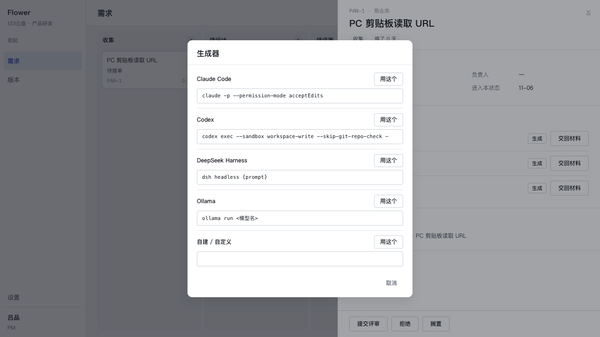
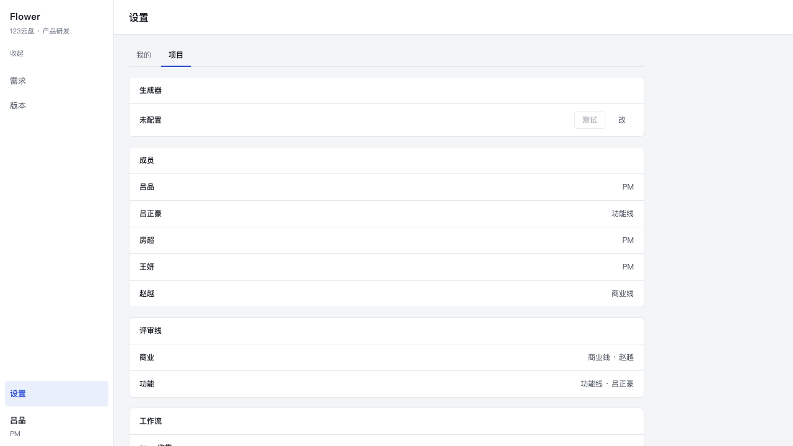
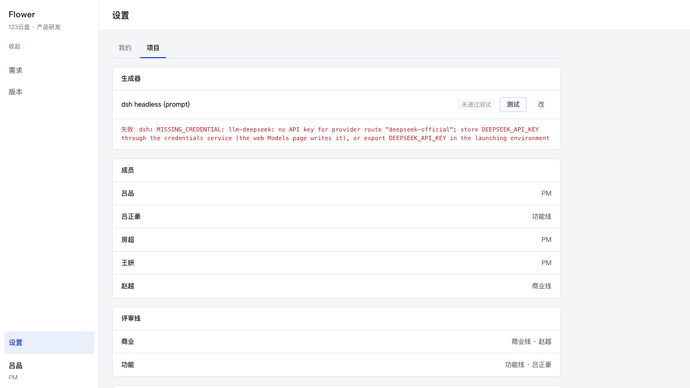
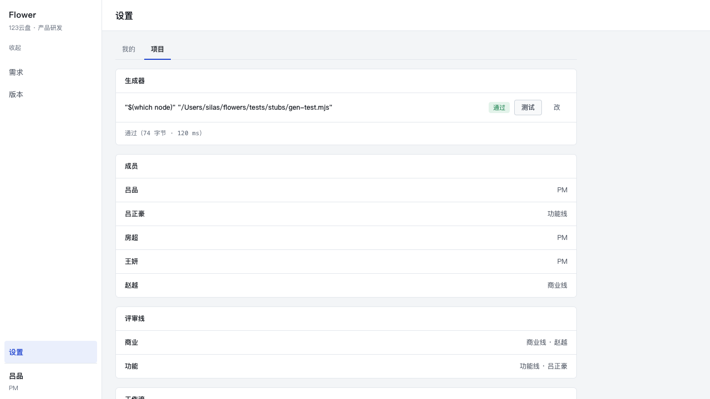
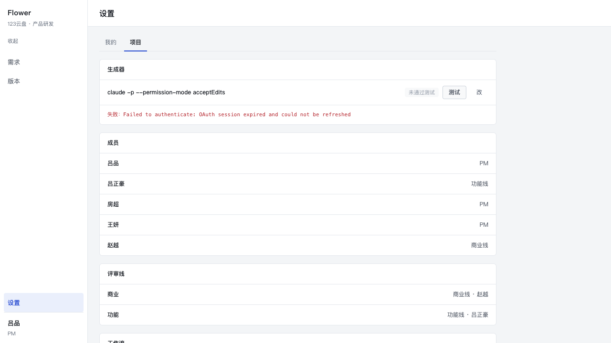
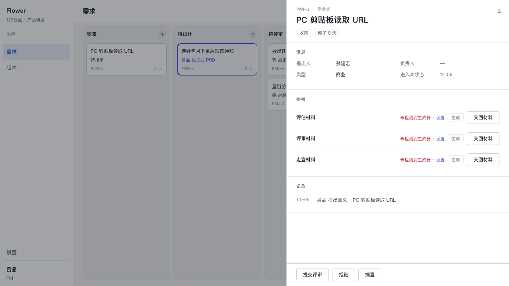
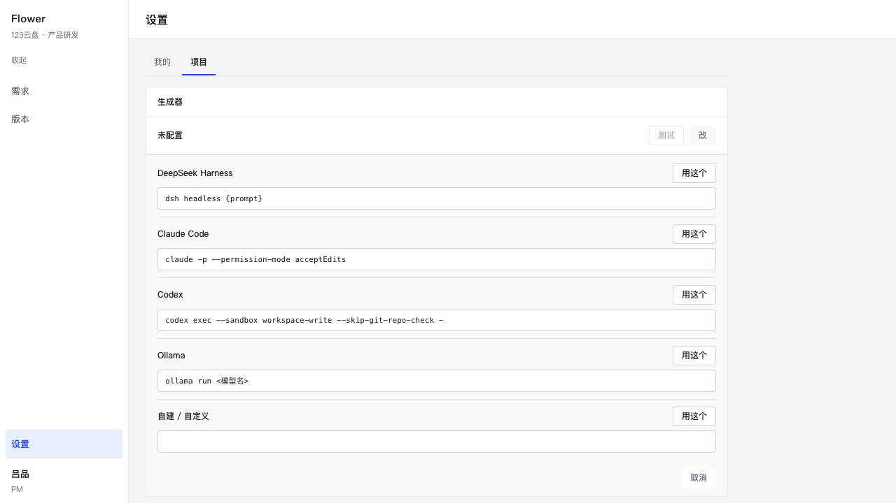

# P2.7 · 生成器的选择：探测、测试，和「装了 ≠ 能用」

P2.6 把「这条机器上恰好能用的那个 CLI」写成了产品规则：`FLOWERS_GEN_CMD` 不设时，
按 `claude` → `codex` 的顺序在 PATH 里找，找到谁就用谁。这一版把那条规则换成三件事：

1. **一张固定的候选表**（五个），命中一个就用、命中多个就问、一个都没有就禁用并指路；
2. **一条显式的命令契约**（`{prompt}` 或 stdin；产物写文件或打 stdout）；
3. **一个就地测试**（设置页那一行的「测试」）：只有它知道一条命令**现在**能不能跑。

本次提交：见 `git log` 的 `feat(uemaster): 生成器改成探测 + 选择，设置页加一行就地测试`
（本文与它同一次提交）。

`src/core` 的六个领域服务（create / evaluate / review / schedule / bounce / terminal）
一行没动。改动落在 `src/core/uemaster/*`（新增 `candidates.ts` / `detect.ts` / `settings.ts`，
重写 `generator.ts`，扩 `start.ts`）、`app/*`、`src/db/schema.ts` + 迁移 `0004_app_settings`、
`src/db/reset.ts`、`tests/*`、`docs/*`。

---

## 1. 候选表

`src/core/uemaster/candidates.ts` 是唯一一份「本机可能装着什么」的清单。它不 import 任何
node 内建模块：服务端（探测、执行）与客户端（选择器、设置页）读的是同一张表、同一个
占位符判断。

| id | 显示名 | command | 任务包怎么进去 | 说明 |
| --- | --- | --- | --- | --- |
| `claude` | Claude Code | `claude -p --permission-mode acceptEdits` | stdin | print 模式；`acceptEdits` 让它直接写产物 |
| `codex` | Codex | `codex exec --sandbox workspace-write --skip-git-repo-check -` | stdin | `-` = 从 stdin 读；`workspace-write` 才写得进 |
| `dsh` | DeepSeek Harness | `dsh headless {prompt}` | `{prompt}` 那个 argv 位 | headless 非交互 |
| `ollama` | Ollama | `ollama run <模型名>` | stdin | 纯管道：HTML 从 stdout 出来；模型名要先填 |
| `custom` | 自建 / 自定义 | 用户给的 | 两种都行 | 不靠 PATH |

`ollama` 的 `<模型名>` 是一个**未填占位符**，不是普通参数：交给 shell 会被当成重定向
（`<文件名` 读 stdin），失败原因会与生成毫无关系。所以 `commandReady()` 认这个形状，
`runGenerator()` / `testGenerator()` 在执行之前就把它拦下并说清楚要填什么。

## 2. 解析顺序

```
FLOWERS_GEN_CMD（非空）
  → app_settings['generator.command']（设置页保存的那条）
    → detect()：
       一条能直接跑   → 用它（source=detected，未验证，见下）
       多条           → choose：界面打开选择器，选完存库再跑
       零条           → none：按钮禁用，旁边指路去设置
```

三条补充：

- **`ollama` 那种「探到了但命令不完整」的候选不算「一条能直接跑」**：只探到它时同样是
  `choose`，让人先把模型名填上。
- **`export` 的覆盖仍然是最高一档**：它存在是为了临时换一条、跑 stub 用例；它不再是唯一的口子。
- **服务端也走同一条顺序**：`startGeneration()` 在防重检查之后、落作业之前解析一次
  （`none` → `generator_unavailable`，`choose` → `generator_unconfigured`）；`runJob()`
  在 worker 里再解析一次（另一个进程，不能信请求那一刻的结论）。界面与库因此不会各说各话。

**「探测到一条」的第一次真跑仍然算一次测试。** 自动用的那条命令没有经过任何验证，所以
它失败时除了照登 stderr，客户端还会把选择器打开——让人当场换一条，而不是对着
`OAuth session expired` 猜自己能做什么。一旦保存过（source=settings），这个行为就不再触发。

## 3. 两种模式（命令与产物各一格）

| 格子 | 判据 | 行为 |
| --- | --- | --- |
| 任务包怎么进 | 模板里有没有 `{prompt}` | 有 → 整段包做 shell 引号（`'…'`，内部 `'` 拼成 `'\''`）后作为**一个** argv 元素；没有 → 写 stdin，然后关掉它 |
| 产物怎么出 | 命令退出 0 之后 | 产物文件 mtime 变了 → 用文件；文件没动、但 stdout 里有一个 HTML 文档（从第一个 `<!doctype html>` 或 `<html` 截到结尾）→ 由 Flowers 写进产物路径；两者都没有 → 失败，附 stderr 尾巴 |

这一条是 `ollama` 或任何「管道式」生成器能成立的全部原因：它们不会用写文件的工具落盘，
只会把 HTML 打到 stdout。反过来，写文件的 CLI（claude / codex）完全不受影响——文件优先。

## 4. 探测能告诉你什么、不能告诉你什么

**能**：这个可执行文件在不在 PATH 里。只此一件事。

**不能**：它能不能用。三条实测（本机，2026-11-06）：

| 探针 | 它说 | 真相 |
| --- | --- | --- |
| `claude auth status` | `{"loggedIn": false}` | 一致，但它只说明**凭证文件**的状态 |
| `claude -p`（真跑） | `Failed to authenticate: OAuth session expired and could not be refreshed` | 真的不能用 |
| `codex login status` | `Logged in using ChatGPT` | **撒谎** |
| `codex exec`（真跑） | `401 … refresh token already used` | 真的不能用 |
| `dsh headless "…"`（真跑） | `MISSING_CREDENTIAL: … DEEPSEEK_API_KEY` | 装了、在 PATH 里、仍然跑不了 |
| `ollama`（PATH） | 文件在 | 服务没起，`ollama run` 一样跑不了 |

`codex` 那两行是整件事的由来：**`login status` 是这一层唯一会被信任的探针，而它会说谎。**
所以探测只查文件系统（`access(X_OK)`，从不执行它），「能不能用」只有 `testGenerator()`
回答——真跑一次极小的包，两种交法都认，失败时 stderr 原文照登。设置页那一行的
「通过 / 未通过测试」只认这个答案，不认 PATH，也不认任何 `--status`。

## 5. 设置页那一行

位置：`/settings?tab=project`（**项目**栏）。

选「项目」而不是「我的」的理由：「我的」那一栏的定义是「关于这个人的事实」（当前成员、
角色），它连一个可写控件都没有；生成器是**这个部署**的配置，与成员、评审线、工作流同属
项目。放进「我的」会让「这一页只显示关于你的事实」这条口径失效。

```
生成器
dsh headless {prompt}                     [通过 / 未通过测试] [测试] [改]
失败：dsh: MISSING_CREDENTIAL: …
```

- **未配置时**显示 `未配置`；保存过但没测通（或压根没测）显示 `未通过测试`。
- **「改」**展开选择器：探测到的候选（命令是可编辑输入框）+ 自建；零探测时列**整张表**，
  并且 `dsh` 排第一（那时的列表是指路，不是清单）。
- **「测试」**跑 `TEST_PACK = 生成一个 HTML 文档，<title>flowers</title>，正文一行 hello`，
  10 秒硬超时，与真生成同一条命令契约；结果落 `app_settings['generator.test']`，
  所以刷新之后仍写着「未通过测试」。
- **保存不要求先测通**（模型名、代理、key 都可能要慢慢调），但那一行必须诚实。
- 屏上没有任何解释性文案：只有行标签、值、按钮，以及测试结果的**原文**。

存储：`app_settings`（键 `generator.command` / `generator.test`），迁移 `0004_app_settings`。
`resetDb()` 随之从五张表变成六张（测试与 `npm run seed -- --reset` 都会把它清掉）。

## 6. 这台机器上的验证

### 6.1 探测：四个

```
detected: claude:true, codex:true, dsh:true, ollama:false
resolve:  {"kind":"choose", candidates:[claude, codex, dsh, ollama]}
```

`claude` / `codex` / `dsh` / `ollama` 四个可执行文件都在 PATH 里，`ollama` 的命令带
`<模型名>` 所以标 `ready:false`。四条 → `choose` → 抽屉里点「生成」打开选择器：



### 6.2 每条候选的测试结果（产品口径：10 秒）

| 候选 | 结果 | 原文 |
| --- | --- | --- |
| `claude` | 失败（3.5 s） | `Failed to authenticate: OAuth session expired and could not be refreshed` |
| `codex` | 失败（10 s） | `超时（10 秒）没有结束` —— 它一直在重试刷新，10 秒里没说出一句完整的话；手工给到 15 秒时它说的是 `token: Your access token could not be refreshed because your refresh token was already used…` + `401 Unauthorized` |
| `dsh` | 失败（1.1 s） | `dsh: MISSING_CREDENTIAL: llm-deepseek: no API key for provider route "deepseek-official"; store DEEPSEEK_API_KEY through the credentials service…` |
| `ollama` | 失败（0 ms，未执行） | `命令里还有占位符 <模型名>，先填上再测` |
| stub（文件模式） | **通过**（74 字节 · 74 ms） | — |
| stub（stdout 模式） | **通过**（78 字节 · 72 ms） | — |

设置页里的样子（未配置 → 失败 → 通过）：

| 未配置 | dsh 测试失败 | stub 测试通过 |
| --- | --- | --- |
|  |  |  |

claude 的失败原文（同一行，另一条命令）：



保存后刷新页面，那一行仍是 `通过（74 字节 · 120 ms）`——值来自 `app_settings`，不是客户端
state。测试结果同样跨刷新保留（失败也保留，否则一次刷新就把失败洗成「未配置」）。

### 6.3 零探测：按钮禁用

把 dev server 的 PATH 换成一个空目录再起（`PATH=/tmp/emptybin:/usr/bin:/bin`），
`detect()` 返回空 → 三行「生成」全部禁用：



同一状态下打开设置页的「改」，指路列表把 `dsh` 排第一：



（两次都是临时改 PATH 重启 dev server 拿到的，之后已按原样恢复。）

### 6.4 stub 走通三条路（不经界面，直接打生成器与 worker）

```
env-stub-file  OK /uemaster/PAN-1/evaluate.html 151 bytes  <title>stub 产物</title>
stdout-stub    OK /uemaster/PAN-1/evaluate.html  78 bytes  <title>stub stdout</title>
prompt-stub    OK /uemaster/PAN-1/evaluate.html 122 bytes  <title>stub prompt 产物</title>   (data-stdin="0")
```

- `FLOWERS_GEN_CMD` + `gen-ok.mjs`：命令自己写文件（文件模式）。
- `gen-stdout.mjs`：**不写任何文件**，只把「两句话 + HTML」打到 stdout——产物由 Flowers 落盘。
  这就是 `ollama` 那条路（验证项 4）。
- `gen-prompt.mjs … {prompt}`：任务包进 argv，stub 里断言 stdin 长度是 0。

单测里还有一条整条路的：`runJob` + stdout stub → 作业 `done`、`uemaster_artifacts` 有行、
`data/uemaster/PAN-n/evaluate.html` 内容真的是 stub 打出来的那份 HTML。

### 6.5 类型 / 单测 / 构建

| 项 | 命令 | 结果 |
| --- | --- | --- |
| 类型 | `npx tsc --noEmit` | 0 错 |
| 单测 | `npx vitest run` | 12 文件 / **360** 通过（325 + 新增 35） |
| 构建 | 隔离副本 `npx next build --webpack` | 通过；5 条路由全动态（`/`、`/_not-found`、`/releases`、`/settings`、`/uemaster/[...path]`） |

新增用例在 `tests/generator.test.ts`（35 条）：候选表、占位符形状、探测（含「执行就会留痕」
的反证）、三条解析出口、两种命令形状（含引号注入的包）、两种产物形状（文件 / stdout /
旧文件未更新 / 没文件）、stderr 原文、小测的通过/失败/超时/占位符、`app_settings` 读写与
换命令即作废、`startGeneration` 的 `none` / `multichoose` 拒绝。stub 文件三个：
`tests/stubs/gen-test.mjs`（小测的文件模式）、`gen-stdout.mjs`（stdout 模式）、
`gen-prompt.mjs`（`{prompt}` 模式）。

## 7. 还粗糙的地方

1. **10 秒对真实 agent CLI 可能太短。** 本机的 codex 在 10 秒里连「我为什么失败」都没说完
   （它在重试刷新 token），于是测试显示的是「超时」而不是那句 401。更麻烦的是反方向：
   一个**能用**的 agent CLI 生成哪怕一页 hello，也常常要 20–60 秒。这条数字是裁决给的，
   我没有改；`TEST_TIMEOUT_MS` 是一个常量，改它只动一行。若沿用 10 秒，建议把「超时」
   在界面上与「失败」分开说（现在都写在 `失败：` 后面，超时那句自己写着「超时」）。
2. **选择器里的「用这个」是保存，不是测试。** 选完立刻开始生成，第一次跑的失败会走
   「stderr 原文」那条路；用户可能更想在选的时候就跑一次小测。没做，因为那会让「选一个」
   变成一个 10 秒的等待。
3. **`{prompt}` 走 shell 引号，受 ARG_MAX 限制。** 现在的任务包只有几 KB，远没到上限；
   如果哪天包变成几 MB（例如把 PRD 全文塞进去），`dsh` 这条路会比 stdin 先撞墙。
4. **占位符规则是全局的。** `<...>` 一律当作「没填」。用户若真的想要一个 `<` 重定向
   （`cmd < file`，`<` 前有空格）不受影响，但 `cmd<file` 这种写法会被拦下。规则写在
   `candidates.ts` 的 `PLACEHOLDER` 上，注释里说明了取舍。
5. **`FLOWERS_GEN_CMD` 期间设置页的行仍然可编辑**，但改完不会生效（env 压过它）。
   行上有「环境变量」标签，没有禁用「改」——一个人可能正想把 env 里的那条搬进库里。
6. **测试在临时目录里跑，命令若写绝对路径仍会落在别处。** `firstHtml()` 只看临时目录两层，
   所以一个把 HTML 写到 `~/Desktop/out.html` 的生成器会被判失败。这是刻意的：小测要能在
   一个干净目录里回答「你交得出 HTML 吗」，不是去全盘找文件。
7. **`app_settings` 是键值表，没有来源/时间线的读模型。** 谁在什么时候改的生成器，库里只有
   `updated_at`；没有事件流（`events` 是需求事件表）。要审计得再开一张。
8. **「清除」没有二次确认。** 设置页的「改」里有一个「清除」：存空串 → 回到按 PATH 探测。
   它立刻生效、没有确认框（与其他行内动作一致），误点一次就得重选。抽屉里的选择器没有
   这个按钮：那里问的是「这一步用哪个」，没有「以后都不选」的语义。
9. **测试结果只记最后一次。** `app_settings.generator.test` 是一个值；测一条、换一条、
   再测一次，前一次的结果就被覆盖了。没有历史，也没有「这条命令曾经通过过」的记忆。
