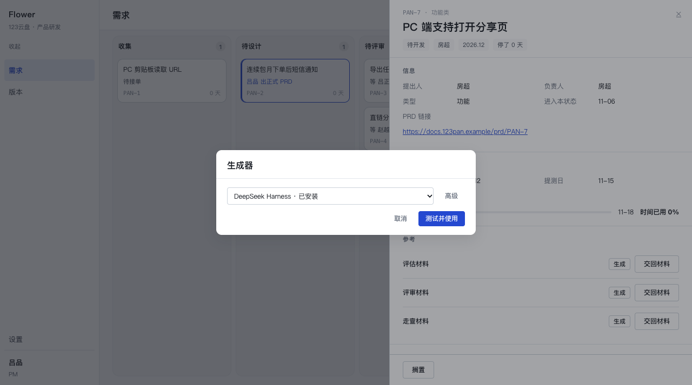
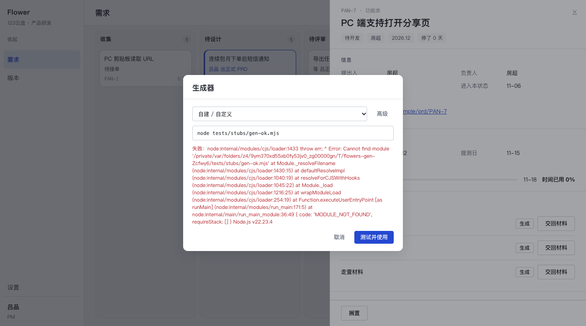
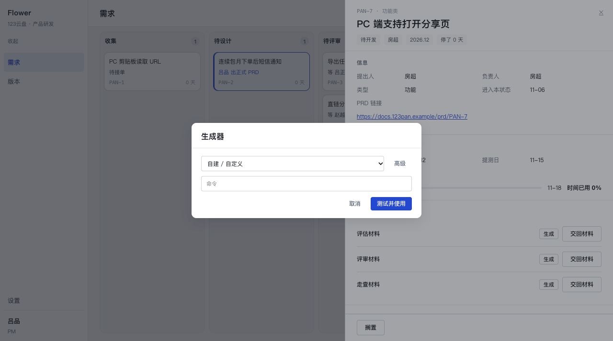
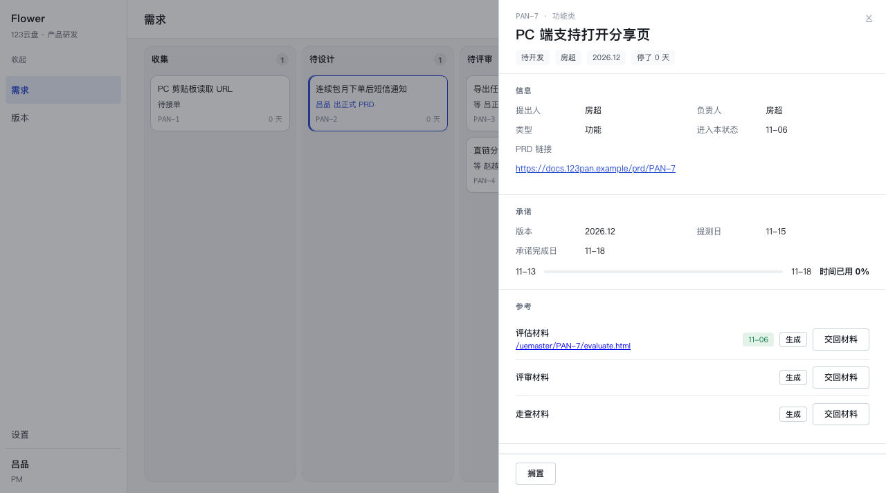
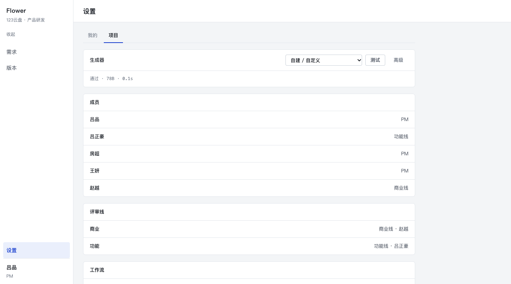
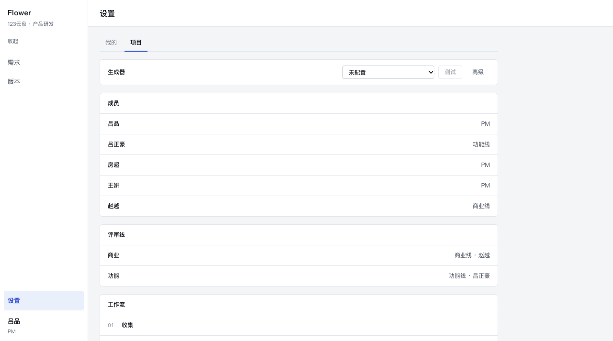
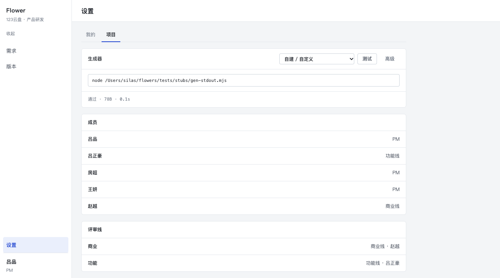
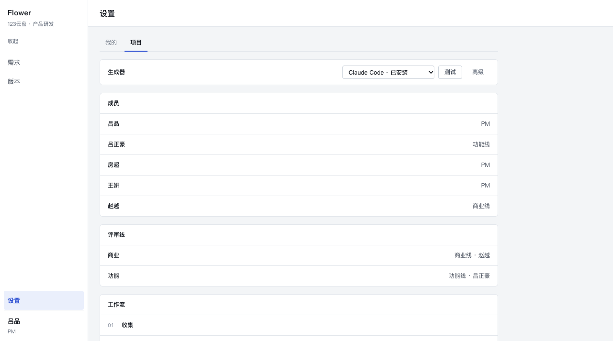
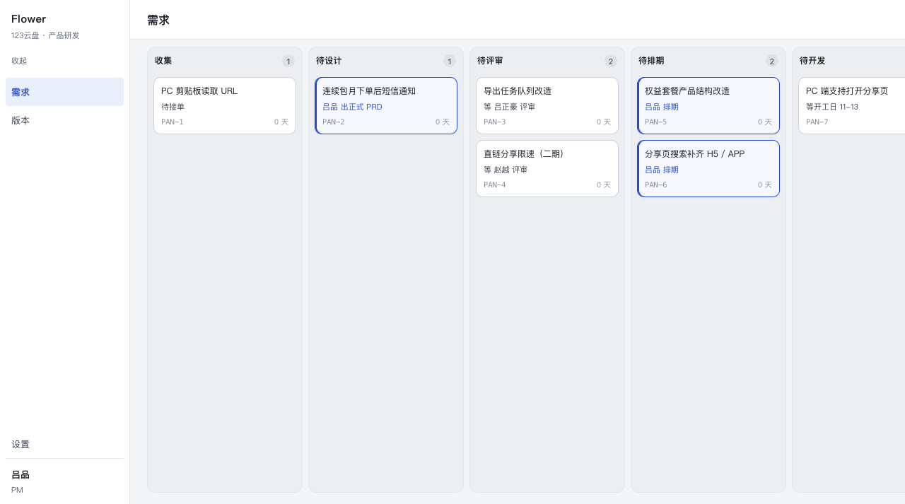

# P2.8 · 生成器：一次性的提问，不是一页要填的表

P2.7 把「这台机器上可能装着哪个 CLI」列成了一张表，但把**配置**做成了目的地：设置页
五张常驻卡片、每张一条命令行输入框，占掉整整一屏；抽屉里点「生成」时，如果探到多条，
再弹一次同样的五张卡。owner 看一眼就说：「你这个图我都不知道咋用，你考虑一下用户故事
地图吧」，以及「这些都让客户下拉选，别弄成一堆」——顺手还点了两个他想要的生成器：
**WorkBuddy** 与 **Grok Bot**。

这一版把这件事从「一页表单」改成「**第一次用时问一次的问题**」：抽屉里一个下拉，
测过就用，答完落库，以后再也不出现；设置页只剩一行，用来以后改。

本次提交：`d27f85e` —— `feat(uemaster): 生成器配置改成一次性的提问——一个下拉、测试并使用、以后不再问`
（本文与它同一次提交）。

`src/core` 六个领域服务一行没动；改动落在
`src/core/uemaster/*`、`app/*`、`tests/generator.test.ts`、`docs/*`。
没有新依赖，没有字面色值，没有迁移（仍然只用 `app_settings` 那两个键）。

---

## 1. 用户故事地图，逐行对账

| # | 他想干什么 | 界面该做什么 | 现在 | 落点 |
| --- | --- | --- | --- | --- |
| 1 | 在这条需求上点「生成」 | 抽屉里就有 | ✅ 本来就有 | `Drawer` 参考段三行（未动） |
| 2 | 第一次被问用哪个生成器 | **一个下拉**，默认选中已安装的第一个 | ✅ 现在就是 | `GeneratorDialog` + `GeneratorSelect`；预选 = `initialOptionId()` |
| 3 | 不确定它能不能用 | 「测试并使用」，测过才用 | ✅ 现在就是 | 对话框里同一个按钮：真跑一次小测，通了才存 |
| 4 | 以后每次 | 直接用上次选的，不再问 | ✅ 现在就是 | `resolveGenerator()`：库里那条 → `ready`，不再经过界面 |
| 5 | 想换一个 | 设置页**一行**下拉 | ✅ 现在就是 | `GeneratorRow` 重写：一行 + 「高级」 |
| 6 | 一个都没装 | 一句原因 + 一条可抄的命令 | ✅ 保持原样 | `GeneratorView.state === 'none'`：按钮禁用 + 去设置那一格 |

第 2、3、4 行是这次真正变的。根因写在 P2.7 的注释里已经很清楚了，只是当时选择了另一边：
「配置生成器」被当成了一个**目的地**，而它其实是一次**只用问一次的提问**。

三条配套决定（都是为了让上表成立，不是为了好看）：

- **探测只标注，不过滤**（`dropdownOptions`）。P2.7 只列 PATH 里探到的行，于是
  「这台机器上有什么」被当成了「你能选什么」——WorkBuddy、Grok Bot 这种还没装的名字
  根本不出现在列表里。现在七行全列，装没装写在后缀上，选不选由人定。
- **解析顺序里删掉「只探到一条就自动用」**。P2.7 的理由是「只装一个的人每次都弹是把
  配置问题变成日常税」——但那个理由只对**第二次以后**成立。第一次什么都没答应过，
  自动选中等于替他做了决定。现在没配过就是 `choose`（弹一次），配过就再也不会问。
- **「测试并使用」先测后存**。存了再测，失败时库里会留下一条已经生效的坏命令，而对话框
  还开着、用户以为什么都没发生；下一次按「生成」就拿它去跑。现在通过了才存。

## 2. 候选表：五个 → 七个

`src/core/uemaster/candidates.ts`（唯一一份清单，服务端与客户端共用）。

| id | 显示名 | command | 任务包怎么进去 |
| --- | --- | --- | --- |
| `claude` | Claude Code | `claude -p --permission-mode acceptEdits` | stdin |
| `codex` | Codex | `codex exec --sandbox workspace-write --skip-git-repo-check -` | stdin |
| `dsh` | DeepSeek Harness | `dsh headless {prompt}` | `{prompt}` 那个 argv 位 |
| `ollama` | Ollama | `ollama run <模型名>` | stdin（`<模型名>` 要先填） |
| `workbuddy` | WorkBuddy | **空串** + `needsCommand: true` | 待用户填 |
| `grokbot` | Grok Bot | **空串** + `needsCommand: true` | 待用户填 |
| `custom` | 自建 / 自定义 | **空串** + `needsCommand: true` | 用户写 |

两个新候选的命令**没有编**。猜一条命令比留空更糟：它会在第一次真跑时以一个与生成毫无
关系的原因失败（子命令不存在、参数不认识），而那种失败最容易被读成「生成器坏了」。
`needsCommand` 是显式标记，不是从空串推出来的——用例钉住了「空命令 ⇔ needsCommand」，
两者不会各说各的。

## 3. 那个下拉

一个原生 `<select>`，两个地方用同一份选项（`dropdownOptions()` 拼好，组件不再判断）：

```
DeepSeek Harness · 已安装
Claude Code · 已安装
Codex · 已安装
Ollama · 已安装
WorkBuddy · 需要填命令
Grok Bot · 需要填命令
自建 / 自定义
```

顺序：**装了的在前、没装的后、自建永远最后**；装了的那一组里 `dsh` 领头（P2.7 的
「零条时先试 dsh」那条指路，搬到了这里）。选项文字由服务端算好，界面只负责渲染。

四种后缀：

| 后缀 | 含义 | 但仍可选 |
| --- | --- | --- |
| `已安装` | PATH 里有这个可执行文件 | 是 |
| `未安装` | PATH 里没有 | 是（装上之后不用再改设置） |
| `需要填命令` | 命令未知（WorkBuddy / Grok Bot） | 是（选中后问一次命令） |
| （无） | 自建 / 自定义 | 是 |

「已安装」不等于「能用」——本机的 codex 装了、登录了、`exec` 仍然 401。能不能用只有
「测试」回答（这是 P2.7 立的规矩，没动）。

**预选**：`initialOptionId()` = 已保存的 → 装了的第一个 → 自建。所以「只装了一个」的机器
上仍然是弹一次对话框，但那个选项已经选好，按「测试并使用」是一次确认，不是一次选择。

## 4. 抽屉里那一次提问

`GenerateButton` 的分支（三条，都在一行里）：

```
ready   → 直接跑（配过了 / env），不弹任何东西
choose  → 弹小对话框：一个下拉 + 高级 + 取消 + 测试并使用
none    → 按钮禁用：「未检测到生成器 · 设置」
```

对话框（`GeneratorDialog`）里发生的事：



（同一屏在 workspace 那个浏览器里：`01b-first-use-dialog-real-browser.png`，逐像素一致。）

- 下拉预选 `DeepSeek Harness`（这台机器装了四个，按顺序它第一个）。
- 按「测试并使用」→ 服务端 `applyGeneratorAction`：真跑一次固定小测（`TEST_PACK`，
  45 秒硬超时，与真生成同一条命令契约）→ **通过了才存** → 抽屉关框、立刻开始这一次
  生成（一次点击的意图，不是两次）。
- 没通过 → 对话框不关，CLI 的**原话**留在框里，可以换一个选项或改高级里那条命令再按：



- 选了「需要填命令」的候选（或 ollama 那种还带 `<模型名>` 的），**输入框自己露出来**，
  不用按高级——那时输入框就是「选它」这个动作本身：



用 stdout 模式的 stub 点一遍（`node tests/stubs/gen-stdout.mjs`，它只把 HTML 打到
stdout，产物由 Flowers 落盘）：测试通过 → 框关 → 生成真的跑完 → 那一行变成链接：



## 5. 设置页：一行

`/settings?tab=project`。整块五张卡片删掉，只剩一行：



- 下拉的值就是「现在用哪个」，**改了就存**（没有保存按钮）。
- 还没配过时下拉显示 `未配置`（不是假装选了第一行）——那才是「现在会跑什么」：



- 测试结果就在这一行下面：`通过 · 78B · 0.1s` / `失败：<stderr 原文>`。
  落 `app_settings['generator.test']`，跟着**存着的那条命令**走：命令换了，结果作废。

**「高级」藏什么**：那条命令行本身（等宽、可改、回车或失焦即存）。


- 默认不出现，因为一个 PM 不该读 `--skip-git-repo-check`。
- 但它必须存在：`ollama` 的 `<模型名>` 只能在这里填；两个「需要填命令」的候选也落在这里。
- 把那行**删空** = 回到「未配置」（服务层本来就把空串当「没设」）。P2.7 那个「清除」
  按钮因此不需要第三个按钮；界面上也不写提示。

按一次「测试」：



换一个生成器、刷新，值还在：



## 6. 「1 Issue」徽标：原因是浏览器扩展，不是我们的标记

owner 截图里 Next 的「1 Issue」是**水合不匹配**：装着的浏览器扩展往 `<body>` 上注入了
`data-atm-ext-installed`，dev 日志那一条错原文指名就是这个属性；React 19 的水合会逐条
比对属性，于是报 mismatch 并亮徽标。我们的标记没有一处读这个属性。

修法：`app/layout.tsx` 的 `<body suppressHydrationWarning>`。只压一层——它不向子节点
传递，我们自己的组件真有 mismatch 照样会报。

**红/绿实证**（同一个页面、同一个注入脚本，只差这一行）：

| 版本 | 注入 `data-atm-ext-installed` 后 |
| --- | --- |
| 去掉 `suppressHydrationWarning` | 1 条 `[error] A tree hydrated but some attributes of the server rendered HTML didn't match the client properties…` |
| 保留 | 0 条 console error / warning |

注入用 CDP 的 `Page.addScriptToEvaluateOnNewDocument` 在水合之前把属性写到 `<body>` 上，
再收集 `Runtime.consoleAPICalled` + `Log.entryAdded`。页面加载后徽标不再出现：



## 7. 验证

| 项 | 命令 | 结果 |
| --- | --- | --- |
| 类型 | `npx tsc --noEmit` | 0 错 |
| 单测 | `npx vitest run` | 12 文件 / **372** 通过（360 + 12） |
| 构建 | 隔离副本 `npx next build --webpack` | exit 0；5 条路由全动态 |
| 浏览器 | :3000（`--webpack`） | 见下 |

浏览器逐条（都在这台机器上，dev server 未重启）：

1. 干净状态（`app_settings` 空）：打开 PAN-7 → 点「生成」→ 对话框出现，七行下拉、预选
   DeepSeek Harness、「测试并使用」→ `01-first-use-dialog.png`。
2. 选「自建 / 自定义」→ 只多出一个输入框 → 填 `node …/gen-stdout.mjs` → 测试失败一次
   （原话留着）→ 换成可用 stub → 「测试并使用」→ 框关、生成跑完、那一行变成
   `/uemaster/PAN-7/evaluate.html` + 日期 → `02`、`04`。
3. 设置页：一行（`05`）；「高级」露出命令行（`06`）；「测试」结论落在那一行（`07`）；
   未配置时是 `未配置` 且「测试」禁用（`10`）。
4. 下拉从「自建」切到 `Claude Code` → 刷新 → 仍是 `Claude Code`（`08`）。
   另外验了「填模型名」这条路：选 Ollama → 输入框自带 `ollama run <模型名>` → 改成
   `ollama run qwen2.5-coder` → 回车 → 刷新后下拉仍是 **Ollama**（不是跳回「自建」）。
5. 页面加载后没有 Issue 徽标（`09`），并用上面那组红/绿证明原因在扩展注入。

用例这边改了两条**钉住旧策略**的断言，改的是策略不是断言的口味：

- 「探测到一条：直接用，但标成 detected」→ 现在是 **choose**（PATH 不替人答应）；
- 「多条没选时指路设置页」→ 现在的出口是抽屉里那一次提问（「测试并使用」）。

新增 12 条：七行候选与 `needsCommand` 的对应、下拉顺序与后缀、预选中「装了的第一个」、
`idForCommand` 的逐字匹配与「同一可执行文件」匹配（`ollama run qwen2.5` 仍算 Ollama，
`codex-tool run` 不算 Codex）、`initialOptionId` 的三段优先级、`testLabel` 两种形状、
「没配过 → choose + savedId=null」、存完之后 `ready` 且不再问、改成自建命令后落在
`custom`、env 仍压过库里那条。

`npx vitest run` 会清空演示库（`resetDb()` 连 `app_settings` 一起截断），所以收尾跑了
`npm run seed -- --reset`，并把 `generator.*` 清空——留着空状态，owner 打开就是那张
一次性的对话框。

## 8. 还粗糙的地方

1. **存的是命令，不是 id。** 所以「这条命令属于哪个候选」只能靠两条规则认：逐字相同，
   或「同一个可执行文件名 + 空格」开头。`ollama run qwen2.5` 认得出是 Ollama，
   `env FOO=1 ollama run qwen2.5` 会落到「自建 / 自定义」。要彻底解决得给
   `app_settings` 加第二个键（candidate id）——这次没做，因为那是一次迁移，而这一格
   的信息量还不值得。
2. **设置页仍允许存一条没测通的命令**（P2.7 的规矩：「装了 ≠ 能用」，人可能要慢慢调）。
   代价是「未通过测试」这个状态还在。抽屉里那次提问不会留下坏命令（先测后存），
   两个入口的标准因此不完全一样；这是有意的。
3. **只装一个也问一次**（story map 第 2 行 / 约束 E 明确要求）。代价是第一次用多一次
   确认；收益是用户见过那张列表，知道还能换。
4. **`GeneratorView.candidates`（探测列表）现在只有测试与 `options` 构造在读**，界面不再
   直接用它。留着是因为它表达的是「探测结论」这一件事（与「选项」不同），但确实是
   下一个可以删的东西。
5. **零安装时两条口径并存**：抽屉禁用（「未检测到生成器」），设置页那行却可以配一条
   命令（高级里手写）。约束 F 要求保留禁用态，所以没动；配完回抽屉就立刻能用。
6. **对话框里的「高级」对「需要填命令」的候选是空的**——输入框本来就露着，展开没有新
   东西。它仍在，是为了两个地方的形状一致；要收掉得引入「这一行没有命令」的分支。
7. **没有「清除」按钮**：清空命令行 = 回到未配置。界面上不写提示（这一页没有解释性
   文案），所以这条得靠用户自己想到。P2.7 那个显式的「清除」是更清楚的做法，但它会
   给这一行加上第三个按钮——与「一行、三个控件」的口径冲突，这次选了后者。
8. **截图来自一台 1280×720 的 headless Chrome，不是 owner 的浏览器**。下拉的展开态是
   原生控件，截图里只能看到选中的那一行（Chromium 的原生弹层不进 DOM）。真实浏览器里
   点开是七行的选择面板，内容与上面那张表一致。
