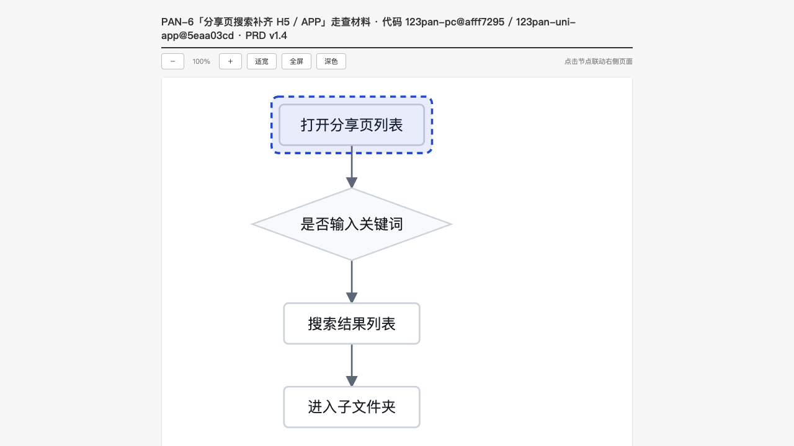
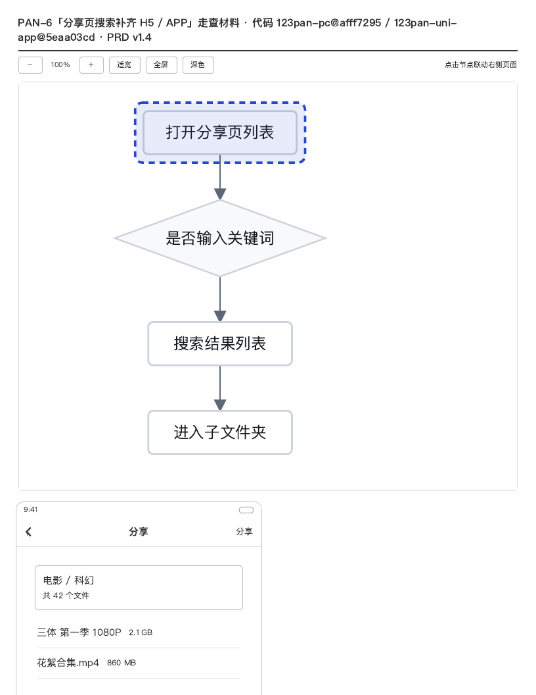
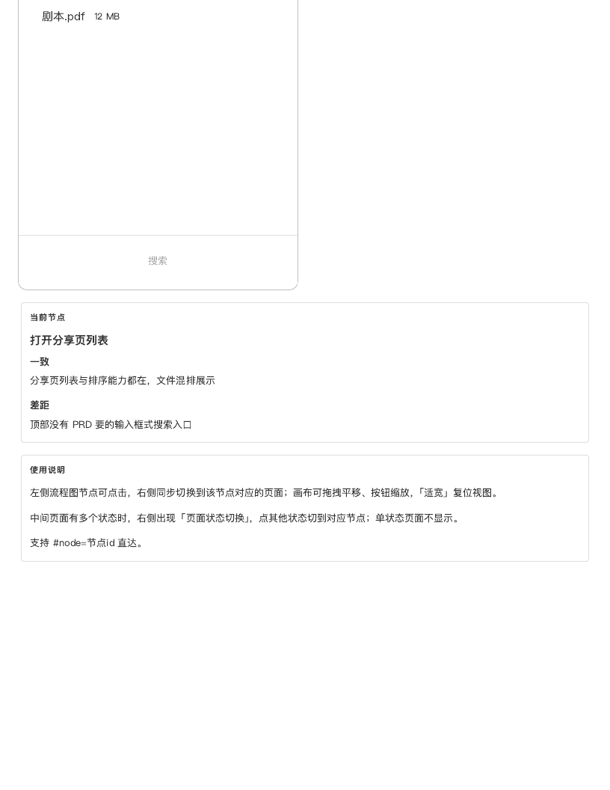

# P3.3 — 走查材料：PRD ⇄ 真实代码

> 一句话：**走查不是「再生成一份材料」，而是「拿镜像的 HEAD 去核对每一句判断」**。
> 所以这条链路里有一段**没有模型**的阶段——它决定了模型能看见什么，也决定了
> 模型编不出来的东西（路径）能不能被当场抓住。

- 代码：`src/core/uemaster/inspect.ts`（新），`start.ts`（接线），`trace.ts` / `schema.ts` /
  `migrations/0007_inspect_phases.sql`（留痕的两个新阶段），`tests/inspect.test.ts`（新）
- 分支：`main`；dev server 仍在 `:3000`（`next dev --webpack`）

---

## 1. 两段式：为什么不是一个提示词

`composeEvaluation` 那条路的输入是「需求本身」，模型画什么都能自圆其说——评审没法证伪。
走查要回答的是另一类问题：「PRD 说的这一条，代码里到底做没做」，它的每一句判断都必须
指向一个**真的存在**的文件。于是链路被切成四段，模型只负责其中两段：

| 段 | 谁在做 | 输入 | 输出 | 成本 |
| --- | --- | --- | --- | --- |
| ① 基线 | 代码 | 需求 + 快照 + 两个镜像的 HEAD | `PrdBaseline` + 两个 `RepoBaseline`（sha / 树 / 形状） | 3 次 git 读 / 仓 |
| ② 定位 | 代码 | PRD 正文 + 标题 | 8 个关键词 → 每仓 12 个候选文件 | 8 次 `git grep` / 仓 |
| ③ 结构 | 模型 | PRD（截断 10k）+ 候选集 + 形状表 | `flows` + `findings` | 1 次调用（+1 次修） |
| ④ 复核 | 模型 | 结论 + **被引文件的正文** | 结论（可降级）+ `wt-*` 页面片段 | 1 次调用（+1 次修） |
| ⑤ 排版 | `build.py` | walkmap | HTML | 子进程 |

②是这条链路的性格所在：**同一个 PRD + 同一个 HEAD，必然得到同一份候选集**。所以
「模型为什么没看见那个文件」可以脱离模型回答——把候选集摊开看就知道了。

### 基线：两个 sha 是标题的一部分

材料标题（也是 walkmap 的 `title`，最终进 `<title>` 与页头）：

```
PAN-6「分享页搜索补齐 H5 / APP」走查材料 · 代码 123pan-pc@afff7295 / 123pan-uni-app@5eaa03cd · PRD v1.4
```

- 两个 sha 来自 `head('123pan-pc')` / `head('123pan-uni-app')` 的**完整** sha，标题里取前 8 位；
  `stats.repos[].sha` 留完整的。
- PRD 版本从正文里取**数值最大**的那个 `vX.Y`（`v1.0` 是文档开头的初版，`v1.4` 才是这一版），
  取不到就退回快照 hash 的前 8 位（`未标版本#c6d6ec4e`）——留一个「不知道是哪版」的名字，
  比编一个版本号好。
- 没有快照时先 `readPrd()`（真调 `wecom-cli`），有快照就用快照：走查的结论要钉在
  **读这一版 PRD 的那一刻**，有快照还去重读，等于让昨天的结论跟着今天的文档漂。

### 定位：关键词怎么来

三段信号，权重 3/2/1：

1. **引号里的界面文案**（`「全部文件」`、`“请输入关键词”`）——PRD 用引号写的就是用户能
   看见的字，而界面上的字在代码里几乎一定能 grep 到；
2. **标题里的词**（含 n-gram）；
3. **正文的 2–6 字 n-gram 频次**，按 `次数 × 长度` 排序——长词更具体。

> 真实 PRD 上跑出来的是：`搜索、文件、目录、上一级、结果、返回、当前、范围`。
> 全是真词，但「文件」「返回」「当前」太通用——这是这一版最粗糙的地方（见 §6）。

候选文件的排序**不是**按命中次数：

```
score(file) = Σ_keywords ( 1 / df(keyword) + 0.05 ) × (文档类 ? 0.25 : 1)
```

- `df` 是该关键词在这个仓里命中的文件数。`当前`（41 个文件）与 `上一级`（2 个文件）对
  「哪个文件讲的就是这件事」的说服力完全不同，按次数排会让通用词通吃；
- 文档类（`.md` / `.mdc` / `.txt`）**降权而不是剔除**：真实仓里 `AGENTS.md`、
  `docs/plans/*.md`、`.cursor/rules/*.mdc` 会同时命中四五个通用词，凭次数把
  `search-entrance.vue` 挤出候选集；但「这份 PRD 只改文档」时它们又该排得进来。

实测对比（`123pan-uni-app`，同样 8 个关键词）：

| 排序 | 前 3 个候选 |
| --- | --- |
| 按命中次数 | `pages/doc/privacy.vue`、`README.md`、`pages/video/video.vue` |
| 按 df 加权 | `pages/doc/privacy.vue`、`pages/video/video.vue`、`stores/config.ts`，第 7 位才是 `search-entrance.vue` |

（`123pan-pc` 侧同样把 `.cursor/rules/*.mdc`、`AGENTS.md` 清出了前 12。）

---

## 2. 提示词契约

### 阶段三：结构

提示词里最先说的不是「你要做什么」，而是**「你要被核对」**：

```
! 证据只能引用这两个仓 HEAD 上**真实存在**的文件。路径会逐条拿 ls-tree 核对，
  写一个不存在的路径，整份结论会被退回重答——不要猜文件名，不要写目录。
```

要的形状（`flows` ≤ 8、`findings` ≤ 12）：

```json
{
  "flows": [ { "id": "A", "title": "分享页搜索入口", "kind": "page" } ],
  "findings": [
    { "verdict": "implemented", "prd": "…", "code": "…",
      "evidence": [ { "repo": "123pan-pc", "path": "src/…", "note": "为什么是这条证据" } ] },
    { "verdict": "missing", "prd": "…", "code": "未找到",
      "evidence": [], "searched": ["面包屑", "全部文件"] }
  ]
}
```

七条规则写在提示词里，也全部写在校验器里（下一节）。PRD 截断到 10,000 字符，并且
**在提示词里写明截了多少**：

> PRD 正文（已截断：只给你前 10000 字符，全文 19723 字符；后面 9723 字符没给——
> 那段不要凭标题猜，猜的地方不要写成结论）

### 阶段四：复核

输入是「上一轮结论 + 你引用的那几个文件的正文（≤10 个 / ≤40k 字符）」，输出是
**同一份 findings**（可降级）+ **每个流程节点一屏 `wt-*` 片段**。两个任务放进同一次调用，
因为它们要读的是同一批文件；分成两次，第二次还得把正文再贴一遍，而模型多半会给出与
第一次不同的判断——一份材料里两套结论，比只有一套错更难查。

页面规则从 `compose.ts` 的那一套照抄（`wt-*` 词表、375/690 两种宽度、无 emoji、只写
body 内片段），只多一条**走查专属**：

> `anno` 的**第一条必须是一条 verdict**：小标题只能是 一致 / 缺失 / 多余 / 不一致 之一。

它是这份材料「走查」的身份。缺了会被退回（`readVerify` 里逐节点检查）。

---

## 3. 校验规则：镜像存在的全部意义

| 规则 | 违反时的中文 | 为什么 |
| --- | --- | --- |
| 每条 `evidence[].path` 必须在该仓 `lsTree` 里 | `第 6 条（implemented） 的证据路径在仓库里不存在：123pan-uni-app:src/pages/pages.json` | 模型会把 `pages.json` 写成 `src/pages/pages.json`；除了拿树核，没有第二种办法发现 |
| `repo` 必须是本次走查的两个仓之一 | `第 2 条（extra）的证据仓库「123pan-cross-frontend」不在这次走查的仓库里` | 引一个没读过的仓 = 引一个没读过的文件 |
| `missing` 的 `evidence` 必须为空 | `第 7 条（missing） 是 missing，但带了证据路径（…）：没有代码可引就不许引` | 一边说「没有」一边递上文件，结论自相矛盾 |
| `missing` 必须给 `searched` | `第 7 条（missing） 但没有给 searched：读者无法判断这次搜索的覆盖面` | 「没搜到」与「搜错了词」在读者眼里必须分得开 |
| `differs` 至少一条证据（`implemented` / `extra` 同） | `第 3 条（differs） 没有任何证据路径` | 「对不上」四个字谁都会写 |
| `flows` 3–8、`findings` 1–12、id 唯一且 `[A-Za-z0-9_]` | `flows 有 2 个，要求 3–8 个` | 少于 3 个节点画不出流程；id 里带别的字符 mermaid 画不出来 |
| `verdict` 四选一（允许别名） | zod：`Invalid enum value` | 见下 |

**失败是硬的，但可以修一次**：所有问题按条拼进 `structureRepairPrompt`（含**被编造的路径
原文**），模型重答；第二次还不过就 `AppError('inspect_invalid', '走查结论 2 次都没通过校验：…')`。
`uemaster_job_attempts` 每一次都留一行（`phase='locate'` / `'verify'`，成功那行 `error` 为 null）。

`verdict` 的别名归一（`normalizeVerdict`）是**真实跑出来的第一条 bug 修**：第一版回话写的是
`"verdict": "missing/缺失"`——模型把枚举值和自己要写的中文标注粘在了一起。这不是
「判断错了」，为它整份退回重答等于拿一次调用（和一次额度预扣）换一个斜杠。归一之后
认不出来的字符串照样被 zod 拒掉。

---

## 4. 一次真实跑（`gpt-5.4-mini` + `dogyun` 三个镜像 + 真 PRD）

命令：建一条 `stage='inspect'` 的作业行，`runJob(db, jobId, { actor: '吕品' })`
（即界面上「生成」按钮走的那条路）。

### 第 1 次：结构一次过，复核前被额度挡住

| 时间 | 事实 |
| --- | --- |
| 基线 | `123pan-pc@afff7295` / `123pan-uni-app@5eaa03cd`；PRD 由 `wecom-cli` 现读，**19,723 字符**（比 `tests/fixtures/prd-pan6.md` 的 16,512 多——线上文档比夹具新） |
| 定位 | 8 个关键词 × 2 仓 = 16 次 `git grep`，全部成功 |
| 结构 | 第 1 次调用 5.8s，回话 2,121 字符 → 通过 |
| 复核 1 | 11.9s，回话 7,791 字符，**被 zod 拒**：`findings.0.verdict：Invalid enum value … received 'missing/缺失'` |
| 复核 2 | **`预扣费额度失败, 用户剩余额度: 积分6.419600, 需要预扣费额度: 积分7.437600`** |
| 结论 | `status=failed`，无产物 |

### 第 2 次（修了 verdict 归一之后）：镜像抓到了真实的幻觉

| 时间 | 事实 |
| --- | --- |
| 结构 1 | 14.5s，回话 3,185 字符，**被拒**：`第 6 条（implemented） 的证据路径在仓库里不存在：123pan-uni-app:src/pages/pages.json` |
| 结构 2 | 8.3s（修复提示词 5,026 字符，里面原样带着那条路径），回话 3,600 字符 → **通过** |
| 复核 1 | **`预扣费额度失败, 用户剩余额度: 积分3.510400, 需要预扣费额度: 积分7.571200`** |
| 结论 | `status=failed`，无产物；整条链路 35.7s |

> 第 6 条是真实数据里最值钱的一条：模型把 `pages.json`（uni-app 的**路由表**，就在仓根）
> 写成了 `src/pages/pages.json`。**只有拿 `ls-tree` 核才抓得住这种错**——它长得完全像真的。

### 为什么没能跑完：网关按 `max_tokens` 预扣，不是按实际用量

两次失败都是同一件事，且第二次是因为我第一次把 `VERIFY_MAX_TOKENS` 设成 8000：

- 回话实际只有 7,791 字符（≈3–4k token），预扣按 8,000 算 → 一次扣 7.4 积分；
- 账户余额只剩 3.51 积分 → 请求在**发出前**就被挡下（`output_chars: 0`，ms 251）。

用两次观测反解出这个网关的预扣公式（`prompt_chars` 是提示词字符数）：

```
prepay ≈ 0.0009 × max_tokens + 0.0000636 × prompt_chars
  校验：8000×0.0009 + 3701×0.0000636 = 7.44  ✓（实测 7.4376）
      5000×0.0009 + 48297×0.0000636 = 7.57 ✓（实测 7.5712）
```

所以我把结构段的 `max_tokens` 从 3500 降到 **2200**（实测 12 条结论只写 2,100 汉字），
复核段从 8000 降到 **5000**。仍然是「余额不够就发不出去」——这不是代码的问题，
但**它是部署要读的一个数字**：跑一次走查的预扣峰值约 7.5 积分。

### 渲染演示（真实镜像 + 真实 PRD + 真实 `build.py`，只有模型回话是脚本）

余额不足时我用**脚本回话**跑完了第四、五段，用来证明产物形状（并给出截图）。
**这一份的结论不是我判定的，是脚本里的；其余全是真的**：真 PRD（现读 19,723 字符）、
真镜像（`afff7295` / `5eaa03cd`）、真 `flowlayout.py`、真 `build.py`。

| 项 | 值 |
| --- | --- |
| 结论 | 4 条：`implemented 1 / differs 2 / missing 1`；流程 4 个节点 |
| 证据 | 引用 3 条路径，**3 条全部过了 `lsTree`**；深读 3 个文件、14,360 字符 |
| 产物 | `data/uemaster/PAN-6/inspect.html`，**28,463 字节**（27,147 字符） |
| 耗时 | 7.2s（快照已在）/ 10.8s（含一次真 `readPrd`） |
| 标题 | `PAN-6「分享页搜索补齐 H5 / APP」走查材料 · 代码 123pan-pc@afff7295 / 123pan-uni-app@5eaa03cd · PRD v1.4` |



截图是 1280×720 视口：三栏在 `<1100px` 才堆叠，所以这一帧只看得见左侧流程图与页头。
下面两张是同一个产物按打印宽度（816px，触发堆叠）渲染的两页，标注面板在里面：




---

## 5. 测试（`tests/inspect.test.ts`，15 条，无网络）

夹具是**当场 `git init --bare` + push** 的两个真仓（`123pan-pc` / `123pan-uni-app`），
模型那层是注入的 `complete`（按脚本回话，提示词原样留在数组里）。库、文件系统、
`flowlayout.py`、`build.py` 全是真的。

| 用例 | 钉住的东西 |
| --- | --- |
| 快乐路径 | 证据路径全部真实存在；`/uemaster/PAN-6/inspect.html` 落盘 + attach；**标题里两个 sha 都在**；`stats` 的每一格（findings / verdicts / cited / deepRead / bytes / prdVersion）；材料里 `一致`/`缺失`/`不一致` 三种标注都在 |
| 编造的路径 | 第 1 版写 `src/pages/share/Search.tsx`（大小写+目录都不对）→ **修复提示词里必须有这个路径**、必须说「不存在」→ 第 2 版过；`structureAttempts === 2` |
| 编造的路径两次不改 | `AppError('inspect_invalid')`，消息带那条路径，调用次数正好 2（上限是硬的），无产物 |
| `missing` 带证据 | 被拒，消息里点名 `missing`，无产物 |
| 没有快照 | `readPrd` 被调用 1 次；有快照后第二次**不再**调用（`latestSnapshot` 优先） |
| 没配镜像 | `AppError('mirror_unconfigured')`，消息同时点名 `code.mirror.repos` 与 `FLOWERS_MIRROR_REPOS`，**0 次模型调用** |
| `runJob` 接线 | 有 provider、没镜像 → 作业 `failed`，`error` 含「代码镜像」与 `code.mirror.repos`，**不退回评估管线** |
| 纯函数 | 关键词（互不包含、不是胶水词）、版本号取最大、PRD 截断、flows→mermaid（三种括号）、`normalizeVerdict` 的四种别名、校验器逐条点名 |

```
$ npx vitest run
Test Files  22 passed (22)
     Tests  556 passed | 1 skipped (557)   # 541 + 本阶段 15
$ npx tsc --noEmit
（无输出）
```

---

## 6. 还粗糙的地方（按「下一个人会撞上」的顺序）

1. **走查的图没有分支。** `flows` 只是一串节点，`mermaidFromFlows` 把它们串成一条主干——
   判断节点没有「是/否」两条出边。好处是排版器三个计数天然为 0（实测确实 0），代价是
   「分支」这件事只能从标注里读。让模型交 mermaid 会重新引入「图≠结论」的风险
   （`compose` 那条路的老问题），所以这一版刻意不交。
2. **关键词还是会被通用词带偏。** 这份 PRD 抽出来的是 `搜索、文件、目录、上一级、结果、返回、
   当前、范围`，「文件」「返回」「当前」在 575 个文件里命中几十处。df 加权把它们压下去了，
   但**没有解决**「抽不出领域短语」的问题。真正的解法大概是：让模型只做「从 PRD 里挑 8 个
   短语」这一件小事（一次极小调用），再由代码去 grep——那会把模型重新放回阶段一，
   牺牲可复现性。没做，是因为现在还说不清哪个更值。
3. **阶段一与阶段二之间没有回路。** 如果结构段的结论里一条证据都引不到候选集之外的文件
   （模型常干的事），没人会发现「候选集选错了」。一个便宜的补丁：把「引用到的文件里有
   几个来自候选集」记进 `stats`，让人一眼看出候选集的命中率。这一版没记。
4. **深读只读「模型引到的」文件。** 模型没想到的文件永远读不到——这是刻意的（它让引用成为
   一次承诺），但也意味着「模型漏看了一个文件」这种错，走查抓不住。
5. **复核阶段不能被跳过。** 页面片段必须由模型给；它两次不给或两次不合契约，整份材料就失败。
   没有「只有结论、没有页面」的降级产物（那种材料其实也有用：一张结论表 + 一条主干图）。
6. **`max_tokens` 是我们的，额度是别人的。** 2200/5000 是按「实测回话长度」定的，
   但网关按 `max_tokens` 预扣——部署时要看的数字是「一次走查峰值预扣 ≈ 7.5 积分」。
7. **镜像配置只有库键、没有界面。** `code.mirror.transport / sshHost / repos` 这一版靠
   `app_settings` 或环境变量（本次演示往库里写了三行，见 §7）。「设置」页里还没有这一格，
   所以「没配镜像」这句话，用户在界面上找不到地方去填。
8. **`123pan-cross-frontend` 没进走查。** 三个镜像里只读两个（PRD 的两个端）。跨端共用层
   如果是这类需求真正的落点，结论会偏——`INSPECT_REPOS` 是一个常量，改它很容易，
   但「该不该改」需要一次真实的走查来回答。

---

## 7. 这次动到什么

- **新文件**：`src/core/uemaster/inspect.ts`、`tests/inspect.test.ts`
- **`start.ts`**：provider 分支里加一个 `job.stage === 'inspect'` 的岔口——先查镜像
  （`resolveMirrorConfig`），没配就 `failJob` 并点名 `code.mirror.repos`，**绝不回落到
  `composeEvaluation`**；有镜像就调 `inspect(...)`，成功走 `doneJob(artifactId)`。别的阶段
  一个字节没动。
- **`trace.ts` / `schema.ts` / `0007_inspect_phases.sql`**：`AttemptPhase` 从三个变成五个
  （`+locate`、`+verify`），CHECK 约束跟着放宽——抽屉里那三行字要能分清是哪条链路的哪一次。
- **`compose.ts`：零改动。** 复用的都是它已经导出的东西（`assembleWalkmap`、`PageFragment`）。
  页面片段的 zod 校验在 `inspect.ts` 里另写了一份，因为它多一条硬规则（第一条标注必须是
  verdict），而且 findings 要与它一起校验——共用一份 `readFragments` 会把两套语义硬拼在一起。
- **演示库**：`app_settings` 里写入了 `code.mirror.transport=ssh`、`code.mirror.sshHost=dogyun`、
  `code.mirror.repos=[…三个 bare 仓…]`；`requirements.prd_url` 仍是那条企业微信链接；
  `provider.*` 三行原样保留；PAN-6 上挂着一份 `inspect.html`（§4 的渲染演示）。
