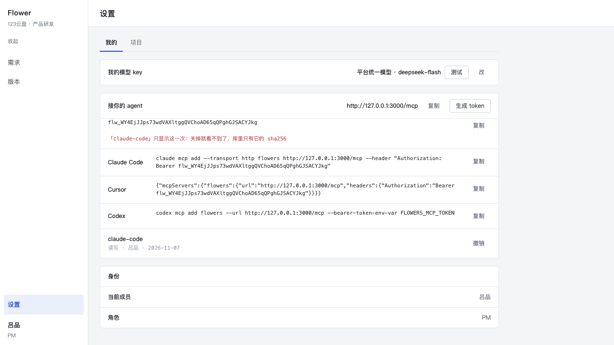
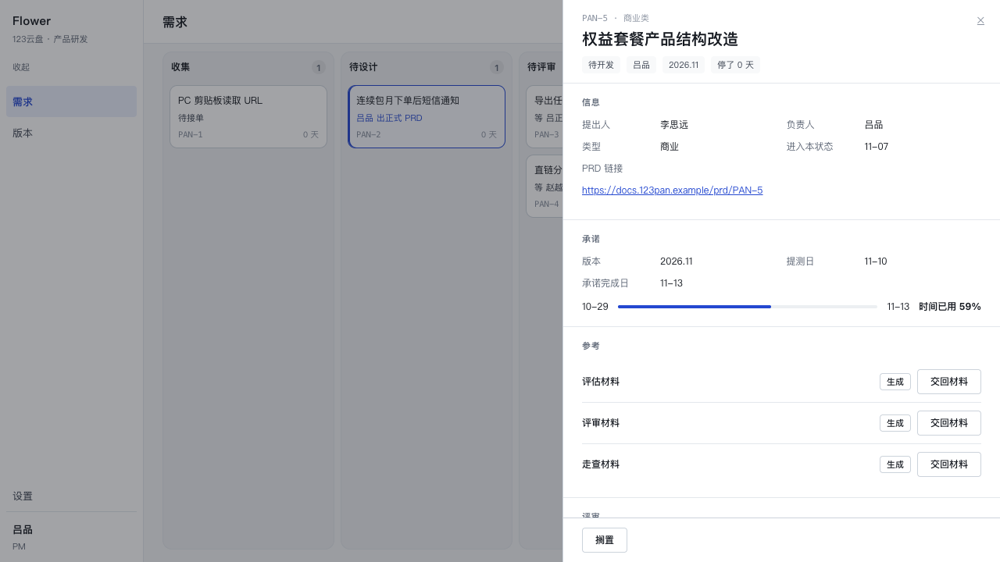

# P4.1 · Flowers 的 MCP 端点（HTTP）

**状态**：完成。`/mcp` 上线（Streamable HTTP，无状态），十五个工具覆盖整套状态机，
token 绑定成员，设置页可生成 / 撤销，`npx tsc --noEmit` 干净，`npx vitest run`
656 passed / 1 skipped（基线 609 + 新增 47），`npm run build` 通过，stdio 那条老入口
仍然可用，工具定义两边共用同一份。

owner 已定的三件事，本文件不再讨论：**HTTP 传输**、**整套状态机暴露（选项 C）**、
**每个动作都会写一句承诺 → token 必须带身份**。

---

## 1. 传输：Streamable HTTP，无状态

| 方案 | 结论 |
| --- | --- |
| stdio | 客户端要本机起进程 + 有仓库 + 有 `DATABASE_URL`。这条路要的是「一条 URL + 一个 token」，排除。 |
| HTTP + SSE（旧 `SSEServerTransport`） | 一条连接一个长会话，断线即断会话；过隧道 / 休眠 / 换网就重来。 |
| **Streamable HTTP** | 选它。`POST` 走 JSON-RPC，`GET` 才开流；`tools/call` 是一次独立请求。 |

实现：`@modelcontextprotocol/sdk` 的 `WebStandardStreamableHTTPServerTransport`
（SDK 1.32.2，Next 16 的 route handler 本来就是 Web `Request`/`Response`，不需要
`StreamableHTTPServerTransport` 那层 Node 适配）。

- `app/mcp/route.ts`：导出 `POST` / `GET` / `PUT` / `PATCH` / `DELETE`，每个都只是把请求
  交给 `mcp/http.ts` 的 `handleMcpRequest`；`runtime = 'nodejs'`、`dynamic = 'force-dynamic'`。
- `mcp/http.ts`：**鉴权 → 建一个绑定身份的 server → 交给 transport**，三步不能换序。

**为什么是无状态**（`sessionIdGenerator: undefined`，每个请求一份 transport）：

1. 身份只活在一个请求里。token 撤销之后**下一个请求立刻 401**，没有「会话是十分钟前
   建立的」那种窗口。
2. 进程里没有会话表：dev / 多 worker / 重启都不会把谁的会话搞丢，也没有会话清理。
3. 代价：服务端不能主动推送（`notifications/*`、进度）。这套工具全是请求-响应，
   代价是零。

`GET`（挂钩 SSE 流）与 `DELETE`（删会话）回 **405**：无状态模式下没有会话可删、也没有
东西可推。SDK 的客户端 `streamableHttp.js` 明确把 405 当成「这个服务器不提供 GET 流」，
会退回只用 POST。

> 先鉴权再看方法：不带 token 的 GET 也是 401，而不是 405 —— 否则「这个端点有没有人守」
> 就成了一个不需要凭据的探测点。

## 2. token 模型

表 `mcp_tokens`（`src/db/schema.ts` + 迁移 `0009_mcp_tokens.sql`）：

| 列 | 说明 |
| --- | --- |
| `id` | uuid |
| `token_hash` | sha256 十六进制，**唯一索引**。原文 `flw_` + 32 字节随机（base64url，43 字符）只出现一次 |
| `member_id` | FK → `members`（`on delete no action`：删人之前先想清楚他的 token 怎么办） |
| `label` | 生成时必填，列表里认人用 |
| `scopes` | `read` \| `write` \| `write`，有 CHECK 约束 |
| `created_at` / `revoked_at` | 撤销 = 写 `revoked_at`，**不删行** |

三条判断：

- **为什么 sha256 不是 bcrypt/argon2**：token 是 32 字节随机值，没有字典可查；每个
  `tools/call` 都要验一次，慢哈希买不到安全只买到延迟。
- **为什么 scopes 是单值**：read ⊂ write ⊂ write 是包含关系，一次给两级等于给高的那一级
  （`mcp/tokens.ts` 的 `RANK` / `scopeAllows`）。`write` **今天没有任何工具要求**——
  这一点写在代码注释里，而不是编一个「管理工具」出来。
- **为什么绑定成员**：选项 C 下 agent 能排期、能打回，每次动作都要在 `events.actor` 写下
  「谁承诺了哪一天」。共享密钥会让那一行失去意义。

### 鉴权顺序（有测试钉着）

```
Authorization 头 → bearerOf()  ← 缺头 / 非 Bearer → 401，**一次查询都不发**
                 → TOKEN_SHAPE  ← 形状不对 → 401，**一次查询都不发**
                 → lookupTokenByHash()  ← 唯一索引一次查询；查不到 / 已撤销 → 401
                 → Identity { tokenId, memberId, member, scope }
```

| 情况 | 结果 |
| --- | --- |
| 没带 `Authorization` | 401 `缺少 token：请求头要带 Authorization: Bearer <token>` |
| `Bearer not-our-token`（形状不对） | 401 `token 无效或已撤销`，**`db.execute` 一次都没被调用**（用例 spy 钉住） |
| 形状对但库里没有 / 已撤销 | 401 `token 无效或已撤销`（两句合一：不告诉试探者「哪个 token 曾经是真的」） |
| 权限不够 | MCP 工具错误：`这个 token 的权限是「读」，调用 requirement_schedule 需要「写」权限` |
| GET / DELETE | 405 `这个端点只接受 POST…`（带 `Allow: POST`） |

**actor 传播**：`runTool(def, identity, args)` 里 `identity.member` 直接进服务签名，
工具参数里没有「我是谁」这一格。评审签字因此与界面同口径：用吕品的 token 去签赵越的单，
拿到的是 `签字人不是这条需求派单到的评审人`。

## 3. 工具表

十四个，读四个 / 写十个。`mcp/tools.ts` 的 `TOOLS` 是唯一来源；stdio 与 HTTP 都由
`mcp/build.ts` 的 `createServer(identity)` 挂载（不存在「两个入口两份定义」）。

| 工具 | 权限 | 合法状态（= `actionsFor`） | 服务 | 参数 |
| --- | --- | --- | --- | --- |
| `requirement_list` | read | 任何状态 | 新读模型（`getBoard` 展平 + 过滤） | `state?` `owner?` `mine?` `limit?` |
| `requirement_show` | read | 任何状态 | `getRequirementDetail` + `listArtifacts` | `requirementId` |
| `requirement_prd` | read | 任何状态 | `latestSnapshot` / `readPrd` | `requirementId` `refresh?` |
| `uemaster_plan` | read | 任何状态 | `getRequirementDetail` + `packFor` | `requirementId` `stage` |
| `requirement_create` | write | —（新建） | `createRequirement`（**直接用它的 `CreateInput`**） | `title` `type` `requester` `ownerMemberId?` |
| `uemaster_attach` | write | 任何状态 | `attachArtifact` | `requirementId` `stage` `url` |
| `requirement_submit_review` | write | 收集、待设计 | `submitReview` | `requirementId` `prdUrl` |
| `requirement_review_pass` | write | 待评审 | `reviewPass` | `requirementId` |
| `requirement_review_reject` | write | 待评审 | `reviewReject` | `requirementId` `reason` |
| `requirement_schedule` | write | 待排期 | `schedule` | `requirementId` `releaseId` `commitTestAt` `commitDueAt` |
| `requirement_bounce` | write | 测试中 | `bounce` | `requirementId` `reason` `newCommitDueAt` |
| `requirement_reject` | write | 收集 | `rejectRequirement` | `requirementId` `reason` |
| `requirement_shelve` | write | 收集 / 待设计 / 待评审 / 待排期 / 待开发 / 开发中 / 测试中 / 已上线 | `shelveRequirement` | `requirementId` `reason` |
| `requirement_restore` | write | 已搁置 | `restoreRequirement` | `requirementId` |

`evaluate` **没有工具**：`actionsFor` 从不返回它（评估要生成材料，不是一个点一下就能完成
的动作），API 上也不该有一个 UI 上不存在的动作。

三个刻意的取舍：

- **不新增校验层**：`requirement_create` 的 `inputSchema` 就是 `src/core/requirements/create.ts`
  导出的 `CreateInput`；其它的只做形状校验（uuid / 枚举 / 非空串），「这条需求现在能不能
  排期」一律交给服务层的 `AppError`。`tests/mcp-tools.test.ts` 有一条专门钉这个：对「收集」
  的需求排期 → `isError` + `不能从「收集」直接到「待开发」`，**且 `SERVICES.schedule` 被调用
  过一次**。谁在工具里加一道预判，这条立刻红。
- **工具描述由声明算出**：`purpose`（手写）+ `权限：write。` + `合法状态：「待排期」。…`
  （由 `LEGAL_FROM` + `STATE_LABEL` 拼）。描述里的中文状态名与表不可能各说各的。
- **没有暴露生成**（`start.ts` 的 `startGeneration`）：它会 spawn 一条本机 CLI，产物质量
  取决于这台机器上装了什么。agent 侧要的是 `uemaster_plan`（拿包、自己画）+ `uemaster_attach`
  （交回来）；「让 Flowers 自己去跑生成器」仍然是抽屉里那个按钮的事。理由写在这里，
  以免下次有人问「为什么 MCP 不能触发生成」。

## 4. `actionsFor` 对齐测试（漂移探测器）

`detail.ts` 的 `actionsFor` 是「这个状态下哪些动作合法」的唯一口径，而它是模块私有函数
（P4 冻结 core，不为 MCP 开导出）。所以 `mcp/tools.ts` 里有一张 `LEGAL_FROM` 镜像表，
`tests/mcp-legal-from.test.ts` 把它**逐状态**钉在真实现上：

1. 用**真实服务**造出十个状态各一条需求（`createRequirement → evaluate → submitReview →
   reviewPass → schedule → tick×3 → reject / shelve`）。三条被时钟推进的需求各用各的日期，
   于是同一次 tick 只推「该走的那一条」——共用一套日期会让先造好的行被后来的 tick 推走，
   那样模拟出来的状态是假的。
2. 对每个状态读 `getRequirementDetail(id).actions`（就是 `actionsFor(state)`）与
   MCP 声明的集合，**双向相等**比较；顺带断言 `detail.state === state`（没有一行被推走）。
3. 另外三条：`evaluate` 在十个状态里都不出现且没有工具；八个 `DetailAction` 各恰好一个
   工具；工具描述里出现的中文状态名与 `LEGAL_FROM` 逐字一致。
4. 最后一条用 `getBoard` 数一遍：十条需求各占一列（`getBoard` 对认不出的状态会抛错，
   于是这条同时证明十个状态都落在状态机里）。

改动方向不对称是有意的：**`actionsFor` 变了而 MCP 没跟** → 红；**MCP 自己想加一个状态** →
也红。两张表因此只能一起改。

## 5. 证据

### 5.1 设置页「接你的 agent」（`/settings?tab=me`）



一行值 + 三个按钮，点「生成 token」才露出表单（名字 + 权限）。生成之后：**原文一次**、
一句「只显示这一次」、三行**带真 token** 的粘贴行（Claude Code / Cursor / Codex）、
下面一行是 token 列表（label · 权限 · 成员 · 日期 · 撤销）。

> 截图里那枚 token 在本次收尾时已撤销（`revoked_at` 非空），随后 demo 数据重置
> （`/tmp/restore-demo.sh` 会 truncate `members` 并级联清空 `mcp_tokens`）。它不是一把
> 还能用的钥匙。

### 5.2 真客户端的 `tools/call`

用官方 SDK 的 `Client` + `StreamableHTTPClientTransport`（Claude Code / Cursor 走的是同一条
协议与同一份 `tools/list`），对着 `http://127.0.0.1:3000/mcp` 跑一遍。节选：

```
▶ connect  http://127.0.0.1:3000/mcp
◀ server   {"name":"flowers","version":"2.0.0"}
◀ tools/list  14 tools
   requirement_list             读
   requirement_show             读
   requirement_prd              读
   uemaster_plan                读
   requirement_create           写
   ...
   requirement_restore          写

▶ tools/call requirement_list {"state":"queue"}
◀ isError=false
{ "count": 2, "requirements": [ { "number": 5, "title": "权益套餐产品结构改造",
  "state": "queue", "stateLabel": "待排期", "waiting": "吕品 排期", "mine": true }, … ] }

▶ tools/call requirement_show {"requirementId":"f5dd9409-…"}
◀ isError=false
{ "number": 5, "state": "queue", "stateLabel": "待排期",
  "actions": ["schedule", "shelve"], "missing": ["evaluate","review","inspect"] }

▶ tools/call requirement_schedule {"requirementId":"f5dd9409-…","releaseId":"3406c0b5-…",
                                    "commitTestAt":"2026-11-10","commitDueAt":"2026-11-13"}
◀ isError=false
{ "state": "ready" }

▶ tools/call requirement_show {"requirementId":"f5dd9409-…"}
◀ isError=false
{ "number": 5, "state": "ready", "stateLabel": "待开发", "actions": ["shelve"] }
```

`actions` 从 `["schedule","shelve"]` 变成 `["shelve"]`——这是 `actionsFor` 在现场说话：
排完期之后那一步就不合法了。

写进库的那一行（`select actor, type, payload from events`）：

```
seq 57 | 吕品 | requirement.scheduled | {"from":"queue","to":"ready",
        "releaseId":"3406c0b5-…","commitTestAt":"2026-11-10","commitDueAt":"2026-11-13"}
```

`actor` 是 token 绑定的那个人。同一个动作在抽屉里长这样（记录段最后一行）：



### 5.3 失败路径（都是真跑出来的）

```bash
$ curl -s -X POST http://127.0.0.1:3000/mcp -H 'content-type: application/json' \
      -H 'accept: application/json, text/event-stream' -d '{"jsonrpc":"2.0","id":1,"method":"tools/list"}'
HTTP/1.1 401 Unauthorized
www-authenticate: Bearer
{"error":"缺少 token：请求头要带 Authorization: Bearer <token>"}

$ # 已撤销的 token
HTTP/1.1 401 Unauthorized
{"error":"token 无效或已撤销"}

$ # read token 调写工具（走 MCP 协议）
◀ isError=true
这个 token 的权限是「读」，调用 requirement_schedule 需要「写」权限
```

## 6. 验证清单

| 项 | 结果 |
| --- | --- |
| `npx tsc --noEmit` | 干净 |
| `npx vitest run` | 28 files · **656 passed / 1 skipped**（基线 609 + 新增 47） |
| `npm run build` | 通过（`/mcp` 是动态 route） |
| 401（缺头 / 坏 token / 已撤销） | 三条都有用例；缺头与形状不对**不查库**（`db.execute` spy） |
| 401 时无服务调用 | `SERVICES.getRequirementDetail` / `createRequirement` spy 未命中 |
| 权限不够 | read token 调 `requirement_schedule` → `isError` + 中文，`SERVICES.schedule` 未命中 |
| actor 传播 | 每个写工具都断言 `toHaveBeenCalledWith(db, '吕品', …)`；另读 `events.actor` 确认 |
| `actionsFor` 对齐 | 十状态逐个双向相等（`tests/mcp-legal-from.test.ts`） |
| 传输 e2e | 真 socket + 官方 Client：initialize → tools/list（14）→ tools/call（读与写各一次） |
| 网络范围 | 只用 `127.0.0.1:0` 的临时端口，没有对外请求 |

新增文件：

```
mcp/tokens.ts            token → 身份（hash / scope / 撤销 / 列表）
mcp/services.ts          工具 → 领域服务的唯一调用表（可 spy，用于断言 actor 与「没被调」）
mcp/tools.ts             十五个工具的定义 + LEGAL_FROM + runTool（scope 检查与错误翻译）
mcp/build.ts             createServer(identity)：两个入口共用
mcp/http.ts              handleMcpRequest：鉴权 → 建 server → Streamable HTTP
mcp/path.ts              /mcp 路径常量（设置页只 import 它，不拖 SDK 进 bundle）
mcp/server.ts            stdio 入口（改为复用 build.ts）
app/mcp/route.ts         Next route 适配（一行实质内容）
app/settings/McpRow.tsx   「接你的 agent」那一格（生成 / 复制 / 撤销 / 三种粘贴行）
app/settings/mcp-actions.ts  两个 server action
app/settings/mcp-endpoint.ts 从请求头推绝对 URL（纯函数，可测）
src/db/schema.ts         + mcp_tokens
src/db/migrations/0009_mcp_tokens.sql
tests/mcp-token.test.ts / mcp-tools.test.ts / mcp-legal-from.test.ts / mcp-http.test.ts
docs/mcp.md              重写
```

`src/core/**` 一行未改。

## 7. 还粗糙的地方

1. **`requirement_prd` 是 read 权限却会写库。** 没有快照（或 `refresh=true`）时它调
   `readPrd`，落一版 `prd_snapshots` + 一条 `prd.fetched` 事件。owner 的工具表里它确实
   标的是 read，我按表实现了；但「read token 能写两张表」这件事要么接受，要么把它拆成
   `requirement_prd`（读快照，没有就报错）+ `requirement_prd_refresh`（write）。后者更干净，
   改动很小，但会动到 owner 定的表，所以留在这里等一句话。
2. **无状态 = 没有服务端推送。** 将来若要「生成完成通知 agent」，得改成有状态 + 会话表，
   或者让 agent 轮询 `requirement_show`（现在就能轮）。这不是缺口，是一个选择，写在这里
   免得下次当成 bug 重做。
3. **没有限流、没有审计日志。** 401 的尝试不落库（故意的：否则未授权请求也能写库），
   于是「有人在暴力猜 token」看不到。token 是 32 字节随机值，猜不动；但真部署到公网时，
   反代上的 429 是必须的，现在没有。
4. **一个成员可以有很多 token，无法「给某个客户端单独限额」。** label 只是标签，不是
   身份的一部分。真需要按客户端区分时，得给 `mcp_tokens` 加 `client` 维度，或在反代上
   按 token 前缀分流。
5. **`write` 是空的。** 词表里有、CHECK 允许、UI 不让选（只给只读 / 读写）、没有任何工具
   要求它。这是刻意的，但读代码的人容易以为漏了什么——`tokens.ts` 的 `RANK` 注释和
   `docs/mcp.md` 各写了一遍。
6. **设置页的 URL 依赖 `x-forwarded-*`。** 反代没传 `x-forwarded-proto` 时会按「本机 → http、
   其它 → https」猜。猜错的表现是客户端连不上（用户能自己改），但更稳的做法是配一个
   `FLOWERS_PUBLIC_URL` 覆盖项——这一版没做，因为「从请求推」是 owner 明确要的。
7. **没有「一键把三种客户端都配上」的东西**：设置页只给一行行命令，粘哪个是人的选择。
8. **`tests/*.test.ts` 仍然要真库**（`flowers` 库、`beforeEach` truncate），这与仓库现有
   做法一致，但意味着 `npx vitest run` 会清空开发库——跑完要 `bash /tmp/restore-demo.sh`。
9. **dsh 接不上。** 它没有 MCP client（扩展模型是 `dsh plugin add <npm pkg>`，插件跑在
   dsh 进程里，没有「连一条 url + 一个头」这一层）。`docs/mcp.md` 明写了这件事和原因，
   代码里也没有为它留后门——留一个手写 HTTP 调用等于第二套协议实现，必然与工具表分叉。
