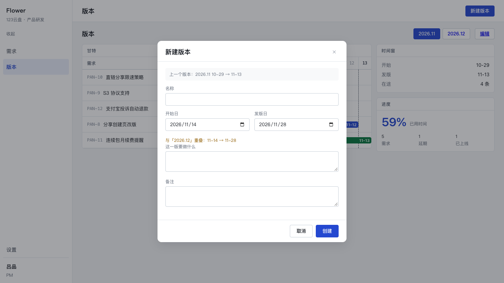
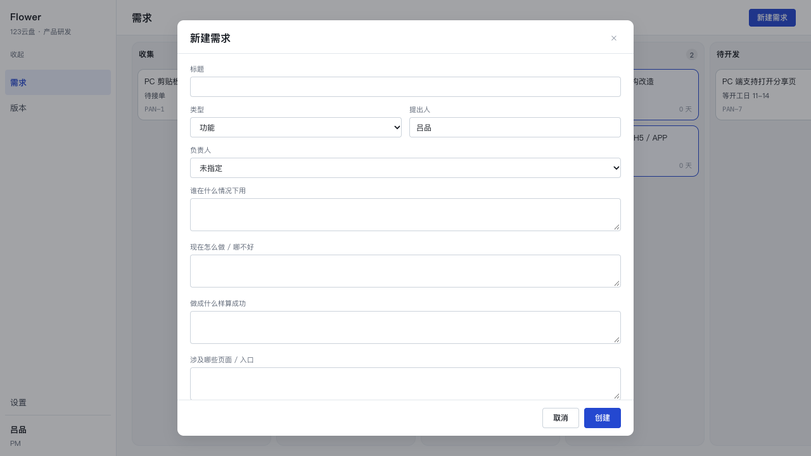
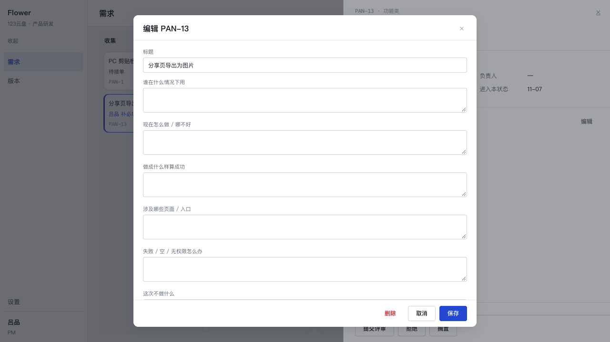
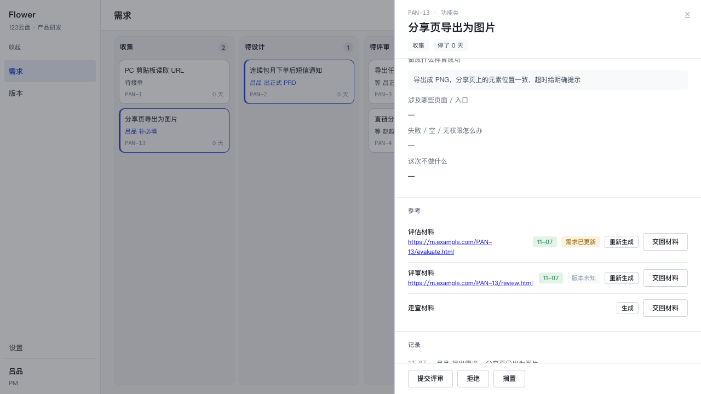
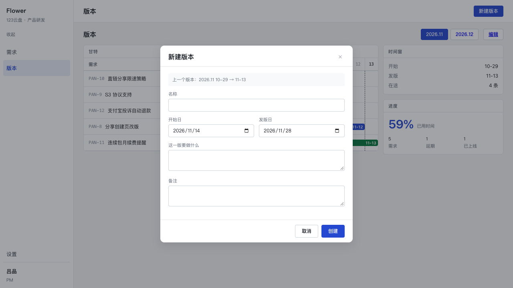
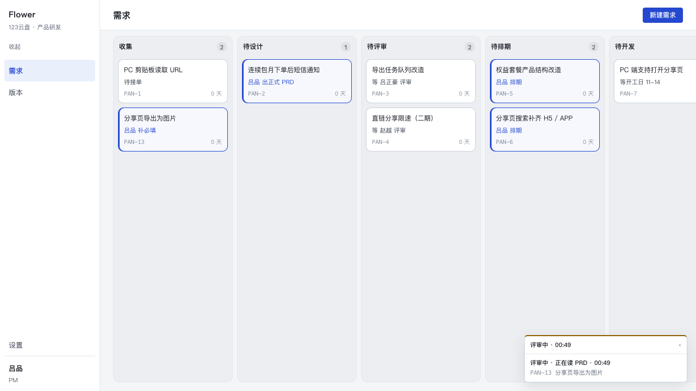
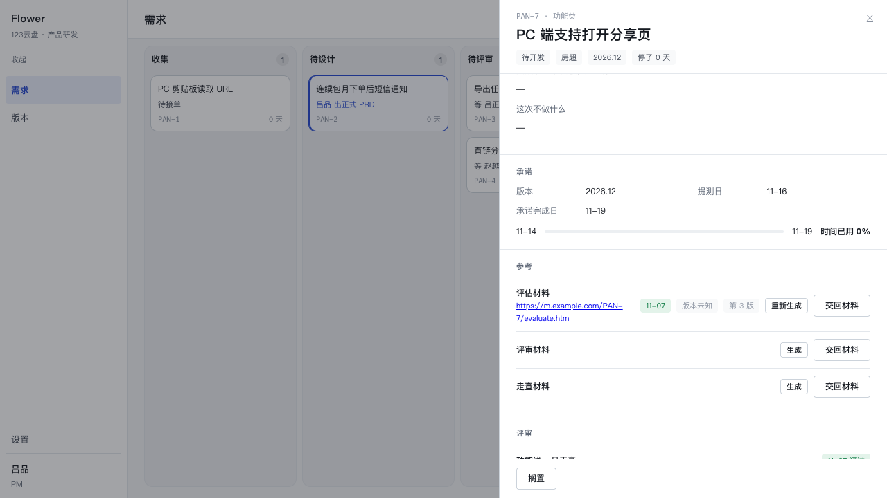

# P4.2 录入面：需求的六问、版本 CRUD、新鲜度、进度卡

日期：2026-11-07　分支：`main`（`192fd0a` 起）　工作目录：`/Users/silas/flowers`

一句话：**让人能把「这条需求到底要做什么」写进库里，并且让每一份材料知道自己是照着
哪一版描述生成的。** 这一版不碰状态机（六个动作一个字没改），只在它前后各加一件事——
前面是录入，后面是「这份材料还作不作数」。

```
src/db/migrations/0010_entry.sql        requirements 六问 + deleted_at；releases goal/note/deleted_at；artifacts input_hash
src/core/requirements/fields.ts         六问的标签 / 列名 / 策略提示（零依赖，客户端也用）
src/core/requirements/fingerprint.ts    内容指纹 + 三态判定
src/core/requirements/manage.ts         updateRequirement / deleteRequirement
src/core/releases/manage.ts             版本的增删改 + 「上一个版本」（上下文）+ 重叠检测（扫全部活版本）
src/core/releases/window.ts             时间窗的纯函数：overlapOf / pickOverlapping / 两句文案（服务层与表单共用）
src/core/read/{detail,board,version}.ts 六问、新鲜度、软删除过滤
src/core/read/{progress,elapsed}.ts     在跑的作业 → 进度卡（中文阶段 + 秒数）
app/components/{RequirementForm,ReleaseForm,ProgressCard,TopbarActions}.tsx
app/{page,releases/page,actions}.ts(x)  两块录入入口 + 七个 server action
tests/entry.test.ts                     38 条用例
```

三个 commit：`00b24c2`（迁移 + 服务层 + 用例）、`d9ee8ff`（UI）、本条裁决的修订见最后一个 commit。

## 1. 六个问题，以及「什么时候算缺」

| 字段 | 界面上的问句 | 缺失的后果（提示语） |
| --- | --- | --- |
| `context` | 谁在什么情况下用 | 没有它，模型编不出角色和入口 |
| `problem` | 现在怎么做 / 哪不好 | —（少一点背景，不会画错） |
| `outcome` | 做成什么样算成功 | 没有它，边界和异常只能靠猜；**商业需求**换成「没有成功口径，评审过不了」 |
| `surfaces` | 涉及哪些页面 / 入口 | 没有它，流程图会画出不存在的页面 |
| `edge_cases` | 失败 / 空 / 无权限怎么办 | — |
| `out_of_scope` | 这次不做什么 | — |

「什么时候算缺」= `trim()` 之后为空（与指纹的归一一致）。**只有三问有提示**，因为只有
它们各自对应生成链路上一个会直接画错的地方：`surfaces` 缺 → 图里凭空长出页面；
`outcome` 缺 → 边界与异常全靠猜；`context` 缺 → 角色与入口靠猜。另外三问空着只是
信息少一点，不提示。

**为什么六问全可空**：真实的需求常常先建一条再补描述；六问做成必填只会逼人在每一格
里填「无」，而「无」比空着更坏——它看起来像有内容。所以新建只要标题 / 类型 / 提出人，
六问「鼓励写」。库里的列也因此是 `text` 可空：历史行没有它们，加非空列就得回填一个
假值。

## 2. 指纹规则（`requirementFingerprint`）

对 **title + 六问 + prdUrl** 八个数做 sha256。序列化是「固定顺序的字符串数组 +
`JSON.stringify`」：

1. **顺序固定**（`FINGERPRINT_FIELDS`）：用数组不用对象，键序就与调用方无关。
2. **归一**：`null` / `undefined` → `''`；`trim()`；`\r\n` → `\n`。
   **null 与 '' 必须同哈希**——库里是 null（历史行），界面上空 textarea 提交的是 ''；
   两者是同一件事（「这一问没写」）。若不同哈希，「打开表单、什么都不改、保存」会把
   所有产物打成「需求已更新」，一次纯粹的无操作制造一场假警报。
3. **用 JSON 而不是拼接**：拼接会让 `['ab','c']` 与 `['a','bc']` 撞哈希——即「真的改了
   描述」却不变旧。
4. 输出 64 位小写十六进制。

不参与：`type` / `requester` / `number` / `state` / 排期日期。`state` 每走一步都会变，
算进去的话产物会在需求进入下一个状态那一刻全部变旧，而描述一个字都没改。

**指纹在读需求的那一刻取，不在 attach 时现算。** 生成跑 2–3 分钟，中途有人改描述是
常态；attach 时现算会把「照旧版做的」记成「照新版做的」。所以四个生成入口
（`compose` / `review` / `inspect` / `start` 的 CLI 那条路）各自在 `loadRequirement`
之后算一次，一路带到 `attachArtifact`。拿不到就存 null——**绝不编一个**，形状不对
（不是 64 位 hex）直接拒（`invalid_hash`）。

## 3. 三态

| 库里 | 界面 | 说明 |
| --- | --- | --- |
| 等于当前指纹 | （不显示） | 产物还是照这份描述做的 |
| 不等于 | `需求已更新` | 描述变了，产物没重做 |
| null | `版本未知` | P4.2 之前的产物，或绕过生成器直接 attach 的（MCP 交的材料） |

**没有第三句话**：这两个是标签，不是段落（任务书的「labels only」）。三态是算出来的、
不存第二遍——所以「编辑保存后产物自己变旧」不需要任何额外写入，刷新即成立。

## 4. 策略提示（userask 要带上上下文）

六问那四句是这一版**唯一允许出现在屏幕上的解释性文字**，每条都是一行、都只在
「空着且离开过那个框」时出现（一打开就红一片等于把六问变成必填）。

版本的策略在表单**顶上**：`上一个版本：2026.11 10-29 → 11-13`（没有版本时
`还没有版本，这是第一个`）。owner 的原话是「新建版本时告诉最近一个版本是几号到几号」
——填这一版的时间窗时，唯一必须知道又不在屏上的事实就是它。

## 5. 版本重叠：两个定义，别合成一个

owner 的裁决（2026-11-07）：**「上一个版本」和「重叠检测」是两件事。**

| | 用途 | 取值 |
| --- | --- | --- |
| 「上一个版本」 | **帮我补日期**的上下文 | 发版日 ≤ 这一版发版日的活版本里最近的那一个（`release_date desc` 取第一条；编辑时排除自己） |
| 重叠命中 | **防撞车** | 扫**全部**活着的版本（`deleted_at is null`），取与这一版时间窗相交、**发版日离这一版最近**的那一条 |

第一版按「只看上一个版本」实现，漏报了一个真实情形：现网要建的 2026.13
（11-14 → 11-28）与种子里的 2026.12（11-14 → 12-07）真的重叠着，而 2026.12 的发版日
在这一版之后——按「上一个版本」的定义根本看不见它。**这就是两个定义必须分开的证据。**
现在同一个表单上两句话同时出现，说的不是同一件事：



（`上一个版本：2026.11 10-29 → 11-13`，而 `与「2026.12」重叠：11-14 → 11-28`。）

其余三条规则没变：

- 半开区间 `[windowStart, releaseDate)`：上一版 11-15 发版、这一版 11-15 开窗**不算
  重叠**——那是正常排法，警它一下只会让人把日期改成 11-16。
- 重叠只产生一行警告，**库里照存**。真实世界里「这一版拖到下一版开窗日」是常态，
  做成硬约束只会逼人把日期填错。
- 同一个函数产出同一句话：服务层返回的 `warning`、界面敲日期时的行内提示，都走
  `window.ts` 的 `pickOverlapping` + `overlapLine`（客户端与服务端共用一份判定；
  `candidates` 由页面把**全部活版本**传给表单，用户改日期时本地重算）。
- 新建的**默认窗口接着上一版往后排**（上一版发版日次日 → +14 天）。第一版做的时候
  默认是「今天起两周」，在今天正好压在 2026.11 身上，一打开表单就顶着一行警告——
  那不是用户的问题，是默认值不对。

## 6. 截图

新建需求（标题 / 类型 / 提出人 / 负责人 + 六问；六问可空）：



编辑描述（只有标题 + 六问，没有类型 / 提出人 / 负责人）：



改完「成功口径」保存回来，产物那两行自己变了（`需求已更新` / `版本未知`），时间轴
多一条「更新描述 · 成功口径」：



新建版本（顶上那行策略；默认窗口接着 2026.11 往后排）：



右下角的进度卡（`评审中 · 正在读 PRD · 00:49`，可折叠，点一行进那条需求）：



## 7. 几个决定与它们的理由

**`updateRequirement` 对 `type` / `requester` / `state` 报错，而不是静默忽略。**
静默丢字段的后果是调用方以为改了：MCP 的 agent 会拿着「成功」回去写下一条需求，
人会在看板上找不到自己刚选的「商业」。一个明确的 `not_editable` 比一次安静的失败便宜。

**事件只记「改了哪几个字段」**（`{field, label, from, to}`，每个值截到 80 字）。
时间轴要回答的是「描述什么时候被谁改过、改了哪一问」，不是把整段新描述再存一遍——
那会让 `events` 变成需求的第二份正文。**没有变化就没有事件**（`changed: []`）：
一次原样保存不该污染时间轴。锁行（`for update`）让两行「旧值 → 新值」能串成一条链。

**软删除只打时间戳。** `events` / `uemaster_artifacts` / `uemaster_jobs` /
`prd_snapshots` / `review_assignments` 五处都指向这一行：硬删要么被外键拦住，要么把
「谁在哪天承诺了什么」一起删掉——而那条审计线是这个系统的全部价值。删除之后：
看板没有它、抽屉打不开、版本页的甘特没有它、时钟不再推进它、进度卡不显示它。

**在跑作业的命运**（任务书要求说清楚）：软删**不掐 worker**（它活在另一个 detached
进程里，`kill` 也拦不住已经发出去的 CLI）。它跑完之后 `attachArtifact` 会因为
`deleted_at is null` 而失败，错误原文落进 `uemaster_jobs.error`；产物一行都不会写，
状态也不会被推进。进度卡立刻不再显示它（读侧 join 带同一个过滤）。恢复（改
`deleted_at` 回 null）之后，已经写下的资产照旧可用——但那次作业仍然是 failed。

**软删版本不解除需求的 `release_id`。** 那条需求的排期是历史事实，不该因为版本行被删
就变空。读侧靠 join 上 `rel.deleted_at is null` 让版本名、开工日一起消失（卡片变成
「缺开工日」）。也没有「还有需求挂着就不许删」这道拦截：owner 要的是兜底，而拦在中间
会让「建错了一个版本」变成「先去把三条需求挪走」。

## 8. 「这是第几版」

`uemaster_artifacts` 里同一 (需求, 阶段) 有几行就是几版——读侧仍然只认最新一行，
但「我在覆盖第几版」是按下「重新生成」之前就该知道的事。所以多一个数字：

- 抽屉那一行在 `present && versions > 1` 时多一个 `第 3 版` pill；
- 生成按钮的悬停警告带上同一个数字：`已有一份旧版本的产物；这次会存成第 4 版（共 3 版）`。



一个数字而不是一句话：屏幕上的解释性文字仍然只有那四句策略提示（labels-only）。
SQL 上它是一次 `count(*) over (partition by stage)` 与 `distinct on` 同查——PG 的求值
顺序是 窗口函数 → DISTINCT，所以窗口数的是整组行数，`distinct on` 随后只留一行。

## 9. 还没做好的地方

1. **补录更早的版本时那句策略会说谎**：如果新建的这一版比所有现存版本都早，
   `previousRelease` 返回 null，界面说「还没有版本，这是第一个」，而其实后面还有版本。
   （重叠检测不受影响：它扫全部活版本。）
2. **「重新生成」的警告仍然是一句 `title`**（鼠标悬停才出现）。版本数已经有个可见的
   pill，但「已有一份当前版本的材料」这句话本身还是只在悬停里。
3. **删除是两步确认**（按钮文字从「删除」变「真的删除」），没有确认框。
4. **MCP 交的材料一律是「版本未知」——这是事实，不是缺陷**（owner 2026-11-07 确认）：
   MCP 的 agent 不该拿到内部指纹，读侧也不替它猜。它如实显示为 `版本未知`。
5. **六问在抽屉里是固定的六行**，空的是六个破折号——长需求下这一段落占掉抽屉首屏
   一半。没有做折叠，因为折叠会让「没写」这件事看不出来。
6. **`?new=1` 会丢掉当前打开的抽屉**（它是顶层对话框，取代 `?open=`）。抽屉开着
   点顶栏「新建需求」，回来要重新点那张卡。（记着，不在这一版里改。）
7. 进度卡只说「在哪一段」，没有「还剩多少」——`uemaster_jobs` 里没有进度百分比，
   也不该编一个（六档 phase 不等长）。
