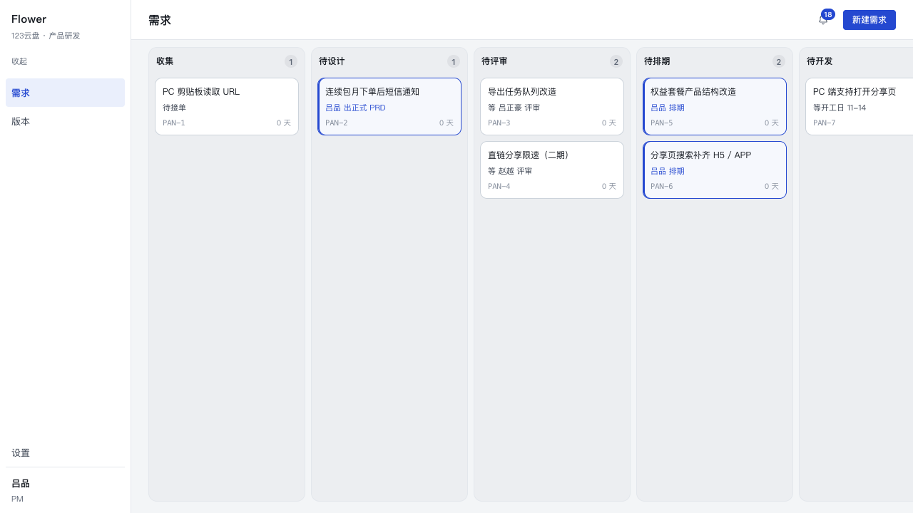
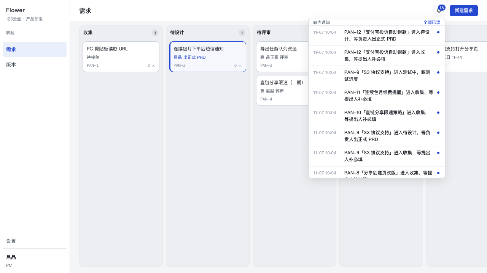
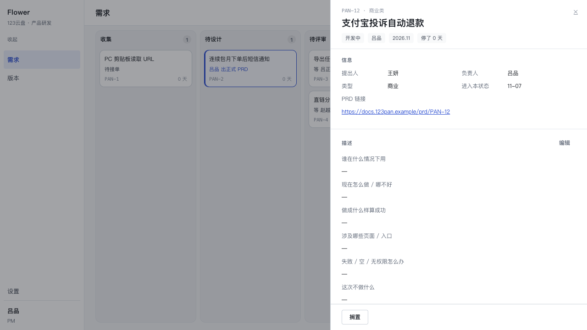
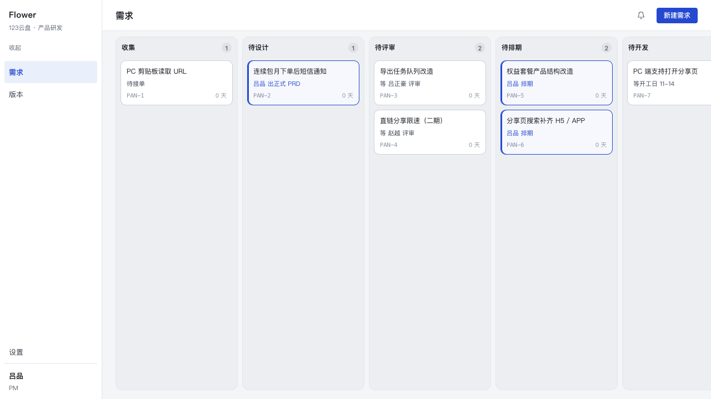
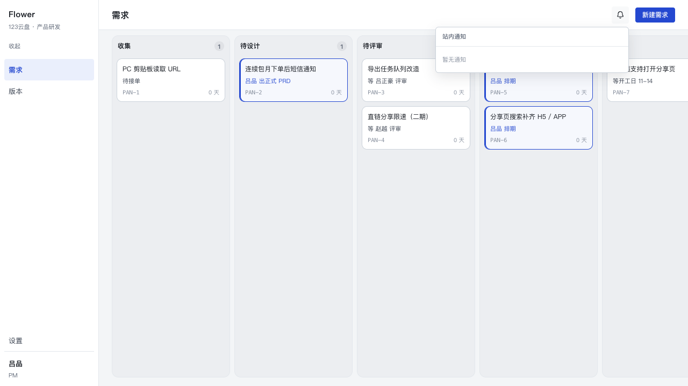

# P4-03 · 站内通知（「找过我的」）

**状态**：完成。`notificationsFor` / `markRead` 落在 `src/core/read/notify.ts`，迁移
`0011_notification_reads`，顶栏铃铛在 `app/components/NotifyBell.tsx`。

## 1. 设计：派生，不落库

```
events（已有） ──派生──▶ 「这条事件该通知谁」
notification_reads(member_id, last_seq) ──只记每个人读到哪一格
```

没有通知表。历史是免费的：第一次打开的人看到的是所有曾经点到他的事件，因为投影发生
在读的那一刻。也没有第二份副本可以漂移——规则改了，旧事件按新规则重新解释。这是刻意
的取舍：宁可让历史换一种说法，也不要让库里躺着一份永远对不上的影子。

## 2. 派生表（事件 type → 观众 → 怎么判断）

类型串全部来自代码（`grep recordEvent`），不是从 spec 反推的。

| 事件 type | 写入方 | 观众 | 判断依据 | 行进文案 |
|---|---|---|---|---|
| `requirement.created` | `requirements/create.ts`（进入收集） | 提出人 + 全部 PM | `r.requester` 是**自由文本**，按 `members.name` 精确同名匹配；PM 是 `role='pm'` | `PAN-n「标题」进入收集，等提出人补必填` |
| `requirement.evaluated` | `requirements/evaluate.ts`（inbox→design） | 负责人 | `r.owner_member_id` | `…进入待设计，等负责人出正式 PRD` |
| `requirement.review_requested` | `submit-review.ts` + `review.ts` 的 `assignReviewer`（→review） | 派单的评审人 | `review_assignments` 里**覆盖这条事件时刻**的那一行（见下） | `…进入待评审，等你签字` |
| `requirement.review_rejected` | `review.ts`（review→design） | 负责人 | `r.owner_member_id` | `…评审打回：<原因>，改完再提交` |
| `requirement.auto_test` | `clock/tick.ts`（dev→test 的时钟边） | 负责人 | `r.owner_member_id` | `…进入测试中，跟测试进度` |
| `requirement.bounced` | `requirements/bounce.ts`（test→dev） | 负责人 | `r.owner_member_id` | `…被打回开发中，新承诺 <日期>` |

**没有站内观众的类型，一条都不产生**：`requirement.scheduled`、`review_passed`、
`auto_dev`、`auto_live`、`updated`、`deleted`、`rejected`、`shelved`、`restored`、
`uemaster.attached`、`prd.fetched`、`release.created/updated/deleted`。用例
`没有站内观众的事件类型一条都不产生` 对五个人逐个断言这些类型不出现。

三处细节：

1. **待评审不是「当前 handed 派单」**。打回后重新提交会再派一次单，同一条需求有多行；
   读「现在 handed 的那一行」会把第一轮的 `review_requested` 安到第二轮的评审人头上。
   `review_assignments` 没有 `created_at`，所以「覆盖事件时刻」的定义是：
   `decided_at is null or decided_at >= e.at` 里 `decided_at` 最早的那一行
   （未收口 = null 排最后，说明它覆盖的是最新那一轮）。取不到 → **没有观众**：数据
   损坏时宁可不通知，也不猜一个收件人。用例 `打回后重新提交：两轮 review_requested
   都归同一个派单评审人` 钉住这条。
2. **「进入测试中」只发负责人**。spec §8 写的是「负责人 + 测试」，但数据模型里没有
   测试角色（`members.role` 只有 `pm` / `commercial_reviewer` / `feature_reviewer`）。
   这里不发明一个角色，也不把它塞给评审人；等角色真的出现时改的是这一条谓词。
3. **提出人是自由文本**。重名 → 名册里同名的每个人都收到（姓名是唯一可用的键，挑一个
   等于替现实做决定）；一个都对不上 → 只有 PM 收到（spec 那一行是「提出人 + PM」，
   PM 那一半仍然成立）。重名与查无此人都不抛错。
4. **已删除的需求整条不出现**：通知行唯一的动作是打开抽屉，而抽屉对一条已删除的需求
   什么也打不开。宁可少一行，不留一个死链接。

spec §8 里其余五行（进入待设计 / 待评审 / 评审打回 / 自动上线 / 打回开发中）标的是
**企微**渠道。本任务只做站内投影，没有任何推送通道；这几条在站内也能看到，是因为
派生规则与渠道无关，而企微是另一个任务。

## 3. 为什么已读是「每人一个 seq 水位线」，不是「每条一个已读标记」

通知是派生出来的，**它没有 id**：每次读都是一次投影，规则一改，同一条事件的「第几条
通知」就会变。`events.seq` 是这条流里唯一稳定的身份（单调、由序列分配、不回退），
所以已读只能以它为坐标。

`notification_reads(member_id pk, last_seq, updated_at)`：读 = `seq <= last_seq`。

- 一个人一行、一次 upsert。每人第一次打开时没有行，`coalesce(last_seq, 0)` 就是
  「全部未读」——新成员看到全部历史，不需要回填。
- 如果按 (member, event) 存行，那是把派生结果物化：规则变了会留下一半指向不再存在的
  通知的行，而且每次打开要写 N 行、每次计数要集合差。
- 未读数与列表共用同一个谓词（`addressed()`），所以「红点 3 条、点开只有 2 条」这种
  分叉不可能出现；未读数不受 `limit` 截断，它数的是全部。

夹取写在 `markRead` 里，两处：`least(请求值, max(events.seq))` 然后
`greatest(旧值, 那个值)`。上界是**实质**的：一个比事件流还大的值如果被原样存下，之后
所有新事件都落在水位线后面，红点永远不再亮——一个不会响的通知比没有通知更坏。单调
不回退：回头点一条更旧的通知不该让已读倒退。

## 4. 点较新的一行，语义是什么（以及为什么接受它）

点一行 → 水位线推到**那一行的 seq**，不是「全部」，也不是「最新」。

水位线只有「到这里为止」，表达不了**洞**。所以点到较新的一行时，更早的那些也会一起算
作已读——这是「读到这里」的定义，而不是 bug。要「点新的、旧的仍然未读」必须把已读
变成 per-notice 的行，那与本节开头那条设计决定冲突（派生物没有 id）。接受它的理由：

- 面板一次显示 30 条，点较新一行的人已经在列表里看过更早的那几条；
- 它让未读数保持一个整数，不需要集合差，也让「全部已读」有确定的含义；
- 回头点一条更旧的通知不会把水位线往回推（`greatest`），所以「已读」不会倒退。

「全部已读」推到**最新一条点到我的事件**（`latestNoticeSeq`），不是当前这一页的最后
一条：feed 有上限，用页尾当水位线会让点完「全部已读」之后红点仍然亮着——第 31 条只是
没被渲染，它依然未读。

## 5. 界面

顶栏「需求」页：铃铛在「新建需求」左边，未读角标为 0 时不渲染。点开是锚在下拉的面板
（360px，列表自己滚），行 = 时间（`MM-DD HH:mm`，固定 +08:00 折算，不用 `Intl`：
服务端与浏览器会给不同的字符串，水合对不上）· 一句话（编号在句子里，不重复放第二列）
· 未读点。空状态一行字。点一行 → 关面板、开 `/?open=<uuid>` 的抽屉、把水位线推到那一
行。轮询 30 秒（`ProgressCard` 的 `setInterval` + server action 模式），没有 websocket。











## 6. 验证

- `npx tsc --noEmit` 干净。
- `npx vitest run`：713 passed / 1 skipped（基线 694 + 本任务的 19）。
- `npm run build` 通过。
- `tests/notify.test.ts` 覆盖：六条规则各断言「该收到的人有 + 不该收到的人没有」、
  无观众类型一条都不产生、已删除需求消失、未读数学（水位线中间 / 不回退 / 大于最新 /
  负数 / NaN / 每人独立 / 无通知为空数组）、提出人三种解析（匹配 / 查无此人 / 重名）、
  排序与 `limit`。

## 7. 还不好的地方

- **水位线没有洞**，见 §4。取舍已写明，但「只读新的、旧的还亮着」这个诉求它给不了。
- **`events` 没有索引**。feed 与未读数各是一条 `events` 全表扫 + 每行一个相关子查询
  （`review_assignments` 覆盖行、`members` 同名校验）。现在是几百行，十万级要
  `events(type)` 或 `(requirement_id, type)`。
- **提出人是自由文本带来的两个后果**：重名两人都收；某人改名之后，他的名字在旧需求上
  的历史通知会归到「现在叫这个名字的人」——因为解析发生在读的时刻，不是快照。
- **已删除需求的历史通知消失**，见 §2 第 4 条。
- **「进入测试中」缺测试角色**，见 §2 第 2 条。
- **面板只有最近 30 条**，没有「看更早」。更早的历史只能从看板 / 抽屉时间轴看。
- **铃铛只在 `/` 出现**（`usePathname()` 判断，因为通知的落点全是需求抽屉）；布局为
  每一页都多读两次（列表 + 未读），layout 拿不到 pathname，省不掉。
- **后台标签页的 30 秒轮询会被浏览器节流**，回来时不是立刻，而是下一次 tick。
- **`resetDb` 与打开着的页面并发时可能死锁**（实测一次）：truncate 需要
  `notification_reads` / `members` 的排他锁，而布局的首帧与轮询在同时读它们。跑
  `seed --reset` / 用例之前先关掉打开的页面。
