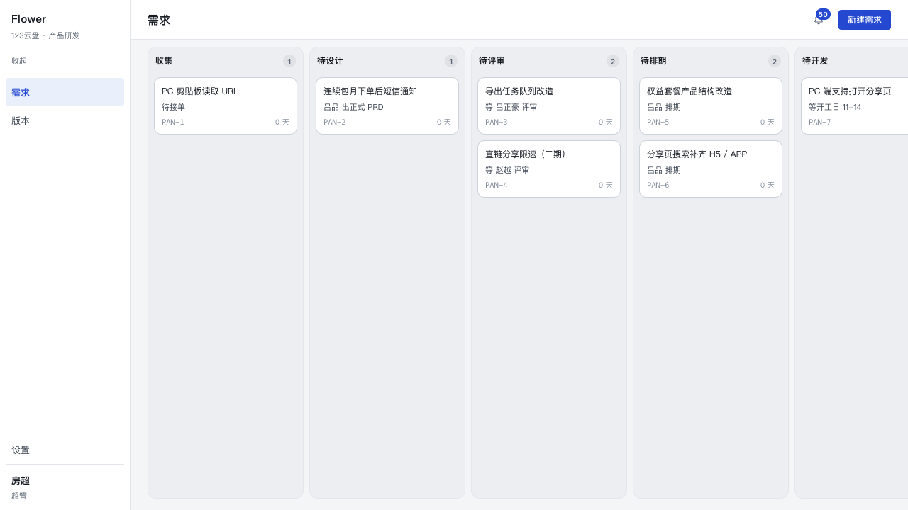

# P4-04 登录 · 角色 · 权限（基础半）

> 目标：把「谁能改什么」从**界面上的按钮**变成**服务层的规则**——页面、MCP、脚本、
> 用例走同一条路，绕不过去。这一版只交付规则与登录页，界面（负责人转交表单、通知偏好、
> 按钮可见性）留给第二个 worker。

- 分支 `main`，起点 `e359a02`
- 迁移 `src/db/migrations/0012_auth.sql`（`members` 加 5 列 + 2 个 CHECK + 1 个唯一索引）
- 新增 `src/core/auth/*`、`src/core/members/manage.ts`、`src/core/requirements/assign.ts`、
  `app/login/*`、`app/components/Shell.tsx`、`proxy.ts`、`tests/auth.test.ts`

---

## 1. 角色表（真正的七个人）

`members.role` 是权限的唯一来源；`members.line` 是**人的属性**（PM 也有条线），
只用于展示、建人、以及「转交只能在本线内」。两列同时存在时 **role 是权威**——
即使有人把某个 PM 的 line 改错，权限也不会跟着变。

| 名字 | role | 中文 | line | 能做什么 |
|---|---|---|---|---|
| 房超 | `product_owner` | 超管 / 产品总负责人 | — | 一切：改任何需求、转交任何负责人、管理成员、评审任何一条、收**全部**通知 |
| 吕正豪 | `feature_reviewer` | 功能线负责人 | feature | 改**功能线**任何需求、在本线内转交负责人、评审本线需求、收本线全部通知 |
| 赵越 | `commercial_reviewer` | 商业线负责人 | commercial | 同上，商业线 |
| 吕品 | `pm` | PM | feature | 只改**自己负责**的需求；评审动作对他**不存在** |
| 李嘉 | `pm` | PM | feature | 同上 |
| 罗丹 | `pm` | PM | commercial | 同上 |
| 王妍 | `pm` | PM | commercial | 同上 |

`src/core/auth/roles.ts` 里另外两张表是**唯一**映射：

```ts
LINE_OF_TYPE = { feature: 'feature', commercial: 'commercial' }
ROLE_OF_LINE = { feature: 'feature_reviewer', commercial: 'commercial_reviewer' }
```

`src/core/requirements/review.ts` 的派单（`assignReviewer`）现在从这里取 `reviewerRoleOf(type)`，
不再自带一份 `REVIEWER_ROLE`——「类型 → 找谁签字」只有一处答案。

### 规则对照

| 规则 | 落点 |
|---|---|
| 1. 录入即负责人 | `createRequirement` 的 `resolveOwner()`：不传 / 传 null（非超管）⇒ 负责人 = actor；传给别人的 id ⇒ 要 `reassignOwner`（超管，或本线负责人；本线负责人只能交给本线的人） |
| 2. 只有条线负责人和超管是评审人 | `can(..., 'review')`；PM 的 `review` 恒为 false。界面上「评审动作对 PM 不存在」由第二个 worker 接（`actionsFor` 需要看人），服务层已经先关死 |
| 3. 拒绝 / 搁置 | `rejectRequirement` / `shelveRequirement` 用 `edit`（负责人 / 条线负责人 / 超管三档）；通知在**读侧**扇出（`notify.ts`），写路径只写一条事件 |
| 4. 「我的」是筛选视图 | 没有任何一处挡住读：`getBoard` / `getRequirementDetail` / `listReleases` 一行没改 |
| 5. token 权限 = 绑定账号的权限 | token 只决定 `actor`；规则全部在服务层，MCP 没有第二条路（见 §8） |

---

## 2. `can()` 真值表

签名（唯一的判断题，全部调用方都用它）：

```ts
export type Ability = 'edit' | 'review' | 'reassignOwner' | 'admin' | 'manageMembers';
export function can(actor: Member, req: RequirementFacts, ability: Ability): boolean
// RequirementFacts = { type, ownerMemberId, state?, reviewerMemberId? }
```

三种需求（都停在 `review`）：

- `own`：功能，负责人 **吕品**（PM·功能线），派单 **吕正豪**
- `featureOther`：功能，负责人 **李嘉**（PM·功能线），派单 **吕正豪**
- `commercial`：商业，负责人 **罗丹**（PM·商业线），派单 **赵越**

`tests/auth.test.ts` 的 `TABLE` 逐格断言下面这张表（39 行，一行不少）：

| 演员 | ability | own | featureOther | commercial |
|---|---|---|---|---|
| 房超（超管） | admin | ✅ | ✅ | ✅ |
| | manageMembers | ✅ | ✅ | ✅ |
| | edit | ✅ | ✅ | ✅ |
| | review | ✅ | ✅ | ✅ |
| | reassignOwner | ✅ | ✅ | ✅ |
| 吕正豪（功能线） | admin / manageMembers | ❌ | ❌ | ❌ |
| | edit | ✅ | ✅ | ❌ |
| | review | ✅ | ✅ | ❌ |
| | reassignOwner | ✅ | ✅ | ❌ |
| 赵越（商业线） | admin / manageMembers | ❌ | ❌ | ❌ |
| | edit | ❌ | ❌ | ✅ |
| | review | ❌ | ❌ | ✅ |
| | reassignOwner | ❌ | ❌ | ✅ |
| 吕品（PM，own 是自己的） | edit | ✅ | ❌ | ❌ |
| | review / reassignOwner / admin / manageMembers | ❌ | ❌ | ❌ |
| 李嘉（PM，own 是别人的） | edit | ❌ | ✅ | ❌ |

`review` 的三条附加条件（表外单测）：

| 情形 | 结果 |
|---|---|
| 状态不是 `review`（inbox / queue…） | ❌（连超管也 ❌——状态门对所有人成立） |
| 派单是别人（同一条线配两个人） | ❌ |
| 还没有派单 | ✅（本线负责人；否则一条派单丢了的会永远签不了） |
| 超管 + 派单是别人 | ✅（不受派单限制，但仍受状态限制） |

另外一格常被写错：**停用的人什么都不行**（`actor.deactivatedAt != null ⇒ false`），
哪怕 `role` 还写着 `pm`。放在 `can()` 最前面，是因为它是唯一一个「角色看着还行、
人已经不该动任何东西」的状态。

### 拒绝的形状

```ts
new AppError('forbidden', '你只能改自己负责的需求')   // edit
new AppError('forbidden', '只有条线负责人和超管可以转交负责人')  // reassignOwner
new AppError('forbidden', '只有超管可以管理成员')       // manageMembers
new AppError('forbidden', '只能把需求交给本线的人')     // 本线约束
new AppError('not_reviewer', '签字人不是这条需求派单到的评审人') // 评审（见下）
```

评审那一格刻意**不叫 `forbidden`**：`not_reviewer` 先于本模块存在，措辞更精确
（「去找该签的人」而不是「你没有权限」），而且 P1 的 R29 用例逐字钉着它。
这是全套权限里唯一一个例外，写在 `roles.ts` 的 `PermissionDenied` 注释里。

`not_found`（需求不存在）排在权限判断**之前**：一条没有的需求对任何人都是 404，
顺序反了会让错误码变成一次存在性探测。

---

## 3. 服务层落点（每一种写动作）

`assertCan(tx, actor, facts, ability)` 一律在**锁行之后、改数据之前**——锁住了才读得到
「这一行的负责人是谁」，也才不会在判完权限与写入之间被人插队。

| 服务 | ability | 说明 |
|---|---|---|
| `createRequirement` | `reassignOwner`（仅当指定别人） | 规则 1，见上 |
| `evaluate` | `edit` | |
| `submitReview` | `edit` | 权限先于 prd 门 |
| `reviewPass` / `reviewReject` | `review` | 替换了原来的 `assertReviewer` 里的手写比对；错误码/文案不变 |
| `schedule` | `edit` | |
| `bounce` | `edit` | |
| `rejectRequirement` / `shelveRequirement` / `restoreRequirement` | `edit` | |
| `updateRequirement` / `deleteRequirement` | `edit` | 改描述与删除同一条规则 |
| `reassignOwner`（新） | `reassignOwner` | 写 `requirement.owner_assigned` 事件；转给同一个人是空操作 |
| `createMember` / `updateMember` / `deactivateMember` / `resetPassword` | `manageMembers` | 只有超管 |
| `saveNotifyPrefs` | —（本人） | 改别人要 `manageMembers` |

`lockRequirement` 的 select 多了 `owner_member_id` 一列：权限判断读的是**库里的那一行**，
不是调用方口头说的。状态机（`src/core/state-machine.ts`）一行没动。

---

## 4. 会话：签名 cookie，为什么不是一张 `sessions` 表

```
flowers_session = v1.<base64url(name)>.<expEpochMs>.<base64url(HMAC-SHA256(secret, "v1.<name>.<exp>"))>
```

- HMAC-SHA256，密钥来自 `FLOWERS_SESSION_SECRET`；没有就生成 32 字节写进
  `data/.flowers-session-secret`（0600，不进 git）。
  **不写死默认密钥**：写死的就是公开的，任何人都能给任何名字签一个合法 cookie。
  也不每次启动随机：那会在 dev 热重载时把人踢下线几十次。
- 名字与过期时间**都在签名覆盖的串里**：改名字、把过期时间往后挪，签名都不成立。
- `httpOnly`（XSS 拿不到凭证本身）、`sameSite=lax`（跨站 POST 不带 cookie；点外链仍然登录）、
  生产环境 `secure`。TTL 12 小时。
- 比较用 `timingSafeEqual`；缺 / 空 / 分段不对 / 版本不对 / 过期 / 签名不符一律 `null`，
  不给试探者任何差异。

**为什么没有 `sessions` 表**：它要回答的只有「这个 cookie 是不是我们发的、发给了谁、
过期没」，三件事都在 cookie 里，验一次签名就有答案，不需要一次数据库往返。会话表还要
带来一张永远没人清理的表、以及「查表挂了怎么办」这个新问题。代价是撤销粒度只有
「换密钥 = 全部踢掉」——这一版没有「只踢掉某个人」的需求，而**停用成员**是另一件事：
`currentMemberRow()` 每次都确认这个人还在名册上、还没停用（见下）。等真有每会话撤销的
需求再加表，那时它才带来净收益。

### `currentMember()` 的解析顺序

1. **会话 cookie**（验得过签名，且那个人还在名册上、没停用）；
2. **`FLOWERS_ACTOR` 环境变量**（脚本 / 部署 / curl 冒烟）；
3. **名册里第一个超管**（`role='product_owner'`，`created_at, id` 序）；
4. 一个人都没有 ⇒ `AppError('no_member', '系统里还没有任何成员：请先跑 npm run seed 建人')`，
   登录页把这一句显示出来。

第 3 级替换掉了写死的 `DEFAULT_MEMBER = '吕品'`——owner 撞到的那个 bug（他是房超，
应用每次说他是吕品）。默认身份必须从库里来。

**一个必须防的坑**（这一轮最容易写错的一格）：会话签名有效，但那个人已被停用。
此时**不能**往下落到第 3 级——否则一个刚被停用的人，在他自己那个还没过期的 cookie 上
会**变成超管**。现在的实现：`currentMemberRow()` 抛 `session_invalid`，页面层用
`hasActiveSession()`（签名 + 人还活着）判门并重定向到 `/login`。

---

## 5. 口令

- `node:crypto` 的 `scrypt`（N=16384, r=8, p=1, keylen=64），每人 16 字节随机盐；
  存储串 `scrypt$N$r$p$<salt>$<hash>`——**参数写进串里**，将来调参不会让老行登录不了。
- 比较 `timingSafeEqual`；坏串 / 缺字段 / 参数非法一律「验不过」，不抛。
- 最短 8 位，中文：`密码至少 8 位`。
- 登录时「查无此人 / 已停用 / 没有口令」三条路都**照样跑一次 scrypt**（`burnDecoy`）：
  文案相同、延迟也相同。只堵文案不堵时间，等于没堵。
- 初始口令由种子生成、**只在 stdout 打印一次**；`resetPassword` 同样只把明文放在返回值里。
  库里任何时刻都只有 scrypt 串。

### 限速（数字就是约定）

- 同一个**名字**连续失败 **5** 次 ⇒ 这个名字被拒 **5 分钟**；
- 成功一次清零；
- 窗口从第 5 次失败起算，不滑动（封顶 5 分钟）；
- 被锁时**正确口令也进不去**（这是限速的意义）；5 分钟后再试就正常。

按名字而不是按 IP：办公室出口是一个 IP，按 IP 会误伤整栋楼。代价是「可以锁住任何一个人
5 分钟」——接受它（5 分钟、可重启清空）。计数只在进程内存里，**多实例部署时实际阈值是
5×实例数**，这一条写进「仍然粗糙」。

---

## 6. 成员管理（`src/core/members/manage.ts`）

- `createMember(name, role, line, password?)`：返回**一次**初始口令；登录名唯一（库上有
  `members_name_unique`）。
- `updateMember(memberId, role?, line?, active?, notifyPrefs?)`
- `deactivateMember`：**停用，不硬删**。三处外键（`requirements.owner_member_id`、
  `review_assignments.reviewer_member_id`、`mcp_tokens.member_id`）指着这一行，硬删会把
  审计线一起删掉。
  - **还占着需求的负责人停不掉**：`这个人还负责 N 条需求，先转交`（不静默把需求变成无主）；
  - 不能停自己；不能把最后一个超管停掉；
  - 顺手撤销他手里的全部 token；`listMembers()` 不再返回他；登录被拒（与密码错同一句）。
- 角色与条线的三条约束：超管无条线；负责人条线必须与角色对应；PM 也必须有条线。
- `resetPassword`：只有超管，返回一次新口令。
- `saveNotifyPrefs`：本人可改自己；改别人要超管。

**没做**：自改口令（用户自己改自己的密码）、邮件/短信、成员列表界面。见「仍然粗糙」。

---

## 7. 通知（`src/core/read/notify.ts`）

仍然是**派生**的（从 `events` 投影，不写第二份副本），只多了一条谓词分支：

| 观众 | 收什么 | 条件 |
|---|---|---|
| 超管 | 全部需求事件 | 排除自己做的事（`e.actor <> 我`） |
| 条线负责人 | `r.type` = 他那一线的全部事件 | 同上 |
| 原有观众 | 提出人 / 负责人 / 派单评审人 / 全部 PM（created） | 不变 |

`notify_prefs`：`null` 或 `{"inherit":true}` = 按角色默认；`{"inherit":false,"changed":false}`
才是真的关。两个开关：`changed`（全部变动）、`rejected`（拒绝 / 搁置，规则 3 单独一项）。
**关掉就是全关**——不给「只收重要的」做二次判断。

新增三种事件的中文行：`被拒绝：原因`、`被搁置：原因`、`负责人改成 X`。

---

## 8. MCP：token 的权限 = 绑定账号的权限（等价性证明）

链路只有一条：`Authorization: Bearer <token>` → `tokens.ts` 查出 `members.name` →
`mcp/services.ts` 把**这个名字**当 `actor` 传进服务函数（与页面调的是同一个函数）。
所以：

1. **scope 与角色正交**：scope 说「这个 token 能不能写」，角色说「这个人能不能写这一条」。
2. 没有任何一处让 MCP 绕过服务层——`mcp/tools.ts` 不写校验，`services.ts` 不吞异常。

实测（本次交付的库，token 绑在 PM 吕品身上、scope=write）：

```
$ curl -s -X POST http://127.0.0.1:3000/mcp -H "authorization: Bearer $TOKEN" ... \
    tools/call requirement_schedule PAN-3（负责人是王妍）
{"result":{"content":[{"type":"text","text":"你只能改自己负责的需求"}],"isError":true}, ...}
```

同一支 token 排自己的需求照常成功（`tests/auth.test.ts` 的
「同一个 token 改自己的需求就通」）。read token 更早一步被 scope 拦下
（`这个 token 的权限是「读」，调用 requirement_schedule 需要「写」权限`）。

`/mcp` 不进门（`proxy.ts` 的 matcher 排除了它）：Bearer token 本身就是身份，
让它依赖 cookie 等于要求 MCP 客户端先开一个浏览器。

---

## 9. 种子口令（本次交付的库里现在这一批）

`npm run seed -- --reset` 会在 **stdout 打印一次**下面这张表（每次重跑都会换一批新的
随机口令；库里只存 scrypt，永远拿不回明文）。下表与当前库一致：

| 名字 | 角色 | 条线 | 初始口令 |
|---|---|---|---|
| 房超 | `product_owner` | — | `nJUZCXZWNCZCnY` |
| 吕正豪 | `feature_reviewer` | feature | `aKYJ24Dit4jkLq` |
| 赵越 | `commercial_reviewer` | commercial | `rcDY6mzhjH3mHM` |
| 吕品 | `pm` | feature | `FesmVu8whYxxgZ` |
| 李嘉 | `pm` | feature | `iLXjkNmzJm4umt` |
| 罗丹 | `pm` | commercial | `GL6sVSTbHHxyib` |
| 王妍 | `pm` | commercial | `zGm5GipLMLDgat` |

> 换口令：超管在「设置 · 成员」里重置（`resetPassword`，同样只显示一次）。

---

## 10. 截图

登录页（两个字段 + 一个按钮，中文；页面**不渲染**左轨/顶栏——一个还没登录的人不该看到
「你现在是谁」）：


失败：未知用户与密码错是**同一句**：


登录后的看板：左轨底部身份是**房超 / 超管**（原来是写死的「吕品」）：



未登录访问 `/` 的实测：`307 → /login`；`/mcp` 无 token：`401`（不是重定向）。

---

## 11. 验证

| 项 | 结果 |
|---|---|
| `npx tsc --noEmit` | 干净 |
| `npx vitest run` | **853 passed / 1 skipped（854）**，31 个文件。基线 714（712 passed + 1 skipped，另有 1 条 `resetDb` 死锁的偶发失败，重跑即过） |
| `npm run build` | 通过；路由表含 `ƒ Proxy (Middleware)`、`ƒ /login` |
| `bash /tmp/restore-demo.sh` | `restored` |
| `can()` 真值表 | 39 行逐格 |
| 九种动作 × 四种身份 | `evaluate / submitReview / reviewPass / reviewReject / schedule / bounce / reject / shelve / restore`（外加 `update` / `delete` / `reassignOwner`，共 12 项）各 4 条：PM 改别人的 → 拒（评审是 `not_reviewer`，其余 `forbidden`）；负责人 / 条线负责人 / 超管 → 通过 |
| 评审门禁 | PM 在 review 状态也被拒；只有派单的人能签；另一条线的负责人也签不了 |
| MCP | PM 的 write token 排不了别人的需求（`isError` + 那句中文，库里状态不变）；自己的可以；read token 更早被 scope 拦 |
| 登录 | 未知用户 = 密码错（同 code 同文案）；5 次失败 → 锁 5 分钟（正确口令也拒）；成功清零；停用 = 同一句 |
| 会话 | 签发/验签往返；换密钥 / 改签名 / 过期 / 改过期时间 全不认 |
| `currentMember` 顺序 | 无会话无 env → 第一个超管（房超）；`FLOWERS_ACTOR` 优先；指到不存在的人 → `no_member`；空库 → `no_member` |
| 通知 | 条线负责人只收本线；超管两条线都收；关掉通知的超管收不到；只关 rejected 的仍收 changed |
| 成员管理 | 非超管一律 forbidden；还占着需求的停不掉（报 N 条）；停用后登录拒/不在名册/token 撤销 |

---

## 12. 仍然粗糙（按影响排序）

1. **限速是进程内的**。多实例部署时阈值变成 `5 × 实例数`，重启即清零。要修就得有一张表，
   而登录路径上多一次写库是一笔真成本——这一轮不做。
2. **撤销只有「全踢」**。会话是自包含签名 cookie，没有 per-session 撤销；停用成员这条
   例外之所以成立，是因为每次解析身份都查一次库（`hasActiveSession`）。
3. **成员管理与转交只有服务 + server action，没有界面**。表单、「删除 = 停用」的确认、
   重置口令后的一次性展示、PB 属于第二个 worker；`app/actions.ts` 里已经备好
   `createMemberAction / updateMemberAction / deactivateMemberAction / resetPasswordAction /
   reassignOwnerAction / saveNotifyPrefsAction / logoutAction`。
4. **`detail.ts` 的 `actionsFor(state)` 仍然只看状态、不看人**。界面上 PM 仍会看到
   「评审通过 / 打回」这类按钮（点了会被服务层拒）。第二个 worker 要把它改成
   `actionsFor(state) ∩ 允许的能力`，规则直接用 `can()`，不要再写一份判断。
5. **超管的铃铛很吵**。扇出规则是「每一条变更」，种子跑完红点是 50。可能需要一个
   「只看与我有关」的筛选（读侧的，不影响权限）。
6. **没有自改口令**。忘了只能找超管重置；`password_updated_at` 已经在记，但没有任何
   「强制过期 / 首次登录必须改」的机制。
7. **MCP 工具里没有转交负责人 / 成员管理**。这一轮只保证「已有的写工具都不如越权」，
   没扩工具面。
8. **条线与角色的一致性靠 `createMember/updateMember` 校验**，库上只有 `line in
   ('feature','commercial')` 这条 CHECK；「负责人角色的 line 必须匹配」是服务层规则，
   直连 SQL 能写出一行不一致的数据（权限不受影响——权限只看 role）。
9. **`FLOWERS_ACTOR` 是一条后门式的便利**：部署环境里设了它，所有无会话请求都是那个人。
   它不该出现在面向公网的部署里；这一条只写在代码注释与这里，没有启动时的告警。
