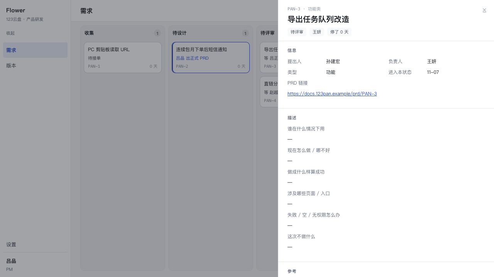
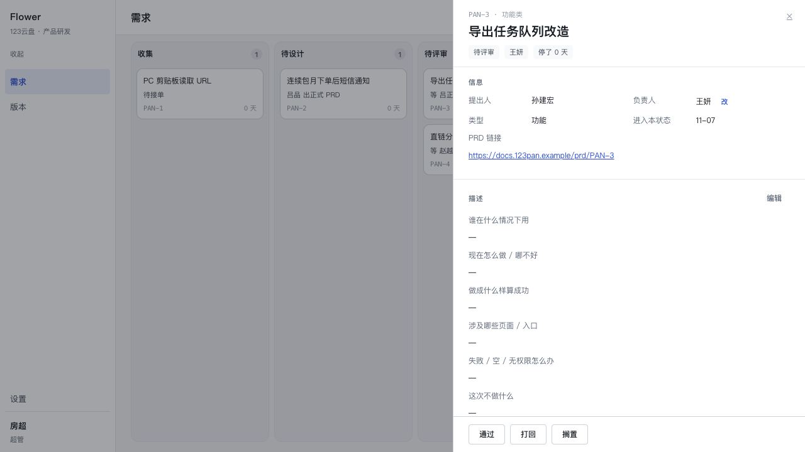
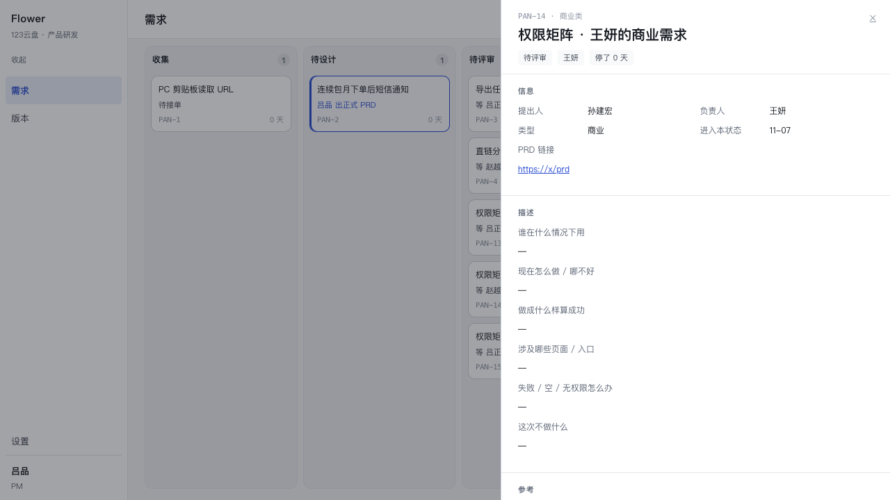
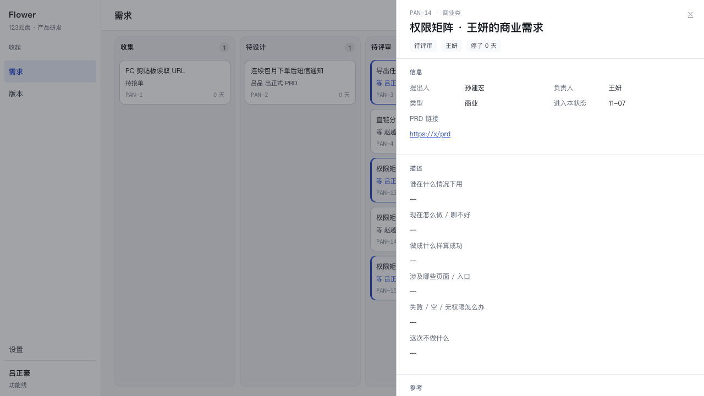
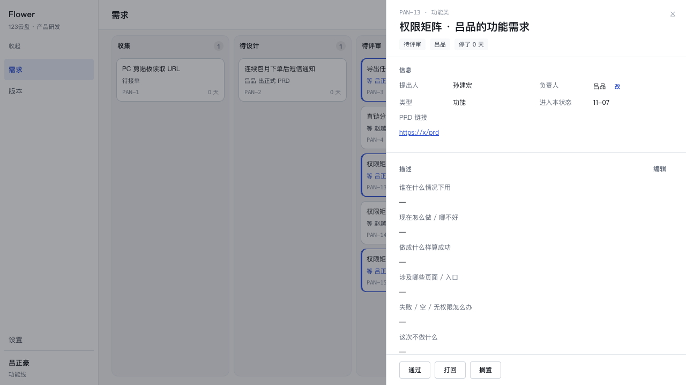
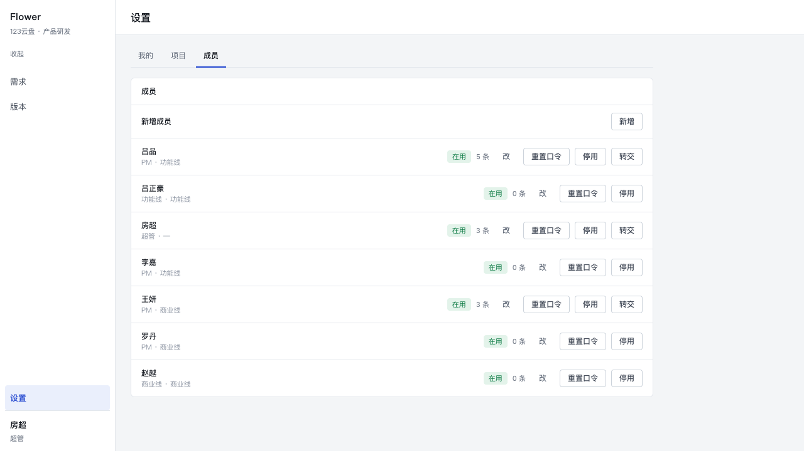
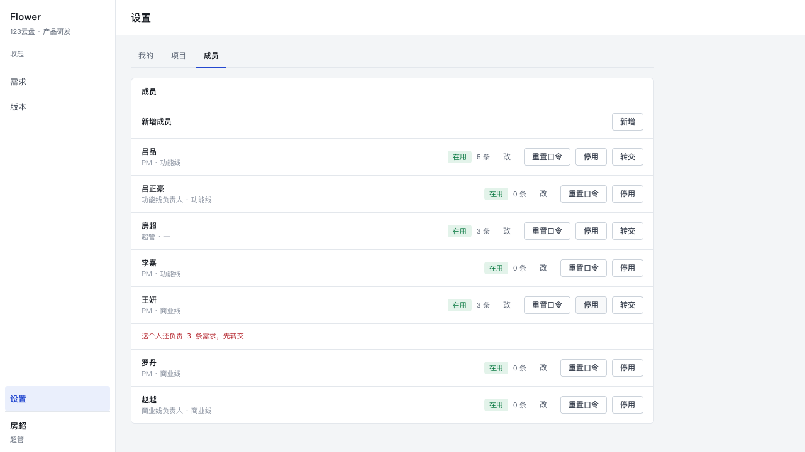
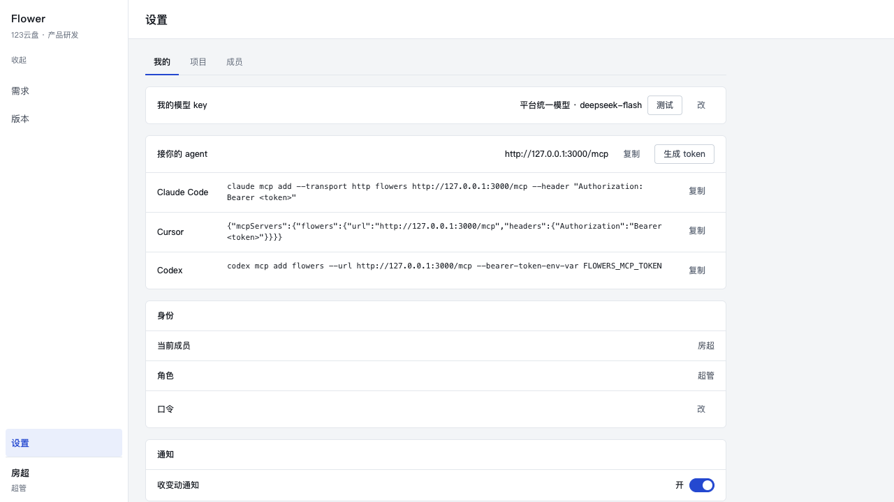

# P4-05 权限的界面那一半

> 目标：把「谁能做什么」从服务层的拒绝**前移到界面的可见性**——owner 的原话是
> 「别人连按钮都不出现」。规则仍然只有一份：`src/core/auth/roles.ts` 的 `can()`。
> 这一版没有新增任何权限分支，只把 `can()` 的结论接进抽屉、设置页与两个写入口
> （生成 / 交回材料）。

- 分支 `main`，起点 `7b6339a`
- 改动：`src/core/read/detail.ts`、`src/core/read/member.ts`、新增
  `src/core/read/member-admin.ts`、`app/password-change.ts`、`app/member-transfer.ts`、
  `app/page.tsx`、`app/actions.ts`、`app/components/{Drawer,OwnerPicker}.tsx`、
  `app/settings/{page,MemberAdmin,MeSecurity}.tsx`、两份 CSS
- 新增用例 `tests/permission-ui.test.ts`（13 条）
- 服务层、状态机、`src/core/auth/*` 一行未改

---

## 1. 交集规则

一处计算，两个消费者：

```ts
// src/core/read/detail.ts
export const ACTION_ABILITY: Record<DetailAction, Ability> = { … }   // 动作 → 要求的能力
export function visibleActions(state, actor, facts) {
  return actionsFor(state).filter((a) => can(actor, facts, ACTION_ABILITY[a]));
}
export function permissionsFor(actor, facts) { … }                  // edit / review / reassignOwner
```

`getRequirementDetail(id, actor?)` 从**库里那一行**取事实（`type` / `owner_member_id` /
`state` / handed 派单上的 `reviewer_member_id`），一次 `can()` 算出：

- `actions` = `actionsFor(state) ∩ can(...)`；
- `permissions` = 描述「编辑」、参考段「生成 / 交回材料」、负责人「改」的可见性。

页面不再判断任何角色。`app/page.tsx` 把 `currentMemberRow()` 交给读模型；抽屉只读结果。

| 动作 | 能力 | 说明 |
|---|---|---|
| `submitReview` / `reject` / `shelve` / `schedule` / `bounce` / `restore` | `edit` | 负责人 / 本线负责人 / 超管 |
| `reviewPass` / `reviewReject` | `review` | 状态必须是 `review`，且是派单到的人（超管不受派单限制） |
| 描述「编辑」、参考段「生成 / 交回材料」 | `edit` | 三者都是写 |
| 负责人「改」 | `reassignOwner` | 超管 / 本线负责人 |
| 设置「成员」 | `manageMembers` | 只有超管 |

**没有身份**（`actor === undefined`，MCP 的纯读）保留旧口径：`actions = actionsFor(state)`，
`permissions` 全 false。MCP 的漂移探测器（`tests/mcp-legal-from.test.ts`）因此一行没改；
明确传 `null` 则动作空——没有身份的人看不见任何动作。

---

## 2. PM 现在看到什么（对比）

登录 **吕品（PM）**，打开 **PAN-3**（负责人王妍、待评审、派单吕正豪）：

| 位置 | 之前 | 现在 |
|---|---|---|
| 动作条 | 通过 / 打回 / 搁置 | **整条不渲染**（不是禁用） |
| 描述 | 编辑 | 不出现 |
| 参考三段 | 生成 / 交回材料 | 不出现（链接仍在） |
| 负责人行 | 只读 | 只读（没有「改」） |

服务层仍然拒绝（`auth.test.ts` 已钉）——这一版关的是「看得见」，不是「做得成」。



**房超（超管）** 打开同一条：通过 / 打回 / 搁置、描述「编辑」、负责人「改」、
参考段三行「生成 / 交回材料」全部出现。



**吕正豪（功能线负责人、派单评审人）**：通过 / 打回 / 搁置（`shelve` 是 `can('edit')`
给本线负责人的，规则给就显示）；描述「编辑」与「生成」也在——他能改本线任何需求。
另一条线的赵越打开同一条：动作空。

---

## 3. 三视角矩阵（owner 指定的那一张，逐格在浏览器里验过）

临时夹具三条（都停在**待评审**，由服务层创建，验证后随 `restore-demo` 清掉）：

| 夹具 | 类型 | 负责人 | 派单评审人 |
|---|---|---|---|
| PAN-13 | 功能 | 吕品 | 吕正豪 |
| PAN-14 | 商业 | 王妍 | 赵越 |
| PAN-15 | 功能 | 李嘉 | 吕正豪 |

| 需求 | 吕品（PM） | 吕正豪（功能线负责人） | 房超（超管） |
|---|---|---|---|
| PAN-13 · 吕品的功能 | 编辑 / 生成·交回 / 搁置（评审动作对他不存在） | **通过 / 打回 / 搁置** + 编辑 / 生成·交回 / **改负责人** | 同左 |
| PAN-14 · 王妍的商业 | **全无** | **全无**（同级但跨线，和 PM 一样） | 通过 / 打回 / 搁置 + 编辑 / 生成·交回 / 改负责人 |
| PAN-15 · 李嘉的功能 | **全无** | **通过 / 打回 / 搁置** + 编辑 / 生成·交回 / **改负责人** | 同左 |

> 「全有」按**规则给这个人的全集**读：PM 在任何状态下都没有 `review`，所以他在自己的
> 需求上拿到的是编辑 / 生成 / 搁置，而不是「通过 / 打回」。中间那一格才是这一轮的重点：
> 吕正豪与王妍同级，但王妍的需求是**商业线**，他打开时必须和吕品一样一个按钮都没有。

| 吕品看王妍的商业需求 | 吕正豪看王妍的商业需求 | 吕正豪看吕品的功能需求 |
|---|---|---|
|  |  |  |

两条边界也按 owner 指的那两条验过：

1. **吕正豪打开 PAN-4**（商业、待评审、派单赵越）：动作条整条不渲染，没有「通过 / 打回」。
   他不是这条的派单评审人，也不在这条线上。
2. **吕正豪打开 PAN-13 / PAN-15**（功能、待评审、派单他）：有「通过 / 打回」。
3. 附带一条容易误读的：**PAN-3 是王妍名下的「功能」需求**（王妍是商业线 PM，但需求类型
   是功能），派单正好是吕正豪，所以他在这条上**有**签字权。它不是跨线反例；跨线反例
   必须拿商业类型的需求（PAN-14 / PAN-11）。

---

## 4. 生成 / 交回材料：判定与取舍

**结论：两者都要求 `edit`，没有就隐藏。** 理由：

1. 它们都是**写**——生成落 `uemaster_jobs` / `uemaster_artifacts` 与事件，交回材料落
   artifacts 与 `uemaster.attached`；与「改描述」同一类。
2. owner 的规矩是「别人的需求只读」。生成一次会改变那条需求的「参考」段与时间轴，
   对旁观者不是只读。
3. 服务层已经是这条口径（`startGeneration` / `attachArtifact` 走 `assertCan('edit')`），
   界面隐藏只是同一结论的前移，不是新规则。

---

## 5. 改负责人（抽屉 · 信息 · 负责人行）

- 只有 `permissions.reassignOwner` 的人看到行内「改」；点开是成员选择器。
- 候选由读模型给：**超管看全名册；条线负责人只看本线**（`ownerCandidates`，
  与服务层「只能交给本线的人」同口径；服务层仍然再判一次）。
- 保存调用既有的 `reassignOwnerAction` → `reassignOwner` 服务：写
  `requirement.owner_assigned` 事件，权限与目标校验都在服务里。

---

## 6. 设置 · 成员（只有超管）

设置页多一个「成员」tab。`can(actor, …, 'manageMembers')` 为 false 的人：
**没有这个入口**，手改 `?tab=members` 得到 **404**（不是被悄悄领回「我的」）。



- 列表：名字、角色、条线、状态（在用 / 已停用）、负责需求数；已停用的人仍在列表里
  （历史行还指着他）。
- 新增：名字 + 角色 + 条线；初始口令由服务端生成，**只在这一次的返回值里显示**。
- 改：角色 / 条线；停用；重置口令（同样只显示一次）。
- **停用被占用的负责人**：服务层拒绝 `member_busy`，界面把那句中文原文显示在
  那一行下面——「这个人还负责 N 条需求，先转交」；旁边就是「转交」。



**转交路径**：行内「转交」→ 选一个活着的成员 → 一次把他名下全部需求转过去。
实现是 `app/member-transfer.ts` 里逐条调 `reassignOwner`：每一条都重新判权限、
判目标、写事件。转完列表的「负责需求数」变 0，再点「停用」即成功
（`tests/permission-ui.test.ts` 覆盖：busy → transfer → deactivate）。

---

## 7. 通知偏好与自改口令（设置 · 我的）

- **收变动通知**：一个开关。开 = `inherit:true`（按角色默认）；关 =
  `{inherit:false, changed:false, rejected:false}`。扇出规则与默认值全在读侧
  （`src/core/read/notify.ts`），这里只把结果翻成一次写。
  关掉之后，超管 / 条线负责人**不再**收到本线扇出的行；点名到他（负责人 / 派单评审人 /
  提出人）的那几条仍然收到——这是读侧既有的口径，本次验证过。
- **自改口令**：身份卡里一行「口令 · 改」→ 旧口令 / 新口令 / 确认。
  旧口令验一次、两次一致，再交给既有的 `setPassword`；长度规则仍只有
  `assertPassword` 一份。



---

## 8. 用例

`tests/permission-ui.test.ts`：

1. **漂移探测器**：10 个状态 × 6 个演员 × 两条线（功能 / 商业），`visibleActions()` 必须
   等于 `actionsFor(state)` 过滤 `can()`。两边都 call `detail.ts` 的真函数。
   另有一条专盯「功能线负责人打开商业需求全无」（同级跨线）。
2. 待评审那一格逐条：本人 `['shelve']`、本线负责人 `['reviewPass','reviewReject','shelve']`、
   别的 PM `[]`、另一条线 `[]`、超管三项。
3. 真库：PM 打开别人的需求 → 动作空、`permissions.edit === false`（编辑 / 生成都不渲染）；
   负责人本人 / 评审人 / 超管各自的集合与 `permissions`。
4. 无身份（MCP 纯读）仍是 `actionsFor(state)`；显式 `null` → 空。
5. 成员管理：非超管 `memberAdminView === null`；非超管建人 → 「只有超管可以管理成员」；
   停用被占用的负责人 → `member_busy` + 那句中文；转交后可以停用。
6. 通知：条线负责人关掉后 feed 只剩派单给他的 `review_requested`。
7. 自改口令：旧口令错 / 两次不一致 / 成功三条路（成功用 `verifyHash` 验新串）。

---

## 9. 仍然粗糙

1. **抽屉读模型多了一条身份参数**。`getRequirementDetail(id)` 不传人的旧口径仍在
   （MCP 用），于是同一函数有两种返回形状的 `actions`：页面永远传人，但读代码的人
   需要看清这个分支。彻底的做法是 MCP 也传 actor，再让 `mcp-legal-from` 改用超管，
   但那会把「MCP 读到的动作」也变成因人而异，超出这一轮。
2. **转交是逐条循环**，没有事务包住整批：中途失败会留下「转了一半」的状态
   （每条本身是原子且写了事件，所以不会丢数据，只是要再点一次）。
3. **成员行不能筛选 / 搜索**。七个人够用；人多了这张表会长。
4. **停用自己 / 停用最后一个超管**的拒绝信息同样落在那一行下面，但没有专门的控件状态
   （按钮不会提前禁用）——服务层是唯一判据，界面只显示它的话。
5. **没有登出入口**（P4-04 遗留）：切换身份只能换浏览器会话 / 清 cookie。截图时用
   新浏览器会话绕开；这一轮没有加，因为它是顶栏的另一个决定。
6. **通知开关只有「全关」**：`notify_prefs` 里 `changed` / `rejected` 两个开关仍然存在
   （P4-04 的读侧口径），界面只暴露一个总开关。要分开需要产品先定文案与位置。
7. **生成器的「没配」状态仍会渲染禁用按钮**（`generator.state === 'none'`）：
   那是设备状态，不是权限，所以没有并进 `edit` 的隐藏逻辑。

---

## 10. 验证

| 项 | 结果 |
|---|---|
| `npx tsc --noEmit` | 干净 |
| `npx vitest run` | **866 passed / 1 skipped（867）**，32 个文件（基线 853 + 新增 13） |
| `npm run build` | 通过 |
| PM（吕品）打开 PAN-3 | 动作条不渲染；无「编辑」；参考段无「生成 / 交回材料」；无「改负责人」 |
| 吕正豪（派单评审人）打开 PAN-3 | 通过 / 打回 / 搁置；编辑与生成按 `edit` 出现 |
| 房超（超管）打开 PAN-3 | 通过 / 打回 / 搁置 + 编辑 + 改负责人 + 生成 / 交回材料 |
| 三视角矩阵 | 吕品看王妍的商业：全无；吕正豪看王妍的商业：**全无**；吕正豪看吕品的功能：全有 + 改负责人；房超三条全有 |
| 边界：吕正豪看 PAN-4（商业 · 等赵越） | 无动作、无「通过 / 打回」 |
| 边界：吕正豪看 PAN-13 / PAN-15（功能 · 派单他） | 有「通过 / 打回」 |
| 非超管 `/settings?tab=members` | 404；设置页无「成员」入口 |
| 停用王妍（3 条需求） | 行内显示「这个人还负责 3 条需求，先转交」 |
| 通知开关 | 开 → 关成功，刷新后仍是关（随后 `restore-demo` 复原） |
| `bash /tmp/restore-demo.sh` | `restored`；此后按 P4-04 §9 重设 7 个口令（种子每次都换随机值），dev server 仍可用（`/login` 200，吕品登录后 PAN-3 仍无动作条） |
