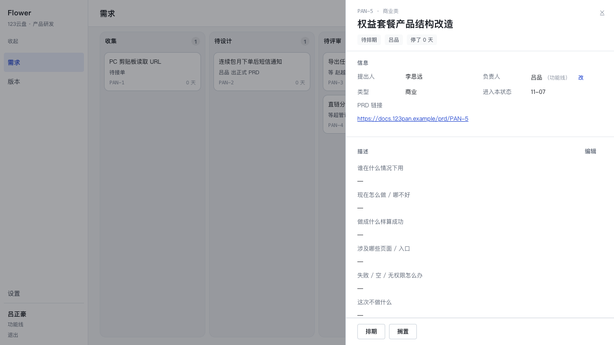
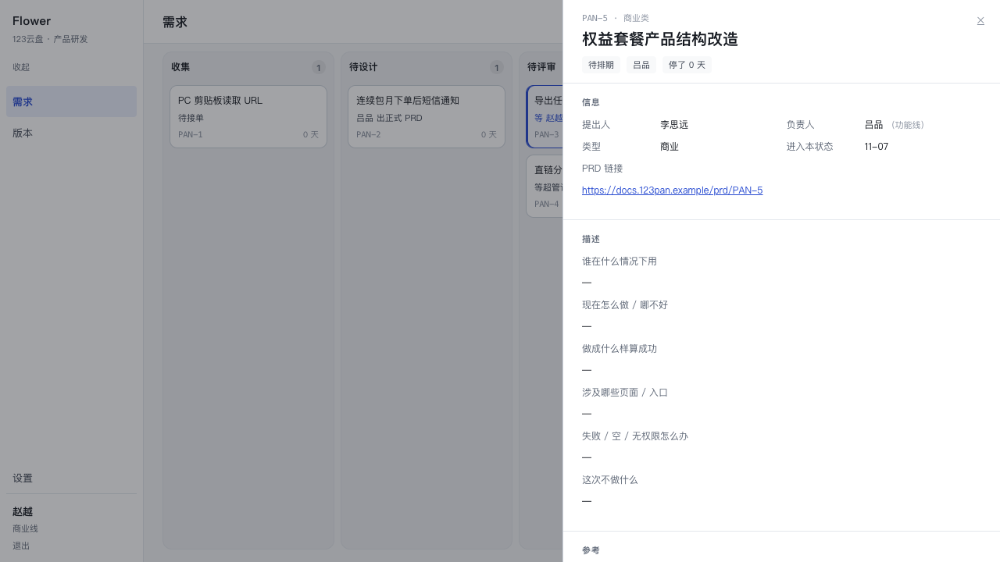
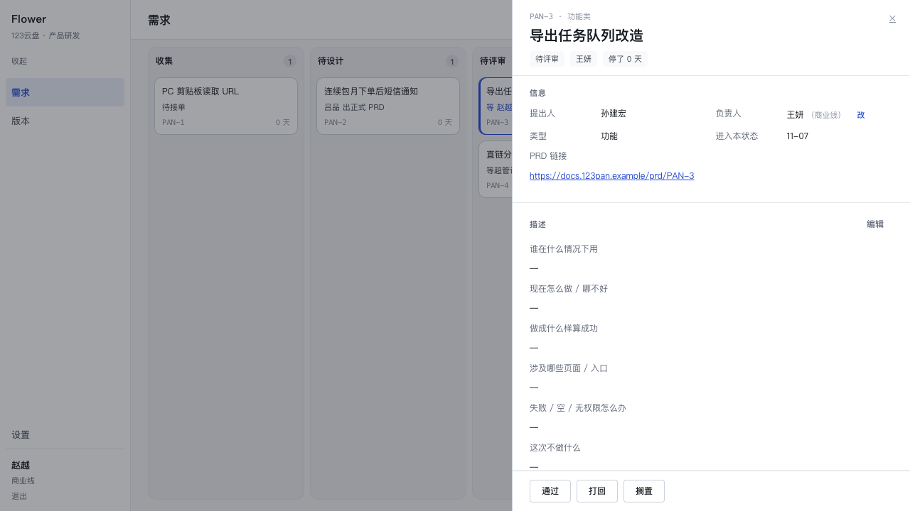
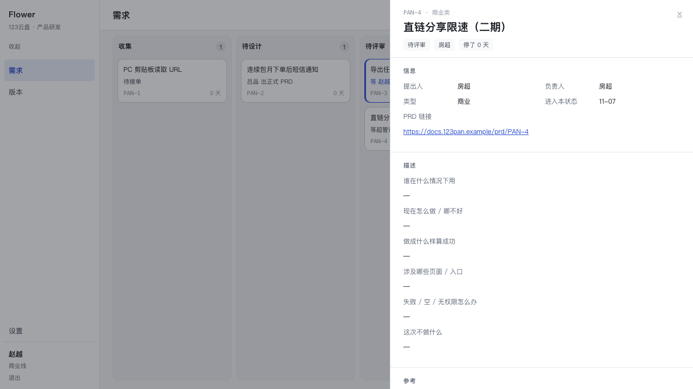
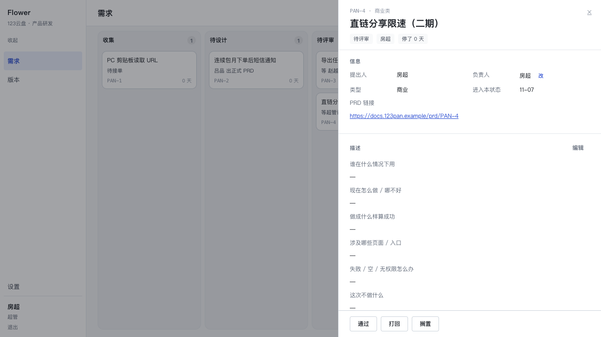
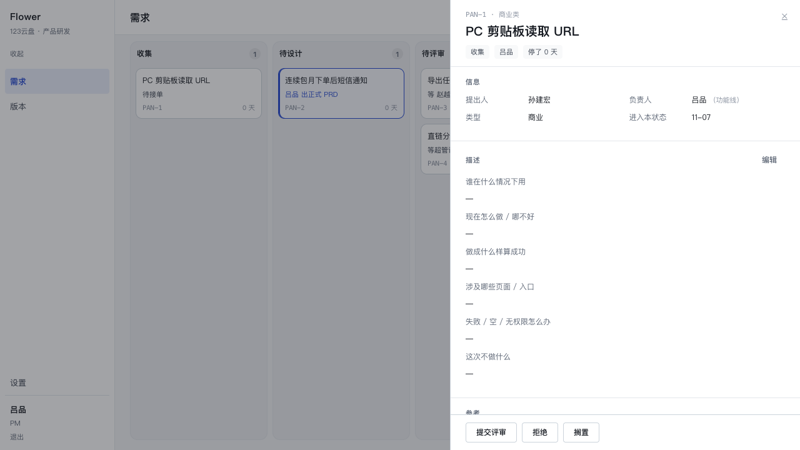

# P4-06 · 权限锚点：从「需求类型」换成「负责人的条线」

分支 `main`，起点 `226a8f4`。本次改动全部在授权层与读/写调用点，`src/core/state-machine.ts` 一行未动。

owner 的决定（原话）：

> 算了 我觉得还是别按需求类型来了 按人的归属吧 就是组织结构的关系 这个相对更固定一些

并且在「混合模型（改按人 / 签按类型）」与「全按人」之间选了**全按人**。立项这一格他确认：
「任何 PM 都能立项，立项即成为负责人」。

---

## 1. 新的锚点规则

一条需求归谁管，只看**负责人那一行的 `members.line`**。需求类型（商业 / 功能）仍然是内容属性
（列表、文案、筛选在用），**不再是权限事实**——它已经从 `RequirementFacts` 这个类型里删掉了，
所以「谁还在拿类型判权限」现在是一次编译错误，而不是一段读起来像是对的分支。

| 谁 | 能做什么 |
|---|---|
| 超管（`product_owner`） | 一切：改任何需求、转交任何负责人、评审任何一条、收到全部通知 |
| **负责人所在条线的负责人**（`role` + `line` 同时成立） | 改这位负责人名下的任何需求、在本线内转交、评审这些需求、收这些需求的全部通知 |
| PM | 改自己负责的；评审对他不存在；对**没有负责人**的需求可以认领 |
| 负责人没有条线（今天只有超管） | 没有条线可锚 → **只有超管**能改 / 能签 |
| 没有负责人 | `edit` / `review` / `reassignOwner` 对所有人关闭（超管除外），改走 `claim` |

判断仍然只有一个入口：`can(actor, facts, ability)`（`src/core/auth/roles.ts`）。新增第六格能力
`claim`；`facts` 的形状从 `{ type, ownerMemberId, state, reviewerMemberId }` 变成
`{ ownerMemberId, ownerLine, state, reviewerMemberId }`。

### 删掉的那张表

`LINE_OF_TYPE`（需求类型 → 条线）与 `type → reviewerRole`（`reviewerRoleOf` / `lineOfType`）
整个删除，没有留成「暂时没人用」的常量。同时删掉的还有两处**长得一模一样的副本**：

- `app/settings/roles.ts` 的 `REVIEW_LINE`（类型 → 评审角色）：设置页那一节从「评审线」改成
  「条线负责人」，摆的是「功能线 → 吕正豪 / 商业线 → 赵越」；
- `src/core/read/member.ts` 里 `ownerCandidates(actor, type)` 的第二个参数——候选不再按类型筛。

`ROLES` / `LINES` / `ROLE_OF_LINE` / `ROLE_LABEL` 保留。`ROLE_OF_LINE` 仍然是「哪条线的负责人是
哪个角色」的唯一一份，派单、扇出、候选三处都从它派生（`leadRoleOf` / `leadLineOf` / `leadsLine`）。

---

## 2. 四条后果，以及各自的落点

### 2.1 负责人没有条线（`owner.line === null`）→ 只有超管

- `can()`：`ownerLine === null` 时 `leadsLine(actor, null)` 恒为 false；超管那一路照旧。
- 派单（`assignReviewer`）：**不写派单行**、返回 `null`。这是刻意的——在这里抛 `no_reviewer`
  会让超管连自己提的需求都提交不了评审，而超管本来就不受派单限制（`can('review')` 里
  `admin` 先返回 true）。「只挡住超管」的规则不是规则。
- 读侧：待评审且没有派单行时，看板那一行从「等派单评审人」改成**「等超管评审」**——旧的措辞
  会让人以为系统还会再派一次。
- 抽屉：负责人后面**不显示条线**（没有），评审段显示那条被作废的派单与原因。

### 2.2 没有负责人（收集 / 待接单）→ 显式 `claim`

- `can('claim')` = `ownerMemberId === null` 且（超管 / PM / 条线负责人）。有主之后对**所有人**
  关闭，包括超管（超管要走转交）。
- 新服务 `src/core/requirements/claim.ts`：`for update` 锁行 → `can('claim')` → 带
  `where owner_member_id is null` 的 update（并发认领时第二个人拿到 `changed: false`，不覆盖）
  → 写一条 `requirement.owner_assigned`（`from: null`）。
- **不改状态**：状态机冻结，认领只是换负责人。认领之后这条需求立刻落到认领人的条线下——
  他的条线负责人能改、能签。
- 界面：抽屉「负责人」那一行，无主时写「待接单」并给一个「认领」按钮
  （`app/components/ClaimButton.tsx`，判据是 `detail.permissions.claim`）。时间轴上这一条事件
  现在有中文：「认领，成为负责人」（转交则是「转交负责人 · A → B」）。

### 2.3 迁移：重算还开着的派单

旧派单是按类型造的。不重算的后果不是界面难看，而是**错的人能签**——比没人签坏得多。

- 单元：`src/db/line-anchor.ts`（`realignOpenReviewAssignments`），一个事务里读全部
  `verdict = 'handed'` 的派单，然后三类处理：
  1. 负责人有条线、那条线有活着的负责人 → `reviewer_member_id` 改到那个人；
  2. 负责人没有条线 → 派单**作废**（`verdict = 'voided'`，原因「负责人没有条线：改由超管评审」）；
  3. 没有负责人 → 作废（原因「需求还没有负责人：认领后再派单」）；
  4. 本来就对 → 不动（计入 `kept`），所以可以重复跑。
- 入口：`npm run db:anchor`（`scripts/migrate-line-anchor.ts`），打印三段：改派的、
  作废的、本来就对的。**一条都没动也打印**——「跑过了、什么都不用改」与「忘了跑」必须在屏幕上
  长得不一样。
- 为什么不是 `src/db/migrations/*.sql`：这是**数据**迁移，不是 schema 变化；而且它需要一份
  「哪几条被作废、为什么」的中文报告，drizzle 的迁移文件没有地方放这份报告。

在还原前的真实库上跑过一次（那份库里 PAN-3 按类型派给吕正豪、PAN-4 按类型派给赵越）：

```
P4-06 评审派单重算：按「负责人的条线」
  改派 1 条，作废 1 条，本来就对 0 条
  PAN-3「导出任务队列改造」吕正豪 → 赵越
  PAN-4「直链分享限速（二期）」作废 赵越 的派单：负责人没有条线：改由超管评审
  作废的这几条现在只有超管能签（抽屉的评审段会显示「作废」）。
```

### 2.4 通知扇出：「本线」= 负责人在这条线上

`addressed()` 里原来的 `r.type = '功能'/'商业'` 换成
`exists (select 1 from members owner where owner.id = r.owner_member_id and owner.line = <我的线>)`。
超管仍然收全部（只排除自己做的事）。「我是哪条线的负责人」用 `leadLineOf(actor)`——与 `can()`
同一个定义，所以「能改它的人」与「收它通知的人」不可能变成两批人。

### 2.5 转交候选：按转交人的线筛，不按类型

`ownerCandidates(actor)`：超管 → 全名册；条线负责人 → 自己那条线的人。服务层仍然再判一次
（`target.line !== locked.owner_line`），所以「功能线负责人对一条商业类需求有转交权、下拉里却只
摆商业线的人」这个荒唐组合不会再出现。

---

## 3. 真值表：动了什么

`tests/auth.test.ts` 的第一节整段重写。旧表 39 行，锚点是「类型 → 角色」；新表 **144 行**
（6 个演员 × 6 种能力 × 4 种需求），四位演员 × 四种归属全部逐格断言，缺的格按 false 断言——
**默认拒绝**，所以给某个角色偷偷加一支会红。

四种需求（都在待评审，只差负责人）：

| 代号 | 类型 | 负责人 | 负责人条线 | 派单 | 它要证明什么 |
|---|---|---|---|---|---|
| `pan5` | 商业 | 吕品 | 功能线 | 吕正豪 | 变更的起因：商业类 + 功能线 PM |
| `ownedByBusiness` | 功能 | 罗丹 | 商业线 | 赵越 | 镜像：类型是功能，签它的是商业线负责人 |
| `noLineOwner` | 商业 | 房超 | 无 | 无 | 负责人没有条线：只有超管 |
| `unowned` | 功能 | 无 | — | 无 | 没有负责人：不能改，但能认领 |

关键翻转（旧表里这四行是全绿的相反方向）：

| 演员 × 需求 | 旧 | 新 |
|---|---|---|
| 功能线负责人 × PAN-5（商业类，吕品） | edit/review/reassign = false | **true / true / true** |
| 商业线负责人 × PAN-5 | true / true / true | **false / false / false** |
| 功能线负责人 × `ownedByBusiness`（功能类，罗丹） | true / true / true | **false / false / false** |
| 商业线负责人 × `ownedByBusiness` | false / false / false | **true / true / true** |

服务层同一组用例也重写了：`makeFor()` 的签字人从「按类型」改成 `LEAD_OF[owner]`（写死名字，
不从实现反查）；新增「商业类需求归功能线 PM 时，功能线负责人能改能签、商业线负责人被拒」
（服务层真跑）、「商业类需求归功能线 PM 时，转交人也是功能线负责人」。
`tests/line-anchor.test.ts` 新增 6 条，专门钉迁移（见 §2.3）。

其它被改到的用例（都是锚点本身的语义，不是为了让测试变绿）：

- `read.test.ts`：`seedInReview(type)` 的负责人挑在对应条线上（功能 → 吕品，商业 → 王妍），
  于是「同一列等不同人」还是那两个人；`seedOneTesting` 的默认负责人从房超改成吕品，
  因为它的详情断言要看到「功能线 · 吕正豪」这条派单。
- `notify.test.ts`：几条用例的负责人从王妍改成吕品或反过来——判据从类型换成了负责人。
- `requirements.test.ts`：派单两条改成「类型与条线故意错开」；脏 type（`'toString'`）那一格从
  「报 invalid_type」改成「脏 type 不影响派单」，因为类型已经不参与这条判断了。
- `permission-ui.test.ts`：`FEATURE_FACTS` 换成 `ownerLine: 'feature'`，新增「商业类 + 功能线
  负责人」与「没有负责人 → 动作条空、PM 有 claim」两格。

---

## 4. 浏览器验证（三个视角，重锚之后）

登录口令见 `docs/superpowers/plans/p4-04-auth.md` §9（本次复跑种子后已把它们重新钉回库里，方便
直接登录）。

### 4.1 PAN-5（商业类，负责人吕品 = 功能线）

功能线负责人**吕正豪**：动作条在（排期 / 搁置）、描述可编辑、负责人可改。



商业线负责人**赵越**：同一个抽屉，动作条没有、编辑没有、改没有——不是禁用，是**一个都不出现**。



> 说明：PAN-5 在种子里停在**待排期**，所以这一屏能证明的是「改」的锚点（排期/搁置/编辑/转交）。
> 「签」这一格用下面两张同类型的图证明：同一套代码、同一个判据，只是状态在待评审。

### 4.2 签字：商业线负责人签得动（类型是功能类）

PAN-3「导出任务队列改造」是**功能类**，负责人王妍在商业线。赵越看到「通过 / 打回 / 搁置」，
评审段写着「商业线 · 赵越 · 待签」——旧规则下这条派给的是功能线负责人。



### 4.3 负责人没有条线：只有超管

PAN-4 负责人是房超（超管，无线）。赵越打开：没有任何动作，评审段显示那张被迁移**作废**的派单与
原因；房超打开：通过 / 打回 / 搁置都在。





### 4.4 立项：PM 认领「待接单」

吕品（PM，功能线）打开 PAN-1（无主）：负责人一行写着「待接单」并给出「认领」。点一下之后负责人
变成「吕品（功能线）」，动作条（提交评审 / 拒绝 / 搁置）与「编辑」同时出现，时间轴多一条
「吕品 认领，成为负责人」。



---

## 5. 代码地图（这次动到的地方）

| 文件 | 改了什么 |
|---|---|
| `src/core/auth/roles.ts` | 锚点、`claim`、`RequirementFacts`（去掉 type、加 ownerLine）、删除 `LINE_OF_TYPE` / `lineOfType` / `reviewerRoleOf` |
| `src/core/auth/guard.ts` | `requirementFacts` 改成读负责人 + 条线（left join members） |
| `src/core/requirements/lock.ts` | `Locked` 加 `owner_line`（`for update of r`） |
| `src/core/requirements/review.ts` | `assignReviewer(tx, id)` 按负责人条线派单；无条线 → 不落派单行 |
| `src/core/requirements/submit-review.ts` / `evaluate` / `schedule` / `bounce` / `terminal` / `assign` / `create` | facts 换成 `ownerLine`；转交/新建的目标人约束改成「本线」 |
| `src/core/requirements/claim.ts` | **新增**：认领服务 |
| `src/db/line-anchor.ts` + `scripts/migrate-line-anchor.ts` + `npm run db:anchor` | **新增**：数据迁移与它的报告 |
| `src/core/read/detail.ts` | `info.ownerLine(Labels)`、`permissions.claim`、时间轴认领文案 |
| `src/core/read/notify.ts` | 扇出按负责人条线；「我是哪条线负责人」用 `leadLineOf` |
| `src/core/read/member.ts` | `ownerCandidates(actor)` |
| `src/core/read/board.ts` | 待评审无派单时写「等超管评审」 |
| `app/settings/roles.ts` + `app/settings/page.tsx` | 「评审线」→「条线负责人」 |
| `app/actions.ts` + `app/components/Drawer.tsx` + `ClaimButton.tsx` + `globals.css` | 认领入口与条线显示 |
| `scripts/seed.ts` | 签字人按负责人条线；自检文案 |

---

## 6. 验证

| 项 | 结果 |
|---|---|
| `npx tsc --noEmit` | 通过（0 error） |
| `npx vitest run` | **983 passed / 1 skipped**（33 个文件；改动前 978，本次新增迁移用例、认领用例，并把真值表从 39 行拆成 144 行） |
| `npm run build` | 通过（6 条路由，全 dynamic） |
| `npm run seed -- --reset` | 自检 PASS（12 条铺满 10 列，3 条需要当前成员动手） |
| `npm run db:anchor` | 在旧数据上改派 1 / 作废 1；再跑一次全 0（幂等） |
| `bash /tmp/restore-demo.sh` | 已执行；dev server :3000 仍在用（`/login` 200） |

---

## 7. 仍然粗糙

1. **`claim` 只落在抽屉里**。看板上那张「待接单」的卡仍然只是「待接单」——要点开抽屉才能认领。
   卡片上加一个「认领」是最自然的下一步，但那要把 `Card` 从纯展示改成带一个 server action，
   这一轮不想顺手动看板的形状。
2. **条线负责人的「本线」只按 `members.line` 判**，没有「代理 / 多人共管」的概念。同一条线配两个
   负责人时，派单按 `created_at, id` 取第一个；`can('review')` 允许任何一位这条线的负责人签，
   但派单行会一直写着第一个人的名字（抽屉里显示的是派单那一位）。
3. **迁移只处理开着的派单**（`verdict = 'handed'`）。`passed` / `rejected` 是历史，按当时的规则
   留着不动（时间轴与「谁签的」不该被重写）。这意味着查旧账时要记得：P4-06 之前的签字人可能
   是按类型派的。
4. **超管提的需求在待评审时没有人被框**。看板写「等超管评审」，但 `waitingOn: 'none'`，
   所以不会把卡主色框给超管本人——「等谁」那一行的名字只有一个来源，而超管不是「派单上的
   评审人」。这是既有裁决（R-mine）与新规则的接缝，没有在这一轮重新裁决。
5. **设置页的「条线负责人」仍是视图侧的第三份中文名**（`app/settings/roles.ts` 自己一份，
   `roles.ts` 一份，`detail.ts` 的 `ROLE_LINE` 一份）。P4-04 就记着这笔账，这次只是把「类型 →
   角色」那张表删了，三份「角色 → 中文」还没合成一份。
6. **认领没有通知**。`requirement.owner_assigned` 会让新负责人的条线收到扇出（如果扇出开着），
   但认领人自己不会收到一条「你认领了」——他自己做的，按「排除本人动作」的规则本来也不该收到。
   这一条目前是对的，只是「立项」这个动作在通知里看不出与转交的区别（时间轴里有）。
