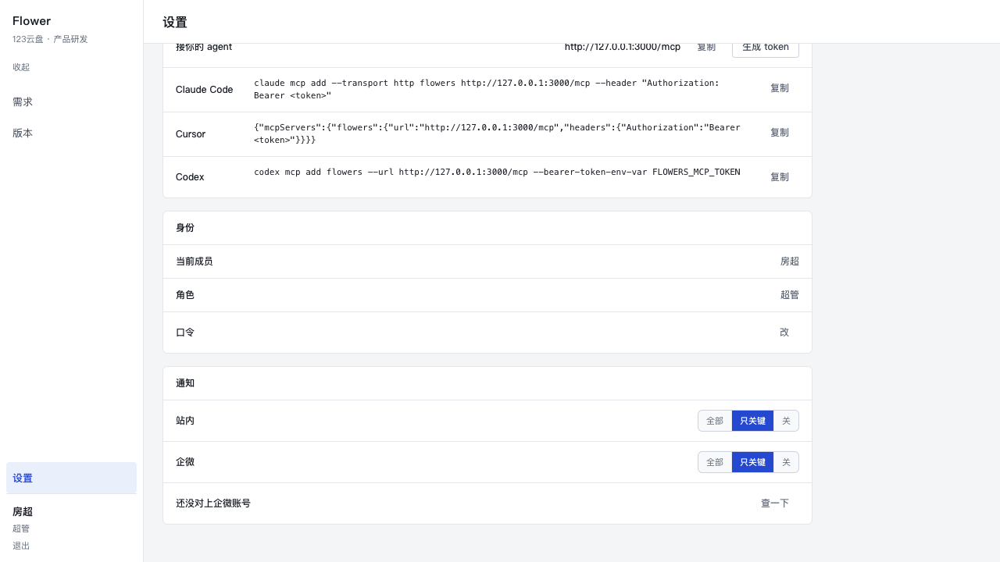
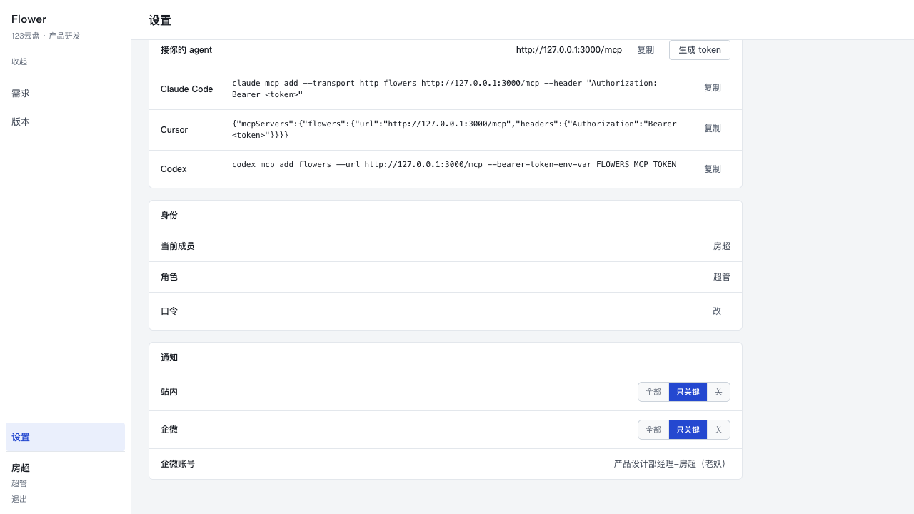

# P4-07 · 通知频道：三档 × 两个频道，加一条企微推送

分支 `main`，起点 `e4a73b7`。站内铃铛与企微推送读**同一份口味、同一条观众谓词**，
各自的档位互不牵连：一个人可以让铃铛全开、企微全关，反过来也行。

## 1. 一句话

`members.notify_prefs` 从「一个开关」换成**两个频道 × 三档**
（`{"site":"key","wecom":"key"}`）；事件按产品口径分成 `action` / `outcome` / `change`
三类；站内 feed 与企微推送都用这一份分类过滤；企微那一路由
`scripts/wecom-dispatch.ts` 跑，`notify_deliveries` 上一条唯一索引
`(member_id, event_seq, channel)` 是「同一条事件对同一个人只发一次」的唯一保证。

## 2. 事件 → 类（穷举，21 个）

三个类的定义（产品口径，写在 `src/core/notify/classes.ts` 的文件头）：

- `action`：**需要我动手**——等我评审签字、等我出 PRD、我负责的需求进入新状态；
- `outcome`：**有结果**——通过 / 打回 / 拒绝 / 搁置 / 自动上线 / 打回开发；
- `change`：**一般变动**——新建、换负责人、描述更新、认领、补材料、发版。

| 事件类型 | 类 | 为什么 |
|---|---|---|
| `requirement.evaluated` | action | 进入待设计，负责人要出正式 PRD |
| `requirement.review_requested` | action | 进入待评审，派单的评审人要签字 |
| `requirement.scheduled` | action | 排期定了，负责人要盯开工 |
| `requirement.auto_dev` | action | 时钟把需求推进到开发中 |
| `requirement.auto_test` | action | 推进到测试中，负责人跟进度 |
| `requirement.review_passed` | outcome | 评审通过 |
| `requirement.review_rejected` | outcome | 评审打回 |
| `requirement.rejected` | outcome | 被拒绝 |
| `requirement.shelved` | outcome | 被搁置 |
| `requirement.bounced` | outcome | 打回开发 |
| `requirement.auto_live` | outcome | 自动上线 |
| `requirement.created` | change | 新建（进入收集） |
| `requirement.owner_assigned` | change | 换负责人 / 认领 |
| `requirement.updated` | change | 描述更新 |
| `requirement.deleted` | change | 删除 |
| `requirement.restored` | change | 恢复 |
| `uemaster.attached` | change | 交了一份材料 |
| `prd.fetched` | change | 拉了一版 PRD 快照 |
| `release.created` | change | 发版窗口新建 |
| `release.updated` | change | 发版窗口改了 |
| `release.deleted` | change | 发版窗口删了 |

这张表是**穷举且被用例钉住的**：`tests/notify-channels.test.ts` 扫 `src` / `app` /
`scripts` / `mcp` 里每一个 `type:` 字符串字面量与 `EVENT_*` 常量，再加上由
`TRANSITIONS` 派生出来的 `requirement.auto_<state>`，与表里的键做**集合相等**断言。
新加一个事件类型却忘了分类 = 用例红。运行期未登记的类型按 `change` 兜底（库里可能有
更早版本写下的类型，一条读不懂的事件不该让铃铛 500）。

**一处口径选择**：`action` 收「我负责的需求进入新状态」时，`auto_dev` / `auto_test`
也进来了。理由写在 `classes.ts` 的注释里：状态往前走了，负责人接下来一定有活；把它们
放进 `change` 会让「只关键」档在一条需求的生命周期里几乎一声不响——那是这一轮要修的
「48 条 vs 1 条」的另一个极端。

## 3. 档位矩阵（3 档 × 3 类）

| 档位 | action | outcome | change |
|---|---|---|---|
| `all`（全部） | ✅ | ✅ | ✅ |
| `key`（只关键） | ✅ | ✅ | — |
| `off`（关） | — | — | — |

两个频道各存一份：`site`（站内铃铛）与 `wecom`（企微推送）。
**默认值：三个角色（超管 / 条线负责人 / PM）都是 `key`。** 没有人默认 `all`——
超管默认收全部变更时一天 48 条（owner 的原话）。默认值的唯一一份在
`src/core/notify/prefs.ts` 的 `DEFAULT_PREFS`。

读侧的容错（同一文件）：`null` / 空串 / 坏 JSON / 不是对象 / 认不出的值 → 逐格回落
`key`，不抛。老形状（P4-03 的 `{"inherit":…,"changed":…,"rejected":…}`）只有
「`inherit:false` 且 `changed`、`rejected` 全 false」这一格是确定的 `off`，其余落回
`key`（多收一点，不会漏）。写入端才校验：`saveNotifyChannels` 只认三档，别的值给一句
中文（`「站内」的档位只能是 全部 / 只关键 / 关 之一（收到的是「x」）`）。

## 4. 两个频道的口径

**站内（`site`）**：`notificationsFor` / `unreadCount` / `latestNoticeSeq` 共用
`addressed(member, channel)` 一条谓词，档位的过滤（`levelFilter`）包在整条谓词外面。
`off` → `false`（feed 空、未读 0，`Shell` 里整个铃铛不渲染）；`key` → 只放行
`action`/`outcome` 的类型；`all` → 不过滤。红点与列表因此是同一句话的两种呈现：用例
在每一档上都断言 `notifyView().unread === notices.filter(unread).length`，并且
`unreadCount` 在不受 limit 截断时等于 feed 长度。

**企微（`wecom`）**：`pendingDeliveries(db, member, {channel:'wecom', limit})` 用同一条
谓词（同一档位、同一批观众），额外做两件事——排除已经有 `sent` 投递行的事件、
**升序**取最旧的（停机一天之后先补最早的那几条，否则永远追不上）。

## 5. 投递与「不重复发送」

表：`notify_deliveries(id, member_id, event_seq, channel, status, error, sent_at, created_at)`
+ **唯一索引 `notify_deliveries_once_unique (member_id, event_seq, channel)`**
+ `channel in ('site','wecom')` / `status in ('sent','failed','skipped')` 两条 CHECK。

- `sent`：CLI 回了 `success: true`。**只有它阻止下一次发送**；
- `failed`：试过了没成（CLI 报错 / 超时 / 没授权）。下一轮**就地重试**
  （`on conflict … do update … where status <> 'sent'`，更新同一行，不插第二行）；
- `skipped`：**没有尝试发送**，因为企微账号还没对上。与 `failed` 分开，是为了让报告里
  两个数字各自可解释。

写投递只有一处（`dispatch.ts` 的 `record`），发送路径上没有第二个 insert，所以唯一索引
的语义不会被旁路绕过；`on conflict` 的 `where` 还挡了「并发两次运行把 `sent` 盖成
`failed`」这一格。

企微侧的三个实现细节：

1. 名字匹配分三档（等于 → 后缀 → 包含），取**最高档**；最高档里 2 个以上 → `ambiguous`
   并列出候选人，0 个 → `no_match`，两者都**不猜**。`产品经理-吕品` 对「吕品」命中后缀档。
2. `members.wecom_userid` 缓存，`wecom_lookup_at` 记「上次试过」（成功、失败都写）。
   一次运行里同一个人只查一次；失败不写 userid。
3. 消息是**两行短 markdown**，没有链接（这一版没有公网入口，`localhost` 链接在手机上
   点不开，一条点不开的链接比没有链接更坏）：
   ```
   **PAN-2「连续包月下单后短信通知」**
   进入待评审，等你签字。
   ```
   正文过 `redact()` + `stripWrappers()`：`security_notice` / `extra_identity_context`
   两个包装字段既不进库也不进消息（在真实 `execFile` 链路上用假 CLI 验过）。

**每人每轮上限默认 5 条**（`DEFAULT_PER_MEMBER_LIMIT`，脚本 `--limit` 可调），剩下的下一
轮补。这个数字出现在每次运行的摘要里，也出现在下面第 8 节。

## 6. UI（设置 · 我的 → 通知）

两行两格：站内 / 企微，各一个三档分段控件（全部 / 只关键 / 关），只有标签、没有解释
文案。点一格 = 一次 `saveNotifyChannelAction(channel, level)`（一次只写一格，互不覆盖），
乐观更新，失败退回原值并显示服务层那句中文。

`wecom !== 'off'` 且 `wecom_userid` 为 null 时多一行「还没对上企微账号 + 查一下」；点下去
跑 `lookupWecomAccount`（缓存优先、成功落库），命中就把**企微显示名**显示出来
（`产品设计部经理-房超（老妖）`——前缀是企微的事实，不是错误），失败就显示原因。





## 7. 真实运行（不是 dry-run）

演示数据由 `bash /tmp/restore-demo.sh` 灌入；七个人里只有**房超**开着企微推送（其余六位
我把 `wecom` 设成了 `off`——不给同事发测试消息），超管的档位是默认的 `key`。

```bash
npx tsx scripts/wecom-dispatch.ts --dry-run     # 待发 5 · 关掉 6 · 一条没发
npx tsx scripts/wecom-dispatch.ts               # 真发
```

| 轮次 | 已发送 | 失败 | 跳过 | 说明 |
|---|---|---|---|---|
| dry-run | 0 | 0 | 0 | 待发 5，库里一行没写，userid 缓存也没写 |
| 第 1 轮真发 | **5** | 0 | 0 | event_seq 3 / 5 / 6 / 8 / 11 |
| 第 2 轮真发 | **5** | 0 | 0 | 12 / 13 / 15 / 16 / 17（上一轮封顶后剩下的） |
| 第 3 轮真发 | **5** | 0 | 0 | 19 / 24 / 25 / 26 / 27 |
| 之后的 dry-run | 0 | 0 | 0 | 待发 5（还没补完），已发过的 15 条不再出现 |

**合计 15 条真实消息，全部发给同一个人**：房超，
企微 userid `wouEv6DQAA71ZeIq-GIEDTmN6msaW0JQ`，显示名 `产品设计部经理-房超（老妖）`。
落库 15 行 `notify_deliveries`，`status='sent'`，`count(*)=15` 且 `count(distinct event_seq)=15`
（没有一条事件被发两次；唯一索引第二次运行没有产生任何新行）。**0 失败、0 跳过。**

第 2、3 轮不是「重复发送」，而是**上一轮封顶后剩下的候选**：每人每轮 5 条的闸门在起作用
（这正是它存在的理由——停机一天之后不该用一次重启换一次刷屏）。我没有再跑第 4 轮：
库里的证据停在第 3 轮，剩下的 5 条候选留给下一次 tick 补。

> 真实发送的形状（两条都实测过）：`message aibot send --chat-id <userid> --msg-type markdown
> --markdown '{"content":"…"}'` 返回 `{"success": true}`；`message send --msg-type text`
> 在这个 corporation 上仍然回 `853006 this tool is not available for your corporation`。
> 这一轮没有出现授权/errcode 失败，所以没有需要逐字报的 errcode。

## 8. 验证

| 项 | 结果 |
|---|---|
| `npx tsc --noEmit` | exit 0 |
| `npx vitest run` | **1027 passed / 1 skipped**（基线 983 → 新增 44 条：`notify-channels` 24 + `wecom-dispatch` 20） |
| `npm run build` | 通过（Route 表不变，7 条路由） |
| 事件 → 类映射**穷举** | 扫源码 + `TRANSITIONS` 派生，集合相等；三类都非空；口径抽样逐条断言 |
| 档位过滤 | 九格矩阵（`allows`）+ 真库上三档的 feed / 未读 / 候选 |
| 不重复发送 | 手工插重复行撞 `duplicate key`；已 `sent` 的那条重跑不再发（runner 的 send argv 数为 0） |
| `--dry-run` | 注入的 runner 只收到 search、没有 send；库里 0 行；userid 缓存没写；`planned` 正确 |
| 查找 | 前缀名命中（`产品经理-吕品`）、0 命中 `no_match`（中文原因落 `skipped`）、多命中 `ambiguous` 不猜、未授权、包装字段剥除、失败只写 `wecom_lookup_at` |
| 包装字段 | 假 CLI 每个响应都带 `security_notice` / `extra_identity_context`：结果、落库 error、发出去的 content 三处都不含 |
| 站内与红点 | 每一档 `notifyView().unread === notices 里未读的条数 === unreadCount` |

## 9. 仍然粗糙

1. **站内没有「补发」这一层**。站内本来就是派生视图（历史免费），所以「档位从 `key`
   改到 `all` 之后，过去那些 `change` 会一次性出现在铃铛里」——这是刻意的（规则改了，
   旧事件按新规则重新解释），但它会让人在一个下午里看到一堆旧变动。要「只从此刻起」
   就得给口味加一个生效时刻，那是另一件事。
2. **每人每轮 5 条是常量**，没有按「停机时长 / 积压量」动态调。停机一整天之后，一个人
   的积压要好几轮才补完（每轮 5 条 × 每轮间隔），而中间进来的新事件排在旧事件后面。
   真到那一天，需要的是「摘要一条」而不是「逐条补发」——这一轮没做。
3. **`skipped` 的失败只在库里**，没有「这个人一直对不上企微」的提醒。设置页那一行
   「还没对上企微账号」只有他自己会看到；一个从不打开设置页的人会一直收不到推送而
   没有任何人知道。
4. **企微消息没有回链**（没有公网地址），只能靠 `PAN-<n>` 编号回站内找。等有域名了，
   正文第三行应该是一条深链。
5. **`wecom_lookup_at` 只记时刻，不记原因**。失败原因只活在 `notify_deliveries.error`
   里；查「这个人为什么一直对不上」要连着那张表看。表结构上刻意没有加第三列
   （这一轮 `members` 只加两列），下一轮如果要给超管做一个「推送体检」页，再加。
6. **`site` 的 `sent` 行没有任何人写**。通道枚举里有 `site`、唯一索引也覆盖它，但站内
   是派生视图，不需要投递记录——这一格现在是空的，留着是为了将来真有「站内已推送」
   一类的需求（比如给铃铛做「未读提醒邮件」）时不用改表。
7. **老形状的迁移只做了一半**：能读懂（全关 → `off`，其余 → `key`），但没有把库里
   老 JSON 改写成新形状。下一次有人保存那一格时才会被写成
   `{"site":…,"wecom":…}`。

## 10. 交付时的库状态

- 演示数据由 `bash /tmp/restore-demo.sh` 重新灌过（这一步在真发之后跑，所以第 7 节那
  15 行 `notify_deliveries` 已经不在了——数字在报告里，重跑一次 dispatcher 就能再看
  到同样的行为）。
- 七个人的 `notify_prefs` 都是 `null`（= 默认 `key`/`key`），`wecom_userid` 都是
  `null`：设置页现在正处在「还没对上企微账号」那一屏，点「查一下」即可复现第 6 节
  第二张截图。
- 种子每次重跑都会换随机口令（`restore-demo.sh` 把它静默了），所以我给**房超**
  留了一个能登进去的口令：`flowers-demo-p4-07`（只在这台机器的演示库上）。
