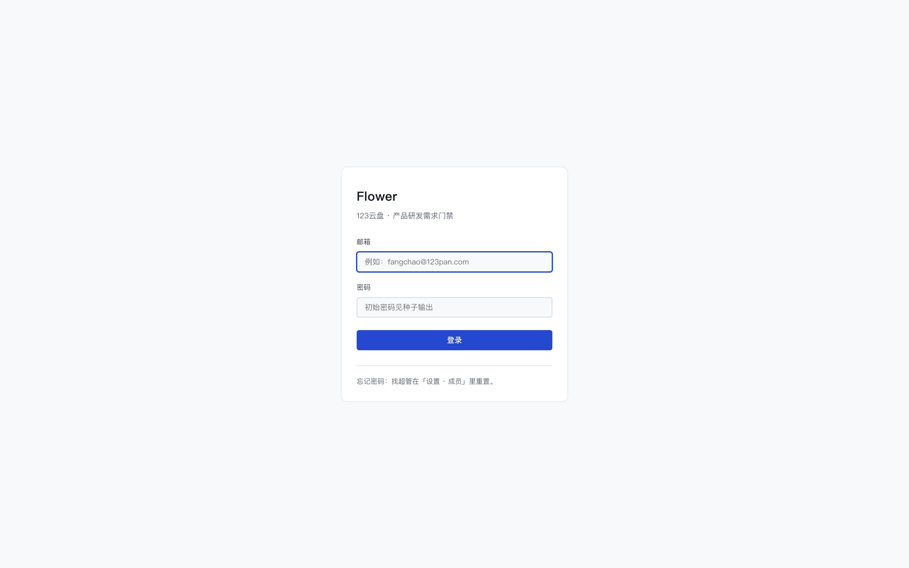
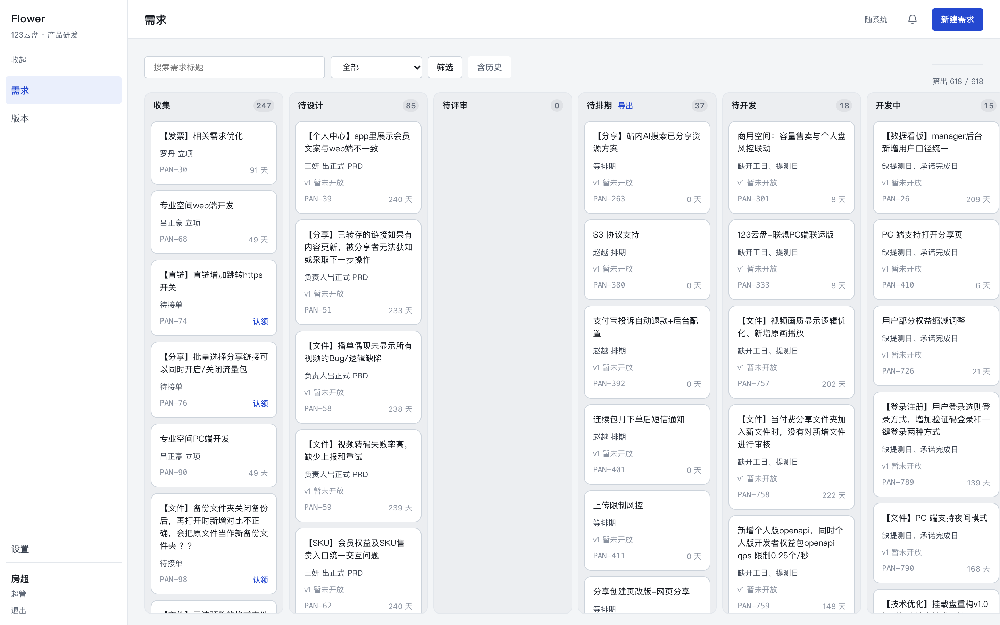
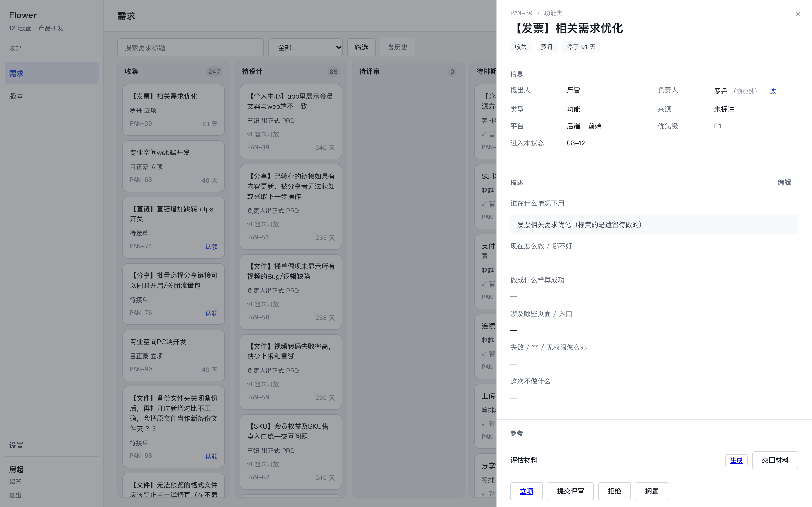
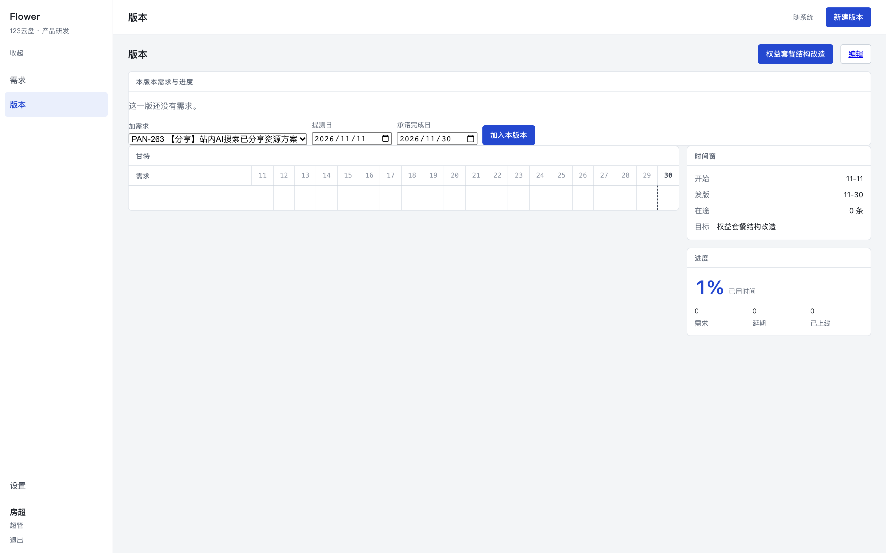
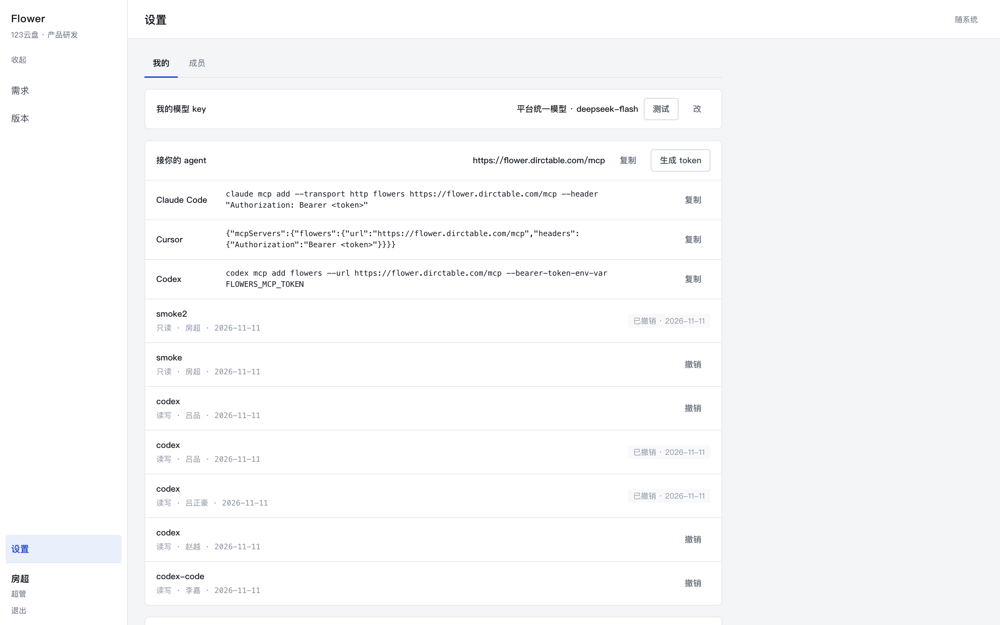
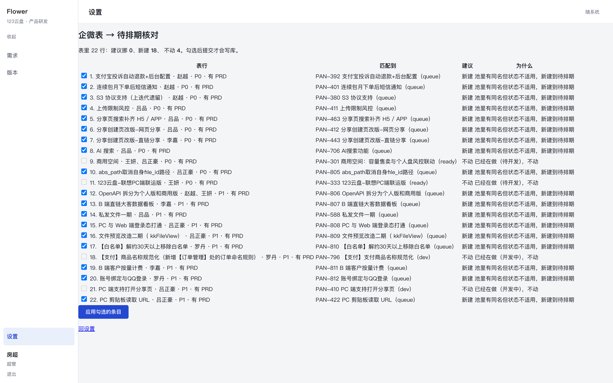

# flowers 使用手册

面向：产品经理、条线负责人、超管。

> 想要一页纸贴在工位上：看 **用户故事地图**（A4 横版）——
> [普通 PM 版](../docs/pdf/flowers-从登录到接上agent-PM.pdf) ·
> [条线负责人版](../docs/pdf/flowers-从登录到接上agent-条线负责人.pdf)
约定：截图都来自本地登录线上站点（`https://flower.dirctable.com`）。

---

## 1. 登录

打开站点 → 邮箱 + 密码。首次登录用初始密码（找超管要），登录后可在设置页改。

- 会话 12 小时；关浏览器不会留永久凭证。
- 生产上 cookie 带 `Domain=.dirctable.com`，所以同一个会话也能进 `b123.dirctable.com`（经营看板）。

---

## 2. 看板：先看「欠你动作」的卡

- **十列就是十个状态**，从左到右：收集 → 待设计 → 待评审 → 待排期 → 待开发 → 开发中 → 测试中 → 已上线（加上已拒绝、已搁置）。
- 卡片三行：**标题** / **现在在等谁**（例如「罗丹 立项」「等你签字」）/ **编号 + 停留天数**。
- **有主色框的卡是「现在欠你一个动作」**——先处理这些。
- 顶部：搜索标题、按状态筛、`含历史`（把已上线超过 90 天的需求放出来，默认隐藏）。
- 不知道编号时：先搜标题；知道编号就在搜索框输 `PAN-380` 或 `380`。

---

## 3. 打开一条需求（抽屉）

点卡片，右侧抽屉打开；地址变成 `/?open=<id>`，可刷新、可分享给同事。

抽屉从上到下六段：

| 段 | 看什么 |
|---|---|
| 信息 | 提出人、负责人、类型、平台、优先级、进入本状态的时间；负责人一栏有「改」 |
| 描述 | **六问**。缺哪几问，这里就显示「—」 |
| 参考 | 评估 / 评审 / 走查三行材料：已生成的是链接，没有的是「生成 / 交回材料」 |
| 评审 | 派单给谁、签字结果 |
| 事件 | 这条需求的完整时间线：谁在什么时候做了什么 |
| 动作条 | 当前状态**合法且你能做**的动作（不会给你一个点了会被拒的按钮） |

---

## 4. 六问：录入就要问清楚

六问是：**谁在什么情况下用 / 现在怎么做·哪不好 / 做成什么样算成功 / 涉及哪些页面·入口 /
失败·空·无权限怎么办 / 这次不做什么**。

- **缺任何一条**：不能立项、不能生成评估材料（按钮会把你送到编辑表单，并标出必填）。
- 编辑表单里六格都带「必填」；空着点保存会被拦下并点名缺哪几条，焦点跳到第一个空格。
- 已经建好的需求（含从老系统迁来的）可以在抽屉「描述」段点「编辑」逐条补。

> 迁移进来的需求大多只有第一问（老系统那段描述），所以要立项前先补完后五问。

---

## 5. 走流程的五个动作

| 你在哪一步 | 点什么 | 要填什么 |
|---|---|---|
| 收集里、没人接 | **认领** | 无（认领后你成为负责人） |
| 收集里、你是负责人 | **立项** | 六问必须齐（否则被拒并点名） |
| 待设计 | **提交评审** | 正式 PRD 链接 |
| 待评审、派单给你 | **通过 / 打回** | 打回要写原因 |
| 待排期 | **排期** | 版本 + 提测日 + 承诺完成日（要有 PRD） |

其它动作：**打回**（测试→开发，重填承诺日）、**退回待开发**（开发→待开发，写原因）、
**拒绝**、**搁置**、**恢复**、**回滚**（已上线撤回待排期，写原因）。

失败时抽屉里显示的是服务端原话（例如「还差两条没填：…」「不能从「待设计」直接到「收集」」），
照它改就行；刷新不会把这句话弄丢。

---

## 6. 版本页：排期与进度

- 顶部切版本；中间是甘特（需求 × 日期），右边是时间窗与进度（已用时间、在途、延期、已上线）。
- **本版本需求与进度**（甘特上方）：
  - 每条需求一行，改「提测日 / 承诺完成日」后点保存 → 立即生效，写一条「改排期」事件；
  - 底部「加需求」：从**待排期且已有 PRD** 的需求里挑一条加进本版本，默认日期取版本窗口。
- 想换版本：在同一行里把版本也改掉即可（规则同排期：提测 ≤ 承诺 ≤ 发版日）。

---

## 7. 设置：模型、企微、机器人、token

### 绑定企微（收私聊）

- 绑定后，需要你动手的事会私聊发给你。
- 拿 userid 最快的办法：点 **按名字查**（系统去通讯录按你的姓名查，查到自动填好）。
- 手机上「我 → 个人信息」看不到这串账号；要自己去后台看：
  管理员登录 `work.weixin.qq.com` → 通讯录 → 点开成员 → **账号**。
- 如果状态显示 **已绑定 · 未激活**：说明共用的那台是**个人机器人**，只能服务它的主人，
  你收不到 → 用下面的「自己的机器人」。

### 用自己的机器人（推荐给非超管）

企微里建一个群 → 添加群机器人 → 复制 webhook → 贴进设置页 → 保存 → 点「测试」。
之后你的私聊推送会发到这个机器人所在的群，不再走共用那条路。
（群播报不受影响：产品群是公共频道，所有人看到的是同一批消息。）

### MCP token（给 AI 用）

设置页 → MCP → 起个名字 → 选 `read` 或 `write` → 生成。**只显示一次**，复制保存好。
token 只能给自己生成，权限就是你在网页上的权限；不想要了点「撤销」。

---

## 8. 企微表核对（超管）

- 一屏三列：表里那行 → 池里匹配到谁 → 建议「挪进待排期 / 新建 / 不动」。
- 勾选要处理的条目 → 「应用勾选的条目」→ 才真正写库。
- 已经在做的需求会显示「不动」且勾选框禁用；同名重复的「另一半」会出现在这里，**别重复勾**。

---

## 9. 群里/私聊收到的消息怎么读

- **群播报**：`评审通过 · 123云盘` + `PAN-号 标题` + `状态 待评审 → 待排期` + `某人 · 时间`。
  点标题进抽屉。
- **告警**：`[告警 · P1 · 这周要处理] 待排期积压` → 现在多少 → 具体哪 3 条（PAN + 负责人 + 多久）
  → 下一步做什么 + 链接；@ 到条线负责人时会写「请安排人处理」。同类问题 3 天内不重复
  （P0 是 6 小时）。
- **批量操作不刷屏**：导入、批量改这类动作只写事件，不进群。

---

## 10. 常见问题

**Q：立项按钮是灰的 / 点了弹编辑页？**
六问没填齐。补齐后按钮会变成可点。

**Q：提交评审被拒「必须有正式 PRD」？**
在抽屉「信息」段补 PRD 链接（编辑表单里也能改），再提交。

**Q：排期被拒「承诺完成日不能晚于版本发版日」？**
先到版本页确认这版发版日；要么改承诺日，要么把这条换到下一个版本。

**Q：我收不到私聊？**
设置页看绑定状态：`已绑定 · 未激活` 说明共用机器人服务不了你 → 配自己的机器人 webhook。

**Q：数字「208 天」是不是错了？**
迁移来的需求没有历史事件，只能算「自迁移起」；新流转的需求按真实进入时间算。

**Q：老系统的编号呢？**
迁移后编号重排，老编号不可反查；抽屉里保留 `legacyRef`（老系统 uuid）供对账。
