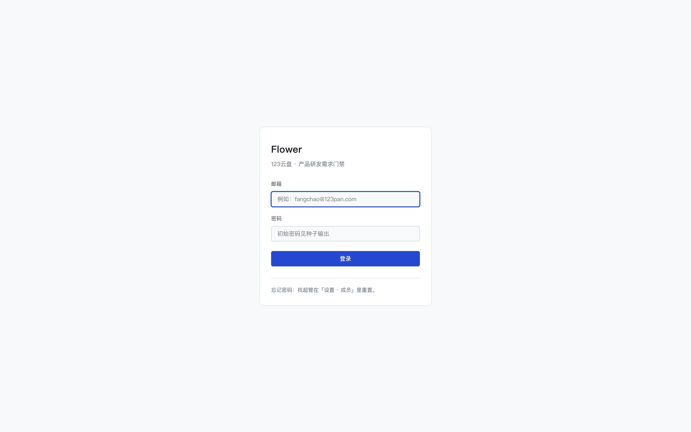
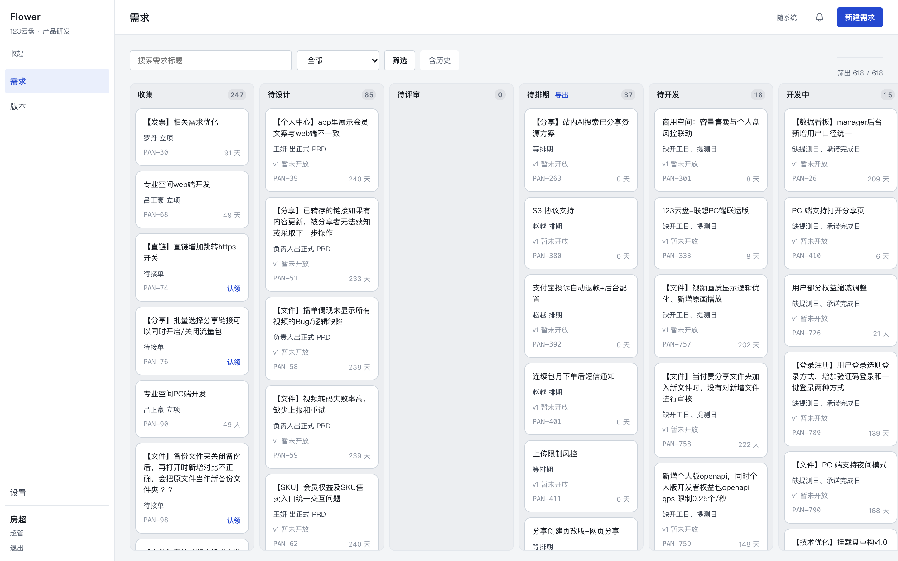
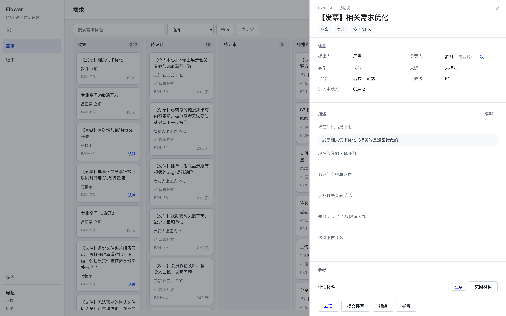
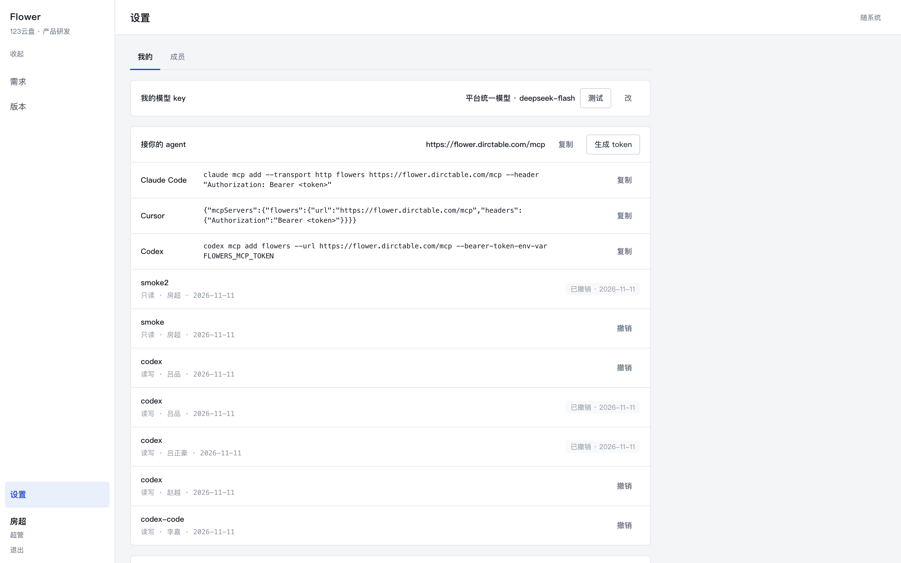
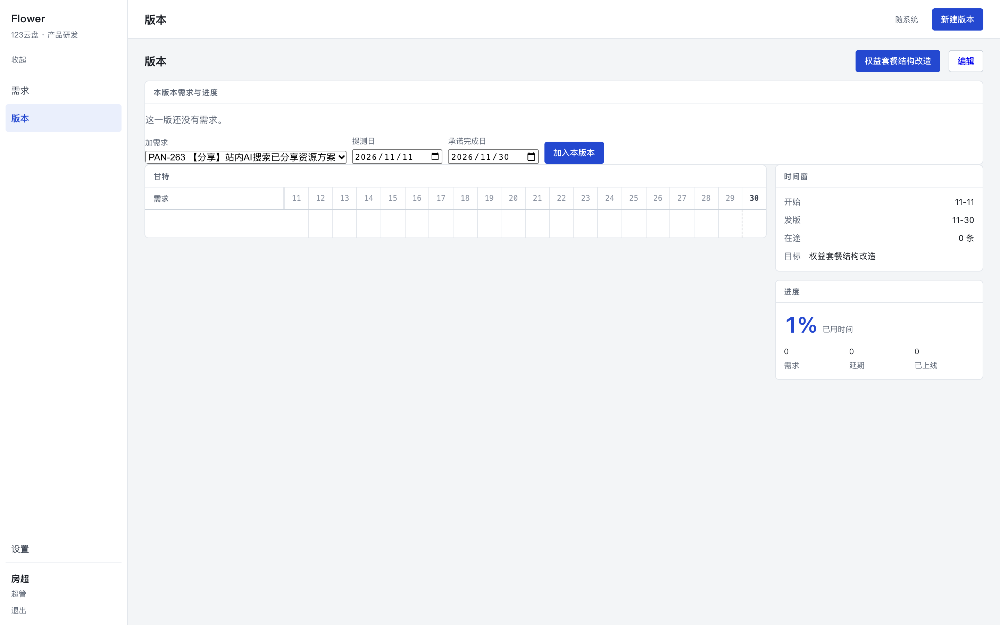

# flowers 使用手册 · 普通 PM

按「第一步做什么、第二步做什么」的顺序写。第一次用照着走一遍（约 15 分钟），之后每天只需要第 6 步往后。

---

## 第一步：登录

打开 `https://flower.dirctable.com`，用邮箱 + 密码登录。首次密码找超管要，登录后可在设置页改。



**做完是什么样**：进入看板，左上角是「需求 / 版本」两栏，左下角显示你的名字和角色（例如「罗丹 · PM」）。

**卡住时**：密码错误三次就找超管重置；登录后 12 小时内不用重登。

---

## 第二步：看懂这一屏在说什么



- **一行列 = 一个状态**：收集 → 待设计 → 待评审 → 待排期 → 待开发 → 开发中 → 测试中 → 已上线（另有已拒绝、已搁置）。
- **卡片三行**：标题 / 现在在等谁（「罗丹 立项」「等你签字」）/ 编号 + 停留天数。
- **有主色框的卡 = 现在欠你一个动作**，先处理这些。
- 顶部可以按标题搜（也可以直接输 `380` 或 `PAN-380`）、按状态筛、点「含历史」把已上线超过 90 天的放出来。

**做完是什么样**：你能一眼说出「哪三条在等我」。

---

## 第三步：打开一条需求看清楚

点卡片，右侧抽屉打开；地址变成 `/?open=…`，可以刷新、可以发给同事。



抽屉六段：信息 / 六问 / 参考材料 / 评审 / 事件 / 动作条。**动作条只给你现在合法、且你能做的按钮**——灰色的按钮在别处根本不会出现。

**做完是什么样**：你知道这条需求现在缺什么（六问空着、没 PRD、还是没排期）。

---

## 第四步：把六问补齐（这一步决定后面能不能走）

六问是：谁在什么情况下用 / 现在怎么做·哪不好 / 做成什么样算成功 / 涉及哪些页面·入口 / 失败·空·无权限怎么办 / 这次不做什么。

抽屉「描述」段点「编辑」，六个格子都带「必填」；空着点保存会被拦下并点名缺哪几条。

**做完是什么样**：六格都有内容；「立项」和「生成」不再是灰的。

**卡住时**：从老系统迁来的需求大多只有第一问，剩下五问要自己补——这是正常的，不是数据丢了。

---

## 第五步：配好你自己的东西（一次性）

进入「设置」→「我的」：



1. **模型（必须自己配）**：接口地址 + API Key + 模型名三格都要填。
   - 平台统一那条 key **只对超管本人开放**，别人的账号拿不到它——没配自己的人点「生成」会被拒，提示就是这句。
   - 三格缺一格等于没配（不会与别人的地址/key 拼成半份，那会把你的 key 发到别人填的地址去）。
   - 填完点右边「测试」：显示「通过 · 耗时 · tokens」才算能用。
2. **绑定企微**：点「按名字查」，系统按你的姓名去通讯录查，自动填好 userid。
3. **自己的机器人**（推荐）：企微建一个群 → 添加群机器人 → 复制 webhook → 贴进来 → 保存 → 点「测试」。
4. **改密码**：改完所有旧会话失效。

**做完是什么样**：设置页显示「已绑定」；点「测试」你的机器人能收到一条消息。

**卡住时**：如果显示「已绑定 · 未激活」，说明共用的那台是**个人机器人**，只能服务它的主人——你必须用第 3 条的自己的机器人，否则一条私聊都收不到。

---

## 第六步：生成 token，接上你自己的 agent

同一个设置页往下，「MCP」那一块：

1. 起个名字（例如 `claude-code`），选 **write**（只查东西选 read 就够）。
2. 点生成——**只显示一次**，复制保存好。
3. 把它交给你的 agent，一条命令：

```bash
claude mcp add --transport http flowers https://flower.dirctable.com/mcp \
  --header "Authorization: Bearer flw_…"
```

或者写进配置文件：

```json
{"mcpServers":{"flowers":{"url":"https://flower.dirctable.com/mcp",
  "headers":{"Authorization":"Bearer flw_…"}}}}
```

**做完是什么样**：让你的 agent 说一句「列出待排期的需求」，它能返回真实数据。

**卡住时**：

- 401 → token 抄错或已撤销，重新生成一个。
- 想让 agent 用脚本而不是 MCP：技能包 `GET /api/v1/skills/flowers-ops`，里面是 SKILL.md + 一个零依赖 CLI。

---

## 第七步：让 agent 替你干重复活

顺序建议：**查重 → 建需求 → 认领 → 立项**。

1. 「查一下有没有『S3 协议支持』」——它按编号、标题、关键词查，别重复建。
2. 「建一条需求」——它会**先问你六问**（调 `requirement_brief_prompts` 取原文），不要让它自己编。
3. 「我来认领」——`requirement_claim`，认领后你成为负责人。
4. 「立项」——`start_design`；六问不齐会被拒，并点名缺哪几条。

**做完是什么样**：回网页刷新，新需求出现在对应列，负责人是你，事件流里能看到 agent 的每一步。

**卡住时**：agent 说「权限是读」→ 你给的是 read token，重新生成 write 的。

---

## 第八步：推进到评审与排期

- **提交评审**：抽屉动作条点「提交评审」，填正式 PRD 链接。
- **被派单签字**：你是评审人时，抽屉里会出现「通过 / 打回」；打回要写原因。
- **排期**：进入待排期后，到「版本」页，用「加需求」把这条选进本版本，填提测日与承诺完成日。



**做完是什么样**：卡片从「待评审」移到「待排期」，再移到「待开发」，并挂在本版本甘特上。

---

## 第九步：上线与收尾

- 上线后会播报到群里，并 @ 提出人「请验收」。
- 不做就**拒绝**（写原因）；暂时不做就**搁置**，之后能从「已搁置」恢复。
- 每周看一眼群里的告警：`[告警 · P1] 待排期积压` 这类会点名 PAN、负责人和下一步。

**做完是什么样**：你手上没有「不知道该谁动」的卡。

---

## 常见问题

**Q：动作条没按钮？**
当前状态不允许，或者这条不是你的（PM 只能改自己的需求；条线负责人能改本线的）。

**Q：提示「必须有正式 PRD」？**
在抽屉「信息」段补 PRD 链接，再提交。

**Q：「208 天」是不是错了？**
迁移来的需求没有历史事件，只能算「自迁移起」；新流转的按真实进入时间算。

**Q：点「生成」提示「未配置模型接口」？**
你还没配自己的模型。到「设置 · 我的 → 模型」填接口地址、API Key、模型名三格，点「测试」通过后再生成。平台那条 key 只给超管本人用，绕不过去。

**Q：agent 能把别人的需求改了吗？**
不能。token 就是你的人身份，权限与你在网页上完全一致。
