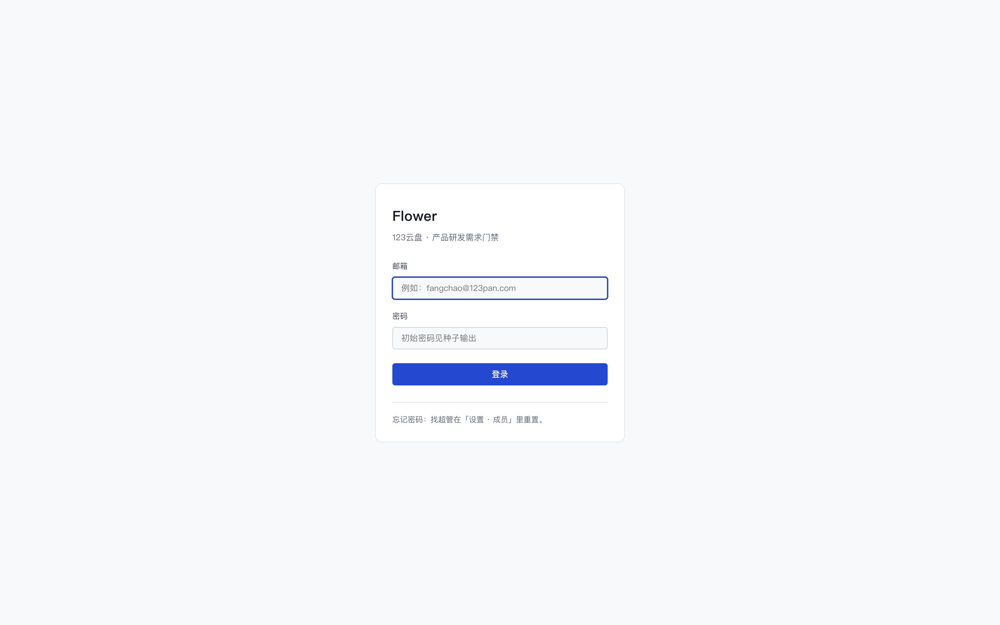
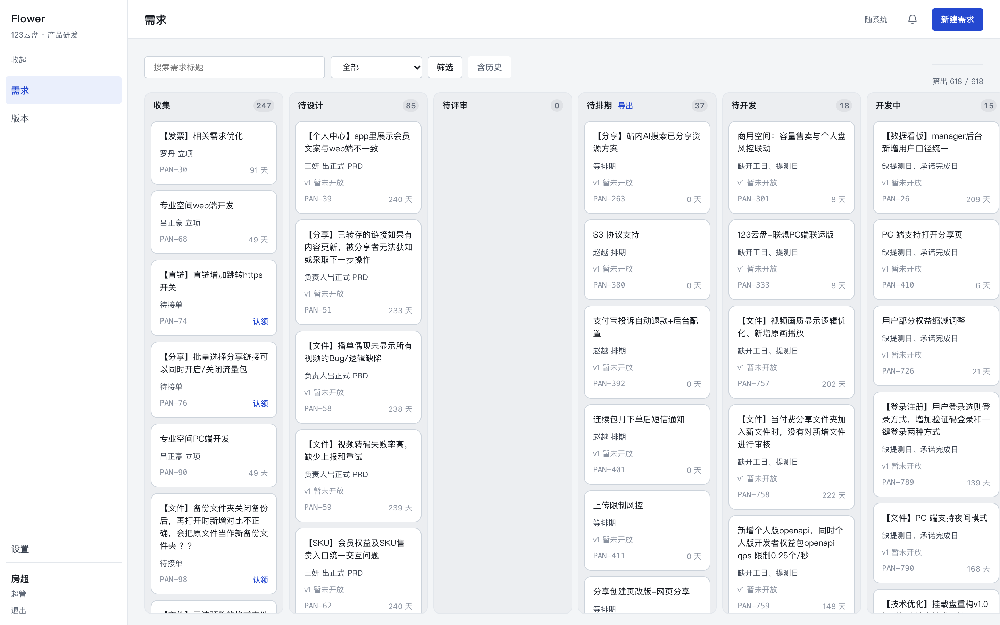
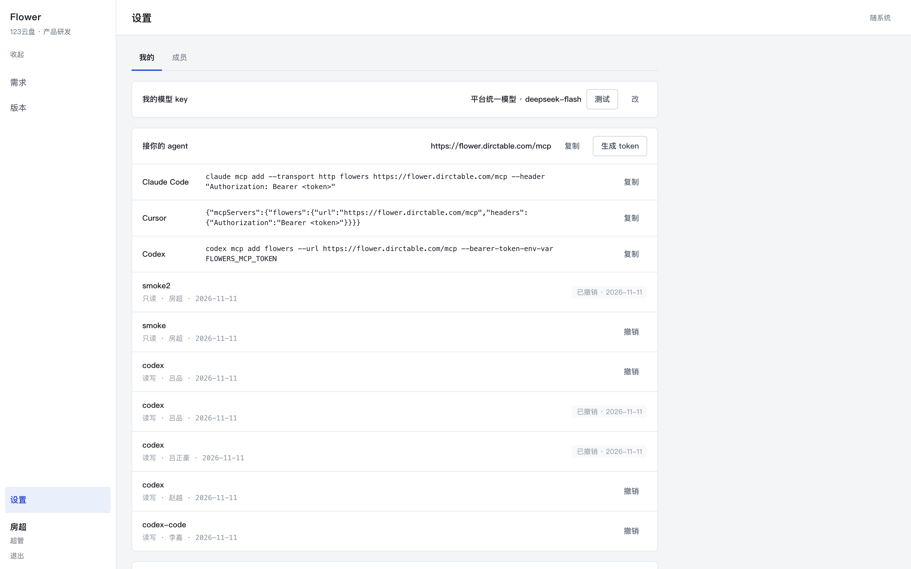
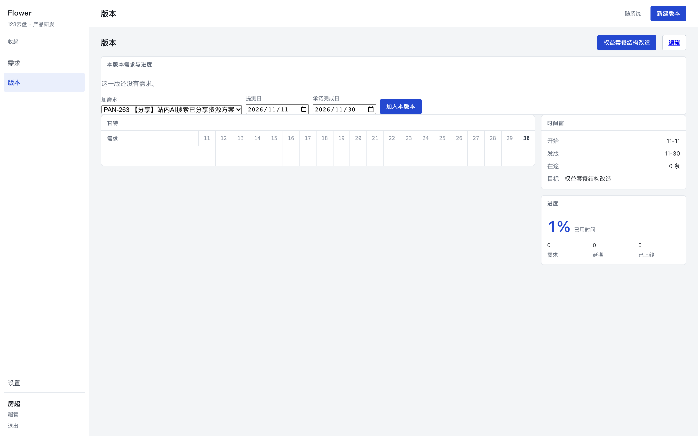

# flowers 使用手册 · 条线负责人

按「第一步做什么、第二步做什么」的顺序写。第一次约 15 分钟走完；之后每天照着第 5 步往后。

---

## 第一步：登录，确认自己的角色

打开 `https://flower.dirctable.com` 登录。左轨底部会显示你的名字与角色。



**你的权限只在本线内有效**：能改/签本线需求、能把需求转给本线的人。跨线要走超管；PM 不能转交。

---

## 第二步：看懂看板（每天 5 分钟）



1. 顶部「负责人」或状态筛一下，先看**本线**。
2. 有主色框的卡 = 现在欠某个动作；卡片上写着在等谁。
3. 停留天数超过 5 天（评审/待排期）或 10 天（开发中）的，就是本线的卡点。

**做完是什么样**：你能列出「本线今天要动的三个人」。

---

## 第三步：配好自己（一次性）

「设置」→「我的」：



1. **私聊通道**：共用的机器人是个人机器人，只服务超管本人。你要收私聊，必须在「用自己的机器人」里填一个**群机器人 webhook**（企微群 → 添加机器人 → 复制地址）。
2. **模型**：要用「生成」出评估材料，填自己的 key 或用平台统一那条。
3. **改密码**：改完旧会话失效。

**做完是什么样**：绑定状态显示「已绑定」，点「测试」你的机器人能收到消息。

---

## 第四步：生成 token，接上自己的 agent

设置页「MCP」：起名 → 选 **write** → 生成（只显示一次）。

```bash
claude mcp add --transport http flowers https://flower.dirctable.com/mcp \
  --header "Authorization: Bearer flw_…"
```

**做完是什么样**：让 agent 说「列出本线卡住的需求」，它能返回 PAN 号 + 负责人 + 停留天数。

**卡住时**：401 = token 错或已撤销；想让它跑脚本就取技能包 `GET /api/v1/skills/flowers-ops`。

---

## 第五步：每天先读告警

群里会收到四段式的告警：

```
[告警 · P1 · 这周要处理] 需求卡住
现在：开发中 14 条超 10 天。
具体是：
· PAN-26【数据看板】… · 赵越 · 自迁移起 208 天
相关人：@吕品 @赵越
其中 赵越 是条线负责人，请安排人处理（派活 / 改排期 / 搁置）。
下一步：找最上面那几条的负责人当天确认：要么推进，要么写原因搁置。
```

- **@ 到你就是让你安排人**，别只看数字。
- P0（群发失败、门挂了、任务停摆）6 小时会再提醒一次；P1–P3 三天一次。

---

## 第六步：派活与接手

- **认领**：无主需求谁都能认领；认领后落在你的条线。
- **转交**：`requirement_assign`，目标必须在册且**本线**；跨线会被拒。
- **agent 版本**：「把 PAN-380 转给吕品」→ 它会先查成员 UUID 再转，写一条 `requirement.owner_assigned` 事件。

**做完是什么样**：本线每条需求都有负责人，时间线上能查到是谁在什么时候转的。

---

## 第七步：签字（建议自己在网页上点）

评审签字要读 PRD 与评估材料，不适合让 agent 代签：

1. 抽屉「参考」段确认评估材料在（没有就点「生成」）。
2. 「信息」段看 PRD 链接。
3. 动作条点「通过」或「打回」（打回写原因）。

**做完是什么样**：需求从「待评审」进入「待排期」或退回「待设计」。

---

## 第八步：排期与版本校准



- **加需求**：版本页「加需求」选待排期条目，填提测日/承诺完成日。
- **改期/换版本**：同一条需求那一行直接改，立即生效，写一条「改排期」事件。
- **延期处理**：承诺日过了还没上线，群里会点名；要么改承诺日（写清为什么），要么把需求「退回待开发」重排。

**做完是什么样**：本版本甘特上没有「没日期」的条，告警里不再点你的名。

---

## 第九步：返工、回滚与批量

- **打回**：测试没过 → 回开发，重填承诺日。
- **退回待开发**：方案变了 → 回待开发重排，写原因。
- **回滚**：已上线出问题 → 抽屉「回滚」退回待排期，版本与两个日期清空，旧值进事件流。
- **批量改**：一次改多条优先级/类型/备注/平台/PRD。默认只给差异，确认后落库，逐条报告成功/跳过/被拒。
- **状态校准**（超管）：存量卡真实进度对不上时，直接摆到正确阶段，必须写原因。

---

## 第十步：每周对账

1. 版本页看延期与在途条数。
2. 群里看 P2「发版前仍有未提测」——距发版 ≤3 天还停在待开发的，当天决定能不能赶上。
3. 超管可到 `/settings/sheet-import` 把企微汇总表的行与池子对一遍（建议挪 / 新建 / 不动，逐条勾选）。

---

## 常见问题

**Q：为什么我不能转交？**
PM 没有转交权；条线负责人也只能转本线的人，跨线走超管。

**Q：签字按钮没出现？**
要么状态不在评审，要么派单不是你，要么你不是这条需求所在条线的负责人。

**Q：agent 改了东西怎么追溯？**
抽屉「事件」段每一步都有 actor 与时间；token 是你的人身份，所以记的是你的名字。

**Q：我改不了别人的需求？**
规则如此：PM 只能改自己的；条线负责人能改本线的；超管不受限。
